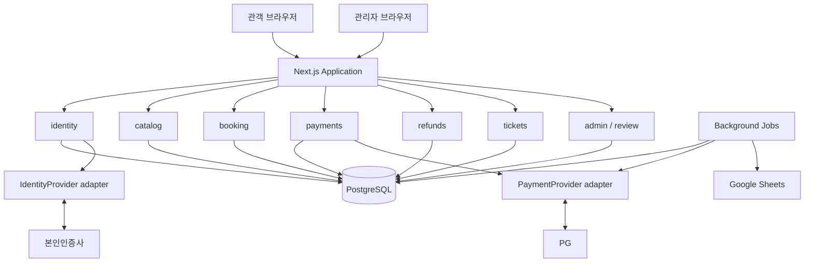
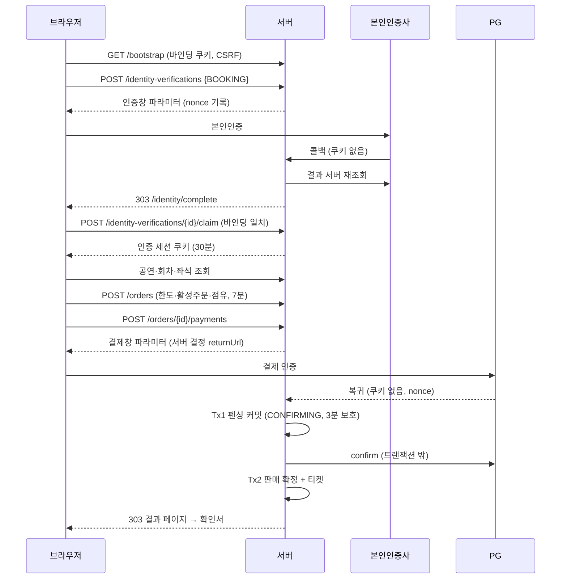

# NAZIR — SYSTEM ARCHITECTURE

> 문서 버전: 1.2 · 기준일: 2026-11-15 · 개발 전달 기준안
> 관련 문서: `DATABASE.md`, `API_SPEC.md`, `DECISIONS.md`, `PROVIDERS.md`, `IMPLEMENTATION_PLAN.md`, `TEST_PLAN.md`
> 이전 버전 원문: `docs/archive/v1.0/ARCHITECTURE`, `docs/archive/v1.1/ARCHITECTURE.md`

표기: **[확정]** 사용자 확정 정책 · **[채택]** 설계 채택안(승인 대기) · **[권장]** 미결정 기본값 · **[외부 확인]**

## 1. 목표와 품질 속성

NAZIR은 뮤지컬/연극 예매 웹사이트다. 초기에는 제한된 공연·회차를 안정적으로 판매한다.

핵심 품질 속성: 좌석 중복 판매 방지, 동일인 구매 한도 보장, PG 서버 검증, 결제 중 좌석 보호, 이력 추적, 외부 장애 격리, 빠른 MVP, QR 확장성.

## 2. 기술 결정

| 영역 | 기술/방향 | 상태 |
|---|---|---|
| Web/API | Next.js + TypeScript + React | 채택 |
| DB | PostgreSQL(15 이상 권장 — `NULLS NOT DISTINCT`) | 채택, 상품 미선정 |
| ORM | Prisma(일반 CRUD, 기본 관계) | 채택 |
| 고급 DB | raw SQL migration(partial unique, CHECK, 복합 FK, 잠금 쿼리) + 스키마 계약 테스트 | 채택 A-019 |
| PG | **토스페이먼츠, 결제창 API 개별 연동**(API 개별 연동 키, 결제창(구버전) SDK) | 확정 D-009, D-010 |
| 본인인증 | **NICE아이디 통합인증 API**(휴대폰 `svc_types: M`) | 확정 D-009 |
| 배포 | Vercel 우선 검토 | **외부 확인 E-007**: 상업적 이용 가능 플랜, 1분 주기 스케줄 지원, 함수 실행시간(confirm 60초 대기 수용), 서울 리전, **NICE 등록용 고정 Outbound IP**(Q-020, NICE 원문: AWS 계열은 별도 문의) |
| DB 호스팅 | 관리형 PostgreSQL, 앱과 같은 리전(서울 권장) | 미선정 |
| 소스 | NAZIR GitHub 저장소(`kkkkmini/NAZIR`) | 채택 |
| 파일 | 객체 저장소 또는 정적 asset(포스터/SVG) | 미선정 |
| 백그라운드 작업 | 스케줄러(1분 주기 필요) + 작업 루틴 | 상품 미선정 |
| Rate limit 저장소 | PostgreSQL 또는 관리형 Redis | 권장 Q-013 |
| 운영 mirror | Google Sheets(읽기 전용 권장 Q-014) | 채택 |

버전과 호스팅 상품은 개발 시작 시 공식 문서·계약 조건을 확인하고 고정한다. 확인되지 않은 플랜 제약을 전제로 구현하지 않는다.

## 3. 모듈형 모놀리스



도메인 모듈:

| 모듈 | 책임 |
|---|---|
| `identity` | 브라우저 바인딩, 본인인증 시작·콜백·claim, 인증 세션, 동일인 주체(subject) |
| `catalog` | 공연·회차·좌석·판매 가능 조건 |
| `booking` | 주문 생성(한도·활성 주문·점유), 취소, 만료(`expireOrder`), 주문 접근 권한 |
| `payments` | 결제 시작, 복귀·펜싱(Tx1/Tx2/Tx3), 판매 확정 호출, 재조회, webhook |
| `tickets` | 판매 확정 트랜잭션 내 티켓 발급, 확인서 |
| `refunds` | 환불 요청·PG 실행 기록·검증·완료, 대사 |
| `admin` | 관리자 인증·권한, 좌석 차단, review case action, 감사 로그 |
| `integrations` | outbox worker, Sheets |

초기에는 마이크로서비스로 분리하지 않는다. 다른 모듈의 데이터를 직접 수정하지 않고 use case 경계를 통해 변경한다. 판매 확정은 `payments`가 `booking`·`tickets`의 use case를 **같은 DB 트랜잭션 안에서** 호출한다(트랜잭션 객체 전달).

## 4. 정상 예매 데이터 흐름 [확정 D-004]



1. 브라우저 바인딩 쿠키 발급.
2. 본인인증(좌석 선택 전 필수) → 서버가 인증사 결과 검증 → 같은 브라우저에서 claim → 인증 세션 발급.
3. 공연·회차·좌석 조회(DB 기반 상태·가격).
4. 주문 생성: 동일인·회차 한도 잠금 → 활성 주문 확인 → 좌석 잠금 → 주문·항목·hold(7분)·접근 세션 원자 생성.
5. 결제 시작: 서버가 DB 금액·허용 수단(카드·간편결제)으로 결제 시도 생성.
6. PG 복귀: hold 유효성 확인 → 펜싱 커밋 → PG confirm(트랜잭션 밖) → 결과 반영.
7. 판매 확정 트랜잭션에서 주문·좌석·결제·티켓·로그·outbox 확정.
8. 모바일 예매 확인서.

좌석을 바꾸려면 주문을 취소하고 4단계부터 다시 진행한다 [확정 D-001].

## 5. 점유·결제 보호·UNKNOWN [확정 D-002, D-003 / 채택 A-001~A-003]

### 5.1 두 종류의 보호 시간

| 구분 | 시간 | 기준 컬럼 | 의미 |
|---|---|---|---|
| 일반 점유 | 7분(연장 없음) | `orders.hold_expires_at` | 결제 확인 진입 전 좌석 보호. 지나면 `expireOrder`로 회수 가능 |
| 결제 확인 보호 | 최대 3분 | `orders.confirm_protected_until` | PG confirm 결과 대기. **지나도 실패·해제하지 않고 UNKNOWN으로 전환**하며 좌석 보호 유지 |

브라우저 타이머는 표시용이다. 판정은 DB 시각(Clock 인터페이스) 기준이다.

### 5.2 트랜잭션과 PG 호출 사이의 상태 전이

```
PENDING/ACTIVE/READY
   │ Tx1 (짧은 트랜잭션: 검증 + 펜싱) ─ 커밋
   ▼
PAYMENT_CONFIRMING/CONFIRMING/CONFIRMING   ← 일반 만료 작업이 회수 불가
   │ PG confirm 호출 (트랜잭션 밖, 멱등 키, timeout 설정값 초기 60초 — §5.2a)
   ├─ 승인 확인 → Tx2 → PAID/CONVERTED/SUCCEEDED(PRIMARY) + 티켓
   ├─ 실패 확정 → Tx2 → (점유 남음) PENDING/ACTIVE/FAILED
   │                    (점유 만료) EXPIRED/EXPIRED/FAILED + 한도 복구
   ├─ 승인 + 금액 불일치 → Tx2 → REVIEW_REQUIRED/CONFIRMING/SUCCEEDED(EXCESS)
   └─ 불명확 → 상태 유지
         │ 3분 경과 → Tx3 → PAYMENT_UNKNOWN/CONFIRMING/UNKNOWN
         ▼
      재조회 작업(백오프) → Tx2 규칙으로 반영
      장기화 → 경보 → review case → 관리자 복구 절차(DECISIONS Q-005)
```

안전성 근거:
- 서버 승인형 PG에서는 confirm을 호출하지 않으면 결제가 발생하지 않는다. 따라서 Tx1 검증 실패, 주문 만료, 새 결제 시도로 대체된 `READY` 결제는 안전하게 폐기할 수 있다. **PG가 서버 승인형을 지원하지 않으면 이 설계는 성립하지 않으므로 PG 선정 필수 요건이다**[외부 확인 E-002].
- Tx1 커밋 후 hold는 `CONFIRMING`이 되어 좌석 partial unique를 계속 점유하고, `expireOrder`는 `PENDING` 주문만 회수한다. 따라서 confirm 호출 중이나 UNKNOWN 중에 좌석이 재판매되지 않는다.
- Tx1과 `expireOrder`는 주문 행 잠금으로 직렬화된다.
- Tx2는 결제가 `CONFIRMING`/`UNKNOWN`일 때만 반영하므로, 복귀·webhook·재조회가 동시에 와도 한 번만 확정된다.
- 프로세스가 confirm 호출 직후 죽어도 상태는 `CONFIRMING`으로 남고, 재조회 작업이 3분 후 UNKNOWN으로 전환해 PG 재조회로 해소한다.

### 5.2a confirm timeout(60초)과 3분 보호의 관계 [채택 A-031]

| 시간 | 의미 | 근거 |
|---|---|---|
| 7분 | 일반 점유. Tx1은 이 안에서만 진입 | 확정 D-002 |
| 3분 | 결제 확인 보호. 좌석을 지키며 결과를 기다리는 시간 | 확정 D-003 |
| 60초(설정값) | confirm HTTP 호출 1회의 timeout | 토스 일반 승인 권장치는 검색만 확인(PROVIDERS §1.8) |
| 10분 | 토스 인증 후 승인 유효시간. 지나면 결제 `EXPIRED` | 토스 원문 |

- 3분 보호 안에서: confirm(멱등 키) → 불명확 → orderId 조회 → `IN_PROGRESS`이면 같은 멱등 키로 재시도(인증 후 10분 이내) → 반복. 60초 timeout이면 2~3회 시도 가능.
- 3분 경과: UNKNOWN 전환, **좌석 보호 유지**(해제·실패 처리 금지). 재조회 작업이 `DONE`이면 확정, `ABORTED`/`EXPIRED`이면 실패 확정.
- 토스 10분 만료 덕분에 "confirm이 토스에 닿지 않은" UNKNOWN은 인증 후 10분 이후 조회로 실패 확정이 가능할 것으로 예상된다(조회 응답 형식 미확인, TEST SBX-06/07). confirm이 토스에서 처리됐다면 조회는 `DONE`을 보여준다.
- 호스팅 함수 실행시간이 60초 대기 + 후처리를 수용하지 못하면 confirm은 요청 처리와 분리된 작업으로 실행한다(E-007).

### 5.3 UNKNOWN이 방치되지 않게 하는 장치

- 재조회 작업: `next_requery_at` 백오프(권장 Q-003).
- 경보: UNKNOWN 진입, 10분, 30분(review case), 회차 24시간 이내 상향.
- 관리자: `REQUERY`, 증빙 기반 확정(SUPER_ADMIN, Q-005 미결정).
- 사용자 화면: "결제 결과 확인 중, 좌석 보호 중", 재결제 불가, 조회 경로 안내.

## 6. 외부 연동과 Provider Adapter [채택 / Q-008, 확정 D-009·D-010]

PG(토스페이먼츠)와 본인인증(NICE아이디)은 adapter로 격리한다. 외부 응답의 중복·지연·순서 역전·timeout을 정상 예외로 처리한다. **PG·인증사 네트워크 호출을 DB 트랜잭션 안에서 수행하지 않는다.**

**정규화 원칙:** 업체 고유 데이터와 응답 형식(토스 `DONE`·`IN_PROGRESS`·한글 `method` 문자열·`easyPay` 코드, NICE `web_transaction_id`·`ticket`·암호화 결과·필드명)은 **adapter 내부에서만** 다룬다. 도메인 계층에는 아래 표의 정규화 결과만 전달한다. 원문 미확인 동작은 adapter 설정값으로 두고 sandbox에서 확인한다(`PROVIDERS.md`).

### 6.1 IdentityProvider (NICE아이디 통합인증 기준)

| 메서드 | 입력(도메인 → adapter) | 정규화 출력(adapter → 도메인) | NICE 구현(adapter 내부, 원문 PROVIDERS §2.2) |
|---|---|---|---|
| `startVerification` | purpose, `requestRef`(NAZIR 인증 ID에서 파생, 20~50자), 서버 결정 `returnUrl` | `{ launchUrl, providerContext }` — providerContext는 불투명 값으로 DB에 암호화 저장 | 토큰 캐시의 접근토큰으로 `auth/url` 호출(`svc_types: ["M"]`, `method_type`), 응답 `transaction_id`·인증 URL(10분 유효) |
| `completeVerification` | 콜백 요청(쿼리/본문), 저장된 providerContext | `{ status: VERIFIED \| FAILED \| CANCELED \| EXPIRED, providerTransactionRef, name, phone, subjectKey: { type: DI \| CI \| PHONE, hmac } }` | `web_transaction_id` + `request_no` + `transaction_id`로 `auth/result` 호출 → 키 유도(PBKDF2) → 무결성 검증·복호화(AES-GCM) → 필드 정규화 |
| `capabilities` | — | `{ callbackMethods, serverSideResult: true, stableKeyTypes, contextTtlSec }` | — |

- **동일인 식별값 원문(DI/CI)은 adapter 안에서 즉시 HMAC 처리**한다(주입된 hasher 사용). 원문은 도메인·DB·로그에 존재하지 않는다.
- `birthdate`·`gender`·`national_info` 등 정책상 불필요한 항목은 adapter에서 폐기한다.
- 접근토큰(24시간)·`ticket`·`iterators`는 공유 토큰 캐시에 두고 providerContext에는 참조 ID만 넣는다(§6.7).
- 결과 요청 기한·재조회 가능 여부·토큰 동일성 요건은 **미확인** — 실패 시 `FAILED`로 처리하고 재인증을 안내한다.

### 6.2 PaymentProvider (토스페이먼츠 결제창 API 개별 연동 기준)

| 메서드 | 입력 | 정규화 출력 | 토스 구현(adapter 내부, 원문 PROVIDERS §1) |
|---|---|---|---|
| `listEnabledMethods` | 서버 설정 | `[ { methodType: CARD, cardCompanies[] } \| { methodType: EASY_PAY, easyPayProvider } ]` | 설정 기반(D-012). PG의 선택적 활성화 가능 여부는 미확인 |
| `createCheckout` | `merchantPaymentRef`, 금액, 주문명, `methodType`, `easyPayProvider?`, 허용 카드사, 서버 결정 success/fail URL | 브라우저에 넘길 불투명 파라미터 | `payment().requestPayment({ method: "CARD", flowMode, cardCompany \| easyPay, … })`. 카드=DEFAULT+`cardCompany`, 간편결제=DIRECT+`easyPay`(코드 미확인) |
| `parseReturn` | 복귀 요청 | `{ merchantPaymentRef, providerPaymentKey, returnedAmount, outcome: AUTHENTICATED \| CHECKOUT_FAILED, failureCode? }` | successUrl `paymentKey`·`orderId`·`amount`, failUrl 에러 코드·메시지 |
| `confirm` | ref, paymentKey, 금액, 결제 시도별 고정 멱등 키, timeout | `APPROVED{ approvedAmount, methodType \| DISALLOWED, methodRaw, cardCompany?, easyPayProvider?, approvedAt, transactionRef }` / `DECLINED{ code }` / `INDETERMINATE{ reason }` | `POST /v1/payments/confirm` + `Idempotency-Key`. timeout·네트워크 오류·5xx·409(처리 중)는 INDETERMINATE |
| `getPayment` | paymentKey 또는 `merchantPaymentRef` | `{ state: NOT_FOUND \| AUTH_ONLY \| APPROVED \| FAILED \| EXPIRED \| CANCELED_PARTIAL \| CANCELED_FULL \| UNREADABLE, approvedAmount, methodType, methodRaw?, cancels[{ providerRefundRef, amount, done, at }] }` | `GET /v1/payments/{paymentKey}`, `GET /v1/payments/orders/{orderId}`(API 개별 연동 시크릿 키 필요). `IN_PROGRESS`→AUTH_ONLY, `DONE`→APPROVED, `ABORTED`→FAILED. 승인 전 결제의 조회 응답 형식은 미확인 |
| `verifyWebhook` / `parseWebhook` | 원본 본문·헤더 | `{ signature: VALID \| INVALID \| ABSENT, eventKind, lookupKey, dedupeKey }` | `tosspayments-webhook-signature`(보안 키 HMAC SHA-256), `eventId` 또는 조합 키(transmission-id 금지) |
| `capabilities` | — | `{ serverConfirm: true, confirmValiditySec: 600, confirmIdempotent: true, lookupByMerchantRef: true, webhookSignature: true, defaultConfirmTimeoutSec: 60 }` | 원문 기반, timeout 값만 검색 근거 |

- 허용 목록 검증(A-030): `APPROVED` 응답의 `methodType`/`cardCompany`/`easyPayProvider`가 결제 시작 시점 허용 목록 밖이면 도메인은 자동 확정하지 않는다(`EXCESS` + review case). `methodRaw`는 PG가 보고한 결제수단 라벨 **원문**(예: 토스 `method`)이며 adapter는 정규화·마스킹 없이 그대로 반환한다. 도메인이 `DISALLOWED`를 `OTHER`로 저장하며 `payments.provider_method_raw`에 원문을 남기고(`OTHER`이면 필수), 사용자의 요청 수단은 `payments.requested_method_type`에 생성 시 기록되어 승인 때 바뀌지 않는다(A-039, DATABASE §7.1).

### 6.3 Mock adapter (테스트 Provider 범위)

| 구분 | Mock이 재현해야 할 것 |
|---|---|
| PaymentProvider | 정상 승인, 거절, confirm timeout(INDETERMINATE), INDETERMINATE 후 지연 승인, 멱등 키 재요청 시 첫 응답 반환·처리 중 409, 인증 후 10분 경과 시 EXPIRED, 중복 승인, 금액 불일치, 허용 외 수단·카드사·간편결제사, 조회 장애, 웹훅 중복·순서 역전·서명 위조·서명 헤더 없음·미매칭, 부분·전체 취소 내역 |
| IdentityProvider | 정상 인증(테스트 인물별 고정 DI 생성), 실패·취소, 결과 위변조(무결성 실패), 결과 재사용, 콜백 위조, URL 10분 만료, 토큰 캐시 유실 |
| 제어 방식 | 시나리오 선택은 local·test에서만 등록되는 제어 엔드포인트 또는 테스트 코드 주입으로만 가능 |

Mock은 서버 전용 모듈이며 클라이언트 번들에 포함하지 않는다.

### 6.4 Google Sheets

핵심 DB 변경과 outbox 이벤트는 같은 트랜잭션, Sheets 전송은 비동기. aggregate 단위 순차 처리와 version 비교로 오래된 이벤트가 최신 행을 덮어쓰지 않게 한다. 전화번호는 마스킹. Phase 1 역반영 없음 권장(Q-014).

### 6.5 Provider 실행 단계와 운영 차단 [채택 A-024~A-026, 확정 D-013]

| 단계 | PG | 본인인증 | 허용 환경 |
|---|---|---|---|
| `MOCK` | 서버 내부 시뮬레이터(§6.3) | 서버 내부 시뮬레이터(§6.3) | local, test(CI) |
| `SANDBOX` | 토스 테스트 키(`test_ck`/`test_sk`, 계약 전 발급 가능 — 원문) | NICE: 별도 무료 테스트 환경이 없음(원문) → 계약·과금 시작 후 실제 인증으로만 가능. 스테이징 사용 규칙은 Q-019 | local, staging |
| `LIVE` | 토스 라이브 키(`live_ck`/`live_sk`) | NICE 운영 client(등록된 Outbound IP) | production만 |

**서버 시작 단계 검사(fail-closed):**
1. 실행 환경 값(`local`/`test`/`staging`/`production`)을 명시 설정으로 읽는다. **값이 없거나 알 수 없으면 production으로 간주**한다.
2. production에서 PaymentProvider 또는 IdentityProvider가 `MOCK`이면 **기동 실패**.
3. production에서 토스 키가 `live_`로 시작하지 않거나 클라이언트·시크릿 키 세트가 맞지 않으면 **기동 실패**(접두사 규칙 원문).
4. production에서 NICE 설정(client_id 존재, 운영 엔드포인트)이 없으면 **기동 실패**. NICE는 테스트·운영 키 구분 규칙이 문서로 확인되지 않았으므로, 환경별 client_id 허용 목록을 설정으로 관리한다(미확인 사항).
5. staging에서 토스 `live_` 키는 기동 실패(운영 키는 운영 서버에만 — 원문 권고).
6. Mock 제어 라우트는 local·test에서만 등록한다. 그 외 환경에서는 라우트가 존재하지 않는다(404).
7. 서버는 비밀값 없이 provider 단계를 상태 정보로 노출하고 배포 후 점검 항목에 포함한다.

**Mock 코드 빌드 제거 비교(A-026):**

| 안 | 보안 효과 | 비용 | 판단 |
|---|---|---|---|
| 런타임 차단만(위 검사) | 설정 실수·환경 변수 누락을 기동 실패로 차단 | 낮음 | **채택** |
| 운영 빌드에서 Mock 제거 | 운영 번들에 Mock 코드 부재 | 환경별 빌드 분기 → staging 검증 산출물과 운영 산출물이 달라짐, 조건부 import 관리 | 필수로 하지 않음(추후 선택) |

런타임 차단으로 남는 위험은 서버 코드·설정 저장소 자체가 변조되는 경우이며, 이는 빌드 제거로도 막히지 않고 배포 권한 통제로 다룬다.

**DB에 단계를 저장하지 않는 이유(A-025):** DATABASE §14.2.

### 6.6 웹훅 처리 구조 [채택 A-027]

```
토스 ──POST──▶ 수신 엔드포인트: 서명 검증 → dedupe 저장 → 200 (10초 이내, 상태 변경 없음)
                                   │
                                   ▼
                        웹훅 처리 작업(비동기): 결제 조회 API → 대조(orderId·금액·상태·MID) → Tx2 규칙 반영
```

- 웹훅은 결제 성공의 직접 증거가 아니다. 반영 근거는 조회 결과뿐이다.
- 수신 엔드포인트는 DB 저장 1회 외에 외부 호출을 하지 않는다.
- 실패 이벤트는 재처리, 반복 실패는 review case. 토스는 미응답 시 최대 7회 재전송(원문).

### 6.7 비밀값과 거래 문맥 [채택 A-028]

| 종류 | 예 | 저장 위치 |
|---|---|---|
| 고정 비밀값 | 토스 시크릿 키·보안 키, NICE client_id/secret, HMAC 키, 개인정보·문맥 암호화 키 | **서버 Secret 관리 체계만**(환경별 분리). DB·저장소·로그 금지 |
| 공유 단기 자격 | NICE 접근토큰(24시간)·`ticket`·`iterators` | 암호화된 공유 토큰 캐시(만료 < 24시간, 저장소 Q-013) |
| 거래별 임시 문맥 | NICE `request_no`·`transaction_id`·토큰 참조 ID | `identity_verifications.provider_context_encrypted`(검증 후 삭제) |
| 거래 식별자 | 토스 `paymentKey`·`orderId`·취소 `transactionKey` | `payments`, `refunds` 컬럼(평문 — 시크릿 키 없이는 API 호출 불가, 원문) |

## 7. 트랜잭션·동시성 경계

트랜잭션 필수: 주문 생성(한도·활성 주문·다중 좌석 점유), 취소, `expireOrder`, 결제 시작, Tx1/Tx2/Tx3, 판매 확정·티켓, 관리자 차단·해제, 환불 요청·완료, review action, 인증 claim, 로그·감사·outbox 생성.

- **전역 잠금 순서**: `purchase_quotas` → `orders` → `payments` → `refunds` → `session_seats`(id 순) → `seat_holds` → `tickets` (DATABASE §13.2).
- 한 트랜잭션은 한 주문의 상태만 바꾼다. 다른 주문의 만료 회수는 `expireOrder` 별도 트랜잭션.
- 동일인 한도: `purchase_quotas` 행 잠금 + CHECK. 단순 COUNT 후 INSERT 금지.
- 최종 방어: partial unique(좌석 유효 점유, 활성 주문, 진행 중 결제, 유효 티켓), 확정 결제 FK, 소유 FK, 환불 CHECK.
- deadlock 발생 시 PostgreSQL이 한쪽을 중단하며, 서비스는 제한 횟수 재시도.
- interactive transaction timeout을 명시하고 트랜잭션 안에서 외부 호출 금지.
- 실제 PostgreSQL에서 동시성 테스트.

## 8. 백그라운드 작업

| 작업 | 주기(권장) | 역할 |
|---|---|---|
| hold 만료 | 1분(권장, Q-038) | `PENDING` + `hold_expires_at` 경과 주문 `expireOrder`. **구현**: `GET /api/v1/internal/jobs/expire-orders`(Bearer `CRON_SECRET`), 읽기 전용 후보 조회 + 주문별 `expireOrder`(DATABASE §19.17) |
| 결제 확인·재조회 | 1분 | CONFIRMING 3분 경과 → UNKNOWN(Tx3), UNKNOWN 재조회, 경보 |
| READY 정리 | 1분 | `checkout_expires_at` 경과 READY → CANCELED |
| 인증 정리 | 5분 | 만료 인증·세션 상태 전이 |
| 환불 검증 | 5분 | `VERIFYING` 재검증, 장기화 review case |
| Webhook 처리·재처리 | 1분(수신 직후 즉시 실행도 허용) | 저장된 `RECEIVED`/`FAILED`/lease 만료 이벤트를 결제 조회 API로 확인 후 반영(§6.6) |
| NICE 토큰 갱신 | 만료 전 | 공유 토큰 캐시의 접근토큰을 24시간 만료 전에 갱신 |
| Outbox worker | 1분 | Sheets 전송(P1) |
| 정합성 검사 | 1시간 | quota 카운터 vs 파생 값, SOLD 소유·유효 티켓 일치 |
| PG 대사 | 1일 | PG 승인·취소 내역 vs DB(미기록 환불, 미매칭 승인) |

작업은 중복 실행돼도 안전해야 한다(행 단위 claim, `SKIP LOCKED`, 상태 조건부 갱신). 주기는 호스팅 스케줄러 제약 확인 후 확정[E-007]. 1분 주기를 지원하지 않는 플랜이면 외부 스케줄러 또는 별도 worker가 필요하다.

## 9. 환경/배포

`local`, `test/staging`, `production`을 분리하고 서로 다른 DB·credential 사용. 운영 secret(PG 키, 인증사 키, HMAC 키, 암호화 키)은 secret manager.

| 환경 | PaymentProvider | IdentityProvider | 외부 접속 호스트(원문) | 비고 |
|---|---|---|---|---|
| local | MOCK 또는 SANDBOX(토스 `test_` 키) | MOCK | `api.tosspayments.com`(sandbox 사용 시) | 개발자 개인 테스트 키 |
| test(CI) | MOCK | MOCK | 없음 | 외부 호출 금지 |
| staging | SANDBOX(토스 `test_` 키) | NICE 실인증만(계약·IP 등록 후, Q-019). **Mock 금지(A-024)** | `api.tosspayments.com`, `auth.niceid.co.kr`, `nice.checkplus.co.kr` | 카드사 심사용 공개 사이트로도 쓸 수 있음(E-008) |
| production | LIVE(`live_` 키) | LIVE(NICE) | 위와 같음 + NICE 등록 Outbound IP | Mock 기동 불가(§6.5) |

- **NICE Outbound IP 등록이 선행 조건**이다(원문). 호스팅에서 고정 출구 IP를 제공하지 못하면 NICE 호출만 고정 IP 프록시를 거치게 하는 방안을 검토한다(Q-020, 미확인).
- 토스 카드사 심사는 **실제 판매 사이트에서 테스트 키로 결제창이 연동된 상태**를 확인한다(원문). 따라서 공개 접근 가능한 사이트(상품 페이지·결제창 동작)를 심사 전에 배포해야 한다. migration은 `migrate deploy`로만 적용하며 배포 전 staging에서 검증하고 스키마 계약 테스트를 통과해야 한다. 서버리스 커넥션 풀링(트랜잭션 모드)과 interactive transaction·row lock 호환성, region latency, 함수 timeout을 확인한다. 예상 최대 동시 접속을 정의하고 부하 테스트를 수행한다(TEST LOAD-*). 운영 배포 전 백업·복구 리허설.

## 10. 보안·관측·복구

- HTTPS, `__Host-` 쿠키(HttpOnly·Secure·SameSite=Lax/관리자 Strict), CSRF(Origin + 토큰), XSS, SQL injection(parameterized query), CORS allowlist.
- 브라우저 바인딩: 인증 세션·접근 세션·Idempotency가 바인딩과 묶여 다른 브라우저에서 재사용 불가.
- 외부 복귀 경로는 쿠키 비의존, 업체 거래 식별자의 단일 사용 상태 검증(nonce는 보존 확인 시 추가) + provider 재조회, 303 이동. `returnUrl`은 서버 결정.
- PG webhook: 서명 검증(보안 키), eventId dedupe, 10초 내 응답, payload 불신·조회 기반 비동기 반영(§6.6).
- Provider 단계: production에서 Mock 기동 불가, 테스트 키 기동 불가(§6.5). **Mock 인증은 실제 판매에 사용하지 않는다**(D-013).
- 비밀값: 고정 비밀값은 Secret 관리 체계만, DB에는 거래별 임시 문맥만(§6.7).
- Rate limit: 공유 저장소 기반(서버리스 메모리 금지).
- 로그에 전화번호·토큰·인증 원문·카드정보 저장 금지(마스킹).
- 추적: correlation ID, 주문번호, `merchant_payment_ref`, PG 거래 ID, webhook ID, outbox ID, review case ID.
- 알림: UNKNOWN 장기화, `REVIEW_REQUIRED`, `review_cases` CRITICAL, webhook 실패·미매칭, outbox DEAD, quota 불일치, DB 오류, 작업 중단.
- DB 직접 수정 금지. 관리자 action과 감사 로그로 복구.

## 11. 단계 범위

- **Phase 1:** 본인인증 선행(NICE), 공연/회차/좌석, 동일인 4석·활성 주문 1건, 7분 점유·취소 후 재예매, 카드·토스페이·네이버페이(D-011, 카카오페이 추후 검토, 페이코 제외), 결제 확인 3분 보호·UNKNOWN 해소, webhook, 모바일 확인서, 조회, 최소 관리자, review case, 수동 환불 요청·검증 기록, Sheets mirror.
- **Phase 2:** 관리자 고도화, 관리자 수동 판매(한도 적용 여부 Q-010), PG 취소 API 기반 환불, SMS, QR 티켓 관리.
- **Phase 3:** QR 스캔, 중복 입장 방지, 현장 예외 및 리허설.

## 12. 미결정

`DECISIONS.md` §3, §4, `PROVIDERS.md`: 동일인 식별값 제공 조건, NICE 측 세션 제약, DB/호스팅 상품, 스케줄러, rate limit·토큰 캐시 저장소, NICE 고정 Outbound IP(Q-020), 통합결제창 간편결제 노출(Q-021), 판매 개시 최소 결제수단 기준(Q-018), 스테이징 NICE 실인증(Q-019), 공연장/SVG, 파일 저장소, SMS, 개인정보 보관기간·암호화, 환불 좌석 재판매 정책.

## 13. 변경 이력

| 버전 | 일자 | 변경 내용 |
|---|---|---|
| 1.0 | 2026-11-13 | 개발 전달 기준안. 원문: `docs/archive/v1.0/ARCHITECTURE` |
| 1.1 | 2026-11-14 | 파일명 `ARCHITECTURE.md`로 정정. 인증 선행 흐름(시퀀스 다이어그램), identity 모듈, 7분 점유와 3분 결제 확인 보호 구분, Tx1/confirm/Tx2/Tx3 상태 전이와 안전성 근거, UNKNOWN 해소 장치, Provider adapter 인터페이스와 mock 장애 주입 요건, 전역 잠금 순서, 백그라운드 작업 목록, 호스팅 확인 항목, 보안(바인딩·복귀 경로·rate limit 저장소) 추가 |
| 1.2 | 2026-11-15 | 토스페이먼츠(결제창 API 개별 연동)·NICE아이디(통합인증) 확정. §6 Provider 인터페이스를 원문 기준 최종안으로 교체(정규화 원칙, NICE 결과 요청·복호화, 토스 confirm·orderId 조회·웹훅 서명), Mock 범위, Provider 단계(MOCK/SANDBOX/LIVE)와 fail-closed 기동 검사, Mock 빌드 제거 비교, 웹훅 처리 구조, 비밀값·거래 문맥 분리. §5.2a confirm timeout과 3분 보호 관계. §8 웹훅 처리·NICE 토큰 갱신 작업. §9 환경별 provider 매트릭스, NICE Outbound IP, 카드사 심사용 공개 사이트. 이전 원문: `docs/archive/v1.1/ARCHITECTURE.md` |
| 1.2.4 | 2026-11-17 | §6 결제 adapter 출력에 PG 결제수단 원문 `methodRaw` 추가(`DATABASE.md` §7.1, A-039). 구조·책임은 변경 없음 |
| 1.2.5 | 2026-11-26 | §8 hold 만료 작업 구현 표기. 설계는 변경 없음 |
