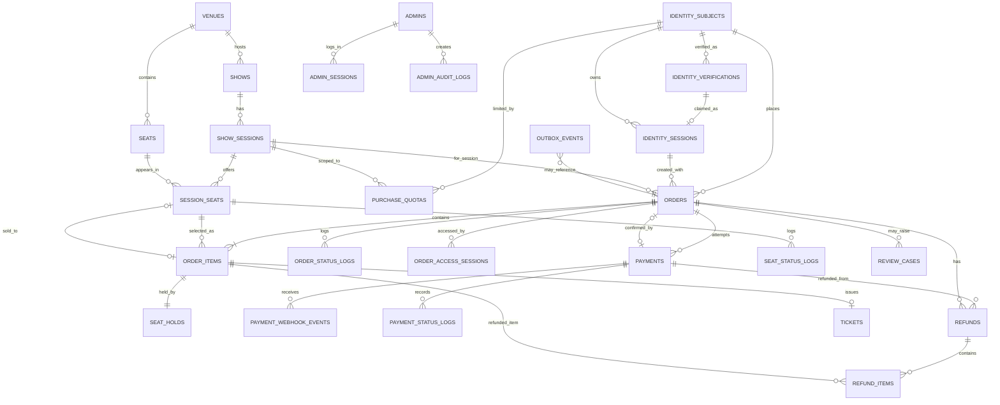

# NAZIR — DATABASE

> 문서 버전: 1.2
> 기준일: 2026-11-15
> 데이터베이스: PostgreSQL
> 상태: 개발 전달 기준안 — 독립 기술 검토, 사용자 확정 정책, 토스페이먼츠·NICE아이디 원문 확인 결과 반영. **P0 검증 전 실제 판매 금지**
> 적용 범위: Phase 1 예매 MVP + Phase 2 이후 확장 기반
> 관련 문서: `DECISIONS.md`(정책·미결정), `PROVIDERS.md`(업체 근거), `API_SPEC.md`, `ARCHITECTURE.md`, `IMPLEMENTATION_PLAN.md`, `TEST_PLAN.md`, `CLAUDE_HANDOFF.md`
> 이전 버전 원문: `docs/archive/v1.0/DATABASE.md`, `docs/archive/v1.1/DATABASE.md`
> 구현 현황: §19 (Step 2 — Prisma schema·migration·계약 테스트). 설계 보완(A-032~A-037)은 사용자 승인 후 본문에 반영했고 §19.6~§19.7에 기록

표기: **[확정]** 사용자 확정 정책 · **[채택]** 설계 채택안(승인 대기) · **[권장]** 미결정 항목의 권장 기본값 · **[외부 확인]** 업체·법률 확인 필요. 상세는 `DECISIONS.md`.

---

## 1. 문서 목적과 설계 원칙

이 문서는 NAZIR 티켓 예매 서비스의 데이터 구조, 무결성 규칙, 상태 전이, 동시성 제어, 외부 연동 저장 방식을 정의한다.

### 1.1 핵심 원칙

1. **PostgreSQL이 유일한 Source of Truth다.** Google Sheets는 비동기 복제본이며 주문·결제·좌석 상태를 결정하지 않는다.
2. **중요한 상태 변경은 서버에서 검증한다.** 브라우저가 보낸 가격, 좌석 상태, 결제 성공 표시, 인증 성공 표시, 카운트다운은 신뢰하지 않는다.
3. **금전·좌석·티켓·인증 이력은 보존한다.** 일반 운영 흐름에서 주문·결제·환불·점유·인증 이력을 물리 삭제하지 않는다.
4. **결제 승인과 예매 확정은 별개다.** PG 거래가 서버에서 확인되고 좌석 판매가 원자적으로 확정된 뒤 티켓을 발급한다.
5. **동시성은 DB 제약조건과 트랜잭션으로 통제한다.** 애플리케이션 사전 조회만으로 중복 점유·판매·한도 초과를 방지했다고 간주하지 않는다.
6. **상태는 도메인별로 분리한다.** 주문, 좌석 점유, 결제, 환불, 티켓, 인증은 각자의 상태를 가진다.
7. **외부 호출은 DB 트랜잭션 밖에서 한다.** PG·인증사 네트워크 호출을 DB 트랜잭션 안에서 실행하지 않는다. 트랜잭션 사이의 안전성은 펜싱 상태로 보장한다(§11.6).
8. **미정 사업 정책은 미결정으로 남긴다.** `DECISIONS.md`에 권장안과 함께 기록하고 설정값으로 구현한다.

### 1.2 명명 및 공통 규칙

- 테이블·컬럼은 `snake_case`, 테이블은 복수형.
- 기본 키는 UUID. 외부 노출 식별자(주문번호·티켓번호)는 별도 컬럼.
- 시각은 `timestamptz`, 서버는 UTC로 처리하고 화면만 `Asia/Seoul`로 변환한다. Prisma 사용 시 `@db.Timestamptz`를 명시한다(Prisma 기본 DateTime 매핑에 의존하지 않는다).
- **만료·보호 시간 판정의 기준 시각은 DB 시각**이다. 서비스 계층은 Clock 인터페이스로 시각을 얻고(운영: DB 조회, 테스트: 고정값 주입), 같은 연산 안에서는 하나의 기준 시각을 사용한다. [채택 A-023]
- 금액은 `bigint` 원화 정수. 애플리케이션은 JSON 직렬화 시 BigInt를 정수 number 또는 문자열로 명시 변환한다.
- 상태값은 애플리케이션 상수와 DB `CHECK` 제약을 함께 관리한다(PostgreSQL enum 사용 여부는 구현자가 결정하되 의미는 이 문서를 따른다).
- 모든 주요 테이블에 `created_at`, 수정 가능한 레코드에 `updated_at`.
- 토큰·nonce·바인딩 값·Idempotency-Key·동일인 식별값은 **원문을 저장하지 않고 hash(또는 HMAC)만 저장**한다.
- 개인정보(이름·전화번호·이메일)는 최소 수집하며, 애플리케이션 레벨 암호화를 권장한다[권장 Q-016]. 로그·오류 메시지에 평문으로 남기지 않는다.

---

## 2. 서비스 범위와 데이터 경계

### 2.1 Phase 1

- 비회원 예매(회원 계정 없음, **본인인증 필수** [확정 D-004])
- 본인인증 → 인증 세션 → 공연·회차 선택 → 좌석 선택 → 점유·주문 생성 → 결제 → PG 승인 검증 → 티켓 발급
- 좌석 7분 임시 점유 [확정 D-002], 결제 확인 중 최대 3분 보호 [확정 D-003]
- 동일 인증 식별자 기준 동일 회차 최대 4석 [확정 D-006], 동일 회차 활성 주문 1건 [확정 D-008]
- 결제 수단: 카드, PG 지원 간편결제. 가상계좌 제외 [확정 D-005]
- 좌석 변경 없음. 취소 후 재예매 [확정 D-001]
- 주문 조회(조회용 본인인증) 및 모바일 예매 확인서
- 최소 관리자 기능, 운영자 확인 사안(review case) 처리
- PG 관리자 페이지 수동 환불 + DB 요청·검증 기록 [확정 D-007]
- Google Sheets 비동기 mirror(Outbox)

Phase 1 관객 화면에는 QR을 노출하지 않는다. 티켓 모델은 QR 및 현장 체크인 확장을 고려한다.

### 2.2 Phase 2·3 확장

- 환불 운영 자동화(PG 취소 API), 관리자 고도화, 관리자 수동 판매 채널
- SMS 자동 발송, QR 티켓 및 스태프 체크인, 중복 입장 방지, 현장 예외 처리

### 2.3 데이터 소유권

| 데이터 | 정본 | 보조 시스템 |
|---|---|---|
| 공연·회차·좌석 | PostgreSQL | 관리자 UI |
| 점유·주문·결제·환불·티켓·구매 한도 | PostgreSQL | 관리자 UI, PG 조회 |
| 본인인증 결과 | PostgreSQL의 최소 검증 기록 + 인증사 | 인증사 원본 거래 |
| 운영 메모 | PostgreSQL `orders.admin_memo` | (Phase 1 Sheets 역반영 없음 [권장 Q-014]) |
| Sheets 동기화 상태 | PostgreSQL `outbox_events` | Google Sheets |

---

## 3. 전체 테이블 목록

v1.1 기준 핵심 테이블은 **27개**다. (v1.0: 21개)

| 영역 | 테이블 |
|---|---|
| 공연 및 좌석 (5) | `venues`, `shows`, `show_sessions`, `seats`, `session_seats` |
| 본인인증 (3) | `identity_subjects`, `identity_verifications`, `identity_sessions` |
| 예매 및 점유 (8) | `orders`, `order_items`, `seat_holds`, `order_status_logs`, `seat_status_logs`, `order_access_sessions`, `purchase_quotas`, `idempotency_records` |
| 결제 및 환불 (5) | `payments`, `payment_webhook_events`, `payment_status_logs`, `refunds`, `refund_items` |
| 티켓 (1) | `tickets` |
| 관리자 (3) | `admins`, `admin_sessions`, `admin_audit_logs` |
| 운영·외부 연동 (2) | `review_cases`, `outbox_events` |

**28번째 테이블 `rate_limit_counters`** [채택 A-045, 2026-11-24 migration `20261124120000_rate_limit_counters`]: 정책·키별 고정 창 카운터.

| 컬럼 | 타입 | 제약 |
|---|---|---|
| `policy` | varchar(64) | PK(1), CHECK `^[a-z][a-z0-9_.]{0,63}$` (코드 레지스트리의 이름만) |
| `key_hash` | varchar(64) | PK(2), CHECK `^v<N>\.[base64url 43자]$` — 식별값(IP /64·바인딩 등)의 HMAC(`NAZIR_RATE_LIMIT` 키링, 버전 포함). **원문 저장 금지** |
| `window_started_at` | timestamptz | NOT NULL, DB `now()` |
| `expires_at` | timestamptz | NOT NULL, CHECK `> window_started_at`, 인덱스 `rate_limit_counters_expires_idx` |
| `count` | int | NOT NULL, CHECK `>= 1`, 상한 limit+1 |
| `created_at`/`updated_at` | timestamptz | DEFAULT now() |

- 증가는 단일 `INSERT … ON CONFLICT (policy, key_hash) DO UPDATE … RETURNING`(`src/server/rate-limit/store.ts`). `expires_at <= now()`이면 창을 새로 시작(count 1). 거절된 요청도 세지만 창은 연장하지 않는다.
- 정리: `deleteExpiredCounters`(만료 행을 배치로 `SKIP LOCKED` 삭제). 실행 주기·주체(Cron 등)는 미정.
- 개인정보 없음(HMAC 키를 모르면 원문 역산 불가, 창이 끝나면 의미 없음). FK 없음 — 다른 테이블과 독립.

**29번째 테이블 `pii_erasure_logs`와 파기 컬럼** [채택 A-048, migration `20261125120000_pii_erasure`]:
- `identity_subjects.subject_key_hash`는 NULL 허용(파기 시에만), `erased_at` 추가, CHECK `identity_subjects_erasure_ck`. 저장값은 DI의 HMAC(base64url 43자)이고 버전은 `key_version`(A-043). 원본 DI·CI 미저장.
- `identity_verifications.pii_erased_at` 추가, CHECK `identity_verifications_pii_erasure_ck`(파기 후 이름·전화·문맥 재기록 불가). `verified_name`·`verified_phone`은 AES-256-GCM 암호문.
- `orders.customer_name`·`customer_phone` NULL 허용(파기 후에만), `customer_pii_erased_at` 추가, CHECK `orders_customer_pii_ck`. 세 고객 필드는 AES-256-GCM 암호문.
- `pii_erasure_logs`: `id`, `target_type`(IDENTITY_VERIFICATION/IDENTITY_SUBJECT/ORDER), `target_id`, `fields`(컬럼 이름 배열, 허용 목록·1개 이상), `reason`(코드 형식), `actor_type`(SYSTEM/ADMIN), `admin_id`(ADMIN일 때만, FK RESTRICT), `created_at`. 인덱스 `(target_type, target_id)`. UPDATE·DELETE 트리거로 차단. **값은 기록하지 않는다.**

### 3.1 v1.0 대비 변경 요약

| 변경 | 내용 | 근거 |
|---|---|---|
| 추가 | `identity_subjects`, `identity_sessions`, `purchase_quotas` | 인증 선행(D-004), 4석 한도(D-006), B4 |
| 추가 | `admin_sessions` | B4 |
| 추가 | `order_status_logs`, `review_cases` | B2, M7 |
| 변경 | `identity_verifications`: `order_id` 제거, `purpose`·브라우저 바인딩·nonce 추가 | A, B4, Q-009 |
| 변경 | `orders`: `show_session_id`, `identity_subject_id`, `identity_session_id`, `confirmed_payment_id`, `hold_expires_at`, `confirm_protected_until` 추가 / `pending_customer_phone` 제거 / 상태 재정의 | A, B1, B2, H7 |
| 변경 | `order_items`: 생성 후 불변 | D-001, B3 |
| 변경 | `seat_holds`: `order_items`와 1:1, `CONFIRMING` 상태 추가, 만료 시각을 주문 단위로 이동 | B1, B3 |
| 변경 | `session_seats`: `venue_id`, `sold_order_item_id` 추가 | H1, H7 |
| 변경 | `payments`: 상태 재정의(`CONFIRMING`), `role`, `refunded_amount`, `merchant_payment_ref`, 재조회 컬럼 | B1, B2, H2 |
| 변경 | `refunds`: `refund_type`, 상태 재정의(`VERIFYING`, `WITHDRAWN`) / `refund_items`: `order_id` | H2, H3, E |
| 변경 | `idempotency_records`: 소유 주체 바인딩, 키 hash | B5 |
| 변경 | `order_access_sessions`: 브라우저 바인딩, 용도 한정 | B5 |
| 변경 | `payment_webhook_events`: 재처리 컬럼, `UNMATCHED` 상태 | H4 |
| 변경 | `tickets`: `session_seat_id` + 유효 티켓 partial unique | H1 |

### 3.2 ERD



> `outbox_events`는 `aggregate_type`·`aggregate_id`로 연결하며 도메인 테이블에 강한 FK를 두지 않는다. `review_cases`는 nullable FK로 주문·결제·환불을 참조한다.

---

## 4. 공연 및 좌석 테이블

### 4.1 `venues` — 공연장

| 컬럼 | 타입 | 제약 / 설명 |
|---|---|---|
| `id` | uuid | PK |
| `name` | varchar(200) | NOT NULL |
| `address` | text | NULL 가능 |
| `timezone` | varchar(64) | NOT NULL, 기본 `Asia/Seoul` |
| `seat_map_version` | varchar(50) | NULL 가능 |
| `seat_map_asset_url` | text | NULL 가능 |
| `created_at` / `updated_at` | timestamptz | NOT NULL |

### 4.2 `shows` — 공연

| 컬럼 | 타입 | 제약 / 설명 |
|---|---|---|
| `id` | uuid | PK |
| `venue_id` | uuid | FK → `venues.id`, NOT NULL |
| `title` | varchar(200) | NOT NULL |
| `slug` | varchar(220) | UNIQUE, NOT NULL |
| `description` | text | NULL 가능 |
| `poster_url` | text | NULL 가능 |
| `status` | varchar(20) | `DRAFT`, `PUBLISHED`, `CLOSED` |
| `sales_opens_at` | timestamptz | NULL 가능 |
| `sales_closes_at` | timestamptz | NULL 가능 |
| `created_at` / `updated_at` | timestamptz | NOT NULL |

제약: `UNIQUE (id, venue_id)` — 회차의 공연장 일치 복합 FK 대상.

### 4.3 `show_sessions` — 공연 회차

| 컬럼 | 타입 | 제약 / 설명 |
|---|---|---|
| `id` | uuid | PK |
| `show_id` | uuid | NOT NULL |
| `venue_id` | uuid | NOT NULL, 공연의 공연장 비정규화 |
| `starts_at` | timestamptz | NOT NULL |
| `ends_at` | timestamptz | NULL 가능 |
| `sales_status` | varchar(20) | `ON_SALE`, `PAUSED`, `CLOSED`, `CANCELED` |
| `max_seats_per_identity` | smallint | NOT NULL, 기본 4 [확정 D-006], `CHECK (max_seats_per_identity BETWEEN 1 AND 4)` |
| `created_at` / `updated_at` | timestamptz | NOT NULL |

제약:
- 복합 FK `(show_id, venue_id)` → `shows(id, venue_id)` (공연장 변경 시 회차와 불일치 방지)
- `UNIQUE (id, venue_id)` — 판매 좌석 복합 FK 대상
- 인덱스 `(show_id, starts_at)`

`CANCELED`는 공연 취소 표시이며, Phase 1 대량 환불은 수동 절차로 처리한다. `max_seats_per_identity`의 상한 4는 확정 정책이며, 회차별로 더 낮출 수 있으나 4를 넘을 수 없다.

### 4.4 `seats` — 공연장의 물리적 좌석

| 컬럼 | 타입 | 제약 / 설명 |
|---|---|---|
| `id` | uuid | PK |
| `venue_id` | uuid | FK → `venues.id`, NOT NULL |
| `svg_seat_id` | varchar(100) | NOT NULL |
| `section_name` | varchar(100) | NULL 가능 |
| `row_label` | varchar(30) | NULL 가능 |
| `seat_number` | varchar(30) | NOT NULL |
| `seat_label` | varchar(100) | 화면 표시명 |
| `created_at` / `updated_at` | timestamptz | NOT NULL |

제약:
- `UNIQUE (venue_id, svg_seat_id)`
- `UNIQUE NULLS NOT DISTINCT (venue_id, section_name, row_label, seat_number)` — PostgreSQL 15 이상 필요, raw SQL migration으로 관리. 구역·열이 NULL인 좌석의 중복을 막는다. (PostgreSQL 15 미만이면 `COALESCE` 표현식 unique index로 대체)
- `UNIQUE (id, venue_id)` — 복합 FK 대상

SVG는 시각적 배치만 담당하며 판매 상태는 DB에서 조회한다. SVG 교체 시에도 `seats.id`는 유지한다.

### 4.5 `session_seats` — 회차별 판매 좌석

| 컬럼 | 타입 | 제약 / 설명 |
|---|---|---|
| `id` | uuid | PK |
| `show_session_id` | uuid | NOT NULL |
| `seat_id` | uuid | NOT NULL |
| `venue_id` | uuid | NOT NULL, 공연장 일치 검증용 비정규화 |
| `price` | bigint | NOT NULL, `CHECK (price >= 0)` |
| `status` | varchar(20) | `AVAILABLE`, `SOLD`, `BLOCKED` |
| `sold_order_item_id` | uuid | NULL 가능, **판매 소유 주문 항목** |
| `created_at` / `updated_at` | timestamptz | NOT NULL |

제약:
- 복합 FK `(show_session_id, venue_id)` → `show_sessions(id, venue_id)`
- 복합 FK `(seat_id, venue_id)` → `seats(id, venue_id)` — **회차 공연장에 속한 좌석만 판매** [H7]
- 복합 FK `(sold_order_item_id, id)` → `order_items(id, session_seat_id)` — 소유 항목은 반드시 이 좌석의 항목 [H1]
- `UNIQUE (sold_order_item_id)` (NULL 제외)
- `CHECK ((status = 'SOLD') = (sold_order_item_id IS NOT NULL))`
- `UNIQUE (show_session_id, seat_id)`, `UNIQUE (id, show_session_id)`(주문 항목 복합 FK 대상)
- 인덱스 `(show_session_id, status)`

`HELD`는 영구 상태가 아니다. 유효 hold(`ACTIVE` + 주문의 `hold_expires_at` 미경과, 또는 `CONFIRMING`) 존재 여부로 계산한다(§11.1).

`session_seats`와 `order_items`는 상호 참조(순환 FK)한다. `sold_order_item_id`는 판매 확정 시점에만 설정되므로 삽입 순서 문제는 없다.

---

## 5. 예매 및 좌석 점유 테이블

### 5.1 `orders` — 주문

주문은 **한 인증 주체의 한 회차에 대한 한 번의 예매 시도**다. 좌석 변경이 없으므로 다른 좌석을 원하면 기존 주문을 취소하고 새 주문을 만든다 [확정 D-001].

| 컬럼 | 타입 | 제약 / 설명 |
|---|---|---|
| `id` | uuid | PK |
| `order_number` | varchar(40) | UNIQUE, NOT NULL, 예: `NZ-202611-000001` (DB sequence 기반 생성) |
| `show_session_id` | uuid | FK → `show_sessions.id`, NOT NULL |
| `identity_subject_id` | uuid | FK → `identity_subjects.id`, NOT NULL |
| `identity_session_id` | uuid | NOT NULL, 주문 생성에 사용된 인증 세션 |
| `status` | varchar(30) | 아래 주문 상태 |
| `customer_name` | text | NOT NULL, 본인인증 결과 이름 snapshot(암호화 권장) |
| `customer_phone` | text | NOT NULL, 본인인증 결과 번호 snapshot(암호화 권장) |
| `customer_email` | varchar(254) | NULL 가능, 사용자 입력 |
| `total_amount` | bigint | NOT NULL, `CHECK (total_amount >= 0)`, 주문 항목 가격 합계 |
| `currency` | char(3) | NOT NULL, 기본 `KRW` |
| `hold_expires_at` | timestamptz | NOT NULL, **일반 점유 만료 시각 = 생성 시각 + 7분** |
| `confirm_protected_until` | timestamptz | NULL 가능, 결제 확인 보호 종료 시각 = 확인 진입 + 3분 |
| `confirmed_payment_id` | uuid | NULL 가능, 예매 확정에 사용된 결제 |
| `admin_memo` | text | NULL 가능, 운영 메모(개인정보 기재 금지) |
| `paid_at` | timestamptz | NULL 가능 |
| `closed_at` | timestamptz | NULL 가능, 비활성 상태 진입 시각 |
| `created_at` / `updated_at` | timestamptz | NOT NULL |

**주문 상태** [채택]:

| 상태 | 의미 | 활성 주문 |
|---|---|---|
| `PENDING` | 주문·점유 생성됨, 결제 확인 전(결제창 진행 포함) | 예 |
| `PAYMENT_CONFIRMING` | 서버가 PG 승인 확인 단계에 진입, 3분 보호 중 | 예 [확정] |
| `PAYMENT_UNKNOWN` | 3분 내 결과 미확정, 재조회 중. 좌석 보호 유지 | 예 [확정] |
| `REVIEW_REQUIRED` | 승인 금액 불일치 등 자동 확정 불가. **좌석이 `CONFIRMING`으로 보호 중이거나 결제 결과가 미해결**인 상태로 한정 | 예 [확정 D-014] |
| `UNFULFILLED` | 발권 불가 확정: 결제 결과(승인됨)가 확정되고 좌석 해제·쿼터 반환이 끝남. 남은 초과 결제 환불은 `refunds`·`review_cases`가 추적 | 아니오 [확정 D-014] |
| `PAID` | PG 승인 확인 및 좌석 판매 확정 완료. 부분 환불·초과 승인 발생 시에도 유지 | 아니오 |
| `CANCELED` | 결제 확인 전 사용자 취소 | 아니오 |
| `EXPIRED` | 결제 확인 전 7분 만료, 또는 결제 실패 확정 시점에 점유가 이미 만료 | 아니오 |
| `REFUNDED` | 모든 좌석(및 초과 결제) 환불 완료 | 아니오 |

> 활성 주문 = `PENDING`/`PAYMENT_CONFIRMING`/`PAYMENT_UNKNOWN`/`REVIEW_REQUIRED` [확정 D-008, D-014]. `UNFULFILLED`·`PAID`·`CANCELED`·`EXPIRED`·`REFUNDED`는 비활성이다.

제약:
- 복합 FK `(identity_session_id, identity_subject_id)` → `identity_sessions(id, identity_subject_id)` — 세션과 주체 일치
- 복합 FK `(confirmed_payment_id, id)` → `payments(id, order_id)` — **확정 결제는 같은 주문의 결제** [B2]
- **확정 결제는 그 주문의 `SUCCEEDED` `PRIMARY` 결제여야 한다.** 주문과 결제가 한 트랜잭션에서 함께 바뀌므로 지연(DEFERRABLE INITIALLY DEFERRED) constraint trigger가 **커밋 시점의 최종 상태**를 검사한다(§7.1, §19.3) [채택 A-032]
- 복합 FK `(identity_subject_id, show_session_id)` → `purchase_quotas(identity_subject_id, show_session_id)` — **주문은 자기 주체·회차의 구매 한도 행 없이 존재할 수 없다** [채택 A-033]
- `UNIQUE (confirmed_payment_id)` (NULL 제외)
- `UNIQUE (id, total_amount)` — 결제 금액 복합 FK 대상(§7.1) [채택 A-032]
- `UNIQUE (id, show_session_id)` — 주문 항목 복합 FK 대상
- **활성 주문 1건:** `UNIQUE (identity_subject_id, show_session_id) WHERE status IN ('PENDING','PAYMENT_CONFIRMING','PAYMENT_UNKNOWN','REVIEW_REQUIRED')` [확정 D-008, D-014]
- `CHECK (status <> 'PAID' OR confirmed_payment_id IS NOT NULL)`
- `CHECK (status NOT IN ('PAYMENT_CONFIRMING','PAYMENT_UNKNOWN') OR confirm_protected_until IS NOT NULL)`
- 인덱스: `(status, hold_expires_at)`, `(status, confirm_protected_until)`, `(identity_subject_id, created_at)`

`orders.hold_expires_at`이 **점유 만료의 단일 기준**이다. 한 주문의 모든 hold는 같은 시각에 생성되고 함께 전이하므로 좌석별 만료 시각을 두지 않는다[채택 A-007]. 이 시각은 연장하지 않는다 [확정 D-002]. `confirm_protected_until`은 결제 확인 보호 시간이며, 이 시각이 지나도 **결제 실패 처리나 좌석 해제의 근거가 아니다** [확정 D-003].

### 5.2 `order_items` — 주문 좌석 항목 (불변)

| 컬럼 | 타입 | 제약 / 설명 |
|---|---|---|
| `id` | uuid | PK |
| `order_id` | uuid | NOT NULL |
| `show_session_id` | uuid | NOT NULL, 소속 회차 일치 검증용 |
| `session_seat_id` | uuid | NOT NULL |
| `price` | bigint | NOT NULL, `CHECK (price >= 0)`, 점유 시점 가격 snapshot |
| `created_at` | timestamptz | NOT NULL |

제약:
- 복합 FK `(order_id, show_session_id)` → `orders(id, show_session_id)`
- 복합 FK `(session_seat_id, show_session_id)` → `session_seats(id, show_session_id)` — **한 주문의 모든 항목은 같은 회차** [H7]
- `UNIQUE (order_id, session_seat_id)`
- `UNIQUE (id, order_id)`, `UNIQUE (id, session_seat_id)`, `UNIQUE (id, order_id, session_seat_id)` — 복합 FK 대상

**불변 규칙** [확정 D-001 / 채택 A-006]: `order_items`는 주문 생성 트랜잭션에서만 삽입하며 이후 UPDATE·DELETE하지 않는다. `updated_at`을 두지 않는다. **UPDATE와 DELETE는 DB 트리거(`order_items_no_update`, `order_items_no_delete`)가 SQLSTATE `23001`로 거부한다** [채택 A-036]. 주문 생성 트랜잭션이 롤백되면 INSERT가 취소될 뿐이며 DELETE가 아니다. 개인정보 파기·보관기간 만료는 이 원장을 임의로 지우는 방식이 아니라 별도 정책·권한으로 다룬다(Q-016). TRUNCATE와 소유자의 트리거 비활성화는 DB 역할 분리로 통제한다(Step 10). 주문 항목 수는 1~`max_seats_per_identity`.

### 5.3 `seat_holds` — 좌석 임시 점유 (주문 항목과 1:1)

| 컬럼 | 타입 | 제약 / 설명 |
|---|---|---|
| `id` | uuid | PK |
| `order_id` | uuid | NOT NULL |
| `order_item_id` | uuid | NOT NULL, UNIQUE |
| `session_seat_id` | uuid | NOT NULL |
| `status` | varchar(20) | `ACTIVE`, `CONFIRMING`, `CONVERTED`, `RELEASED`, `EXPIRED` |
| `released_reason` | varchar(30) | NULL 가능: `USER_CANCELED`, `PAYMENT_FAILED`, `ADMIN_RESOLVED`, `REFUND_RESOLVED` |
| `ended_at` | timestamptz | NULL 가능, 종료 상태 진입 시각 |
| `created_at` / `updated_at` | timestamptz | NOT NULL |

- `ACTIVE`: 일반 7분 점유
- `CONFIRMING`: 결제 확인 중 펜싱. **일반 만료 작업이 회수할 수 없다.** 결제 UNKNOWN 동안에도 유지한다.
- `CONVERTED`: 판매 확정
- `RELEASED`: 사용자 취소, 결제 실패 후 해제, 운영자 해제
- `EXPIRED`: 7분 만료 처리

제약:
- 복합 FK `(order_item_id, order_id, session_seat_id)` → `order_items(id, order_id, session_seat_id)` — **hold의 주문·좌석이 항목과 일치** [H7]. 항목이 불변이므로 가능하다.
- `UNIQUE (order_item_id)` — 항목당 hold 1개
- **좌석당 유효 점유 1개:** `UNIQUE (session_seat_id) WHERE status IN ('ACTIVE','CONFIRMING')`
- 인덱스 `(order_id, status)`

**단순화 검토 결과** [채택]: 좌석 변경 제거로 `order_items`가 불변이 되어 hold와 항목이 1:1이 되었다. `seat_holds`를 `order_items`에 병합하는 안도 검토했으나, (1) 점유 상태와 주문 항목(가격·소속)의 도메인 분리 원칙, (2) partial unique 인덱스를 상태 전용 테이블에 두는 명확성, (3) Phase 2 이후 재점유 정책 확장 여지 때문에 **별도 테이블을 유지**하고 관계만 1:1로 단순화했다. v1.0의 "항목 갱신 + hold 이력" 모델과 A→B→A 시나리오는 제거되었다.

### 5.4 `order_status_logs` — 주문 상태 변경 로그

| 컬럼 | 타입 | 제약 / 설명 |
|---|---|---|
| `id` | uuid | PK |
| `order_id` | uuid | FK → `orders.id`, NOT NULL |
| `from_status` | varchar(30) | NULL 가능 |
| `to_status` | varchar(30) | NOT NULL |
| `source` | varchar(30) | `API`, `RETURN`, `WEBHOOK`, `PG_REQUERY`, `EXPIRY_JOB`, `ADMIN`, `SYSTEM` |
| `admin_id` | uuid | FK → `admins.id`, NULL 가능 |
| `note` | text | NULL 가능, 개인정보 금지 |
| `created_at` | timestamptz | NOT NULL |

상태 변경과 같은 트랜잭션에서 삽입한다. 인덱스 `(order_id, created_at)`.

### 5.5 `seat_status_logs` — 좌석 상태 변경 로그

| 컬럼 | 타입 | 제약 / 설명 |
|---|---|---|
| `id` | uuid | PK |
| `session_seat_id` | uuid | FK → `session_seats.id`, NOT NULL |
| `from_status` | varchar(20) | NULL 가능 |
| `to_status` | varchar(20) | NOT NULL |
| `order_item_id` | uuid | NULL 가능, 판매·해제 관련 항목 |
| `reason` | text | NULL 가능 |
| `actor_type` | varchar(20) | `ADMIN`, `SYSTEM` |
| `admin_id` | uuid | FK → `admins.id`, NULL 가능 |
| `created_at` | timestamptz | NOT NULL |

관리자 차단은 `AVAILABLE`이고 유효 hold가 없을 때만 허용한다. 만료가 지났지만 아직 `ACTIVE`인 hold가 있으면 먼저 `expireOrder`(§11.4)를 실행한 뒤 재시도한다. 차단 트랜잭션은 다른 주문의 hold를 직접 변경하지 않는다.

### 5.6 `order_access_sessions` — 주문 확인서 접근 세션

인증 세션(30분)이 만료된 뒤에도 같은 브라우저에서 예매 확인서를 볼 수 있도록 하는 **읽기 전용** 접근 세션이다. 주문 변경·결제에는 사용할 수 없다.

| 컬럼 | 타입 | 제약 / 설명 |
|---|---|---|
| `id` | uuid | PK |
| `order_id` | uuid | FK → `orders.id`, NOT NULL |
| `token_hash` | varchar(255) | UNIQUE, NOT NULL |
| `browser_binding_hash` | varchar(255) | NOT NULL |
| `scope` | varchar(30) | NOT NULL, Phase 1은 `CONFIRMATION_VIEW`만 |
| `status` | varchar(20) | `ACTIVE`, `REVOKED`, `EXPIRED` |
| `expires_at` | timestamptz | NOT NULL [권장 Q-013: 회차 종료 후 24시간, 최대 30일] |
| `last_used_at` | timestamptz | NULL 가능 |
| `revoked_at` | timestamptz | NULL 가능 |
| `created_at` / `updated_at` | timestamptz | NOT NULL |

인덱스 `(order_id, status)`. 요청의 바인딩 쿠키 hash가 `browser_binding_hash`와 다르면 거부한다. 발급 조건은 §11.10.

### 5.7 `purchase_quotas` — 동일인·회차 구매 한도 카운터

동일 인증 주체의 동일 회차 구매 한도(최대 4석)를 직렬화하고 DB 제약으로 보장한다 [확정 D-006 / 채택 A-011].

| 컬럼 | 타입 | 제약 / 설명 |
|---|---|---|
| `identity_subject_id` | uuid | PK(복합), FK → `identity_subjects.id` |
| `show_session_id` | uuid | PK(복합), FK → `show_sessions.id` |
| `seat_limit` | smallint | NOT NULL, 행 생성 시 `show_sessions.max_seats_per_identity` snapshot, `CHECK (seat_limit BETWEEN 1 AND 4)`. **이후 회차 한도를 변경해도 기존 행에는 반영하지 않는다**(변경이 필요하면 관리자 절차로 별도 처리 — Phase 1 범위 밖) [채택 A-029] |
| `counted_seats` | smallint | NOT NULL, 기본 0, `CHECK (counted_seats >= 0 AND counted_seats <= seat_limit)` |
| `version` | bigint | NOT NULL, 변경마다 증가 |
| `created_at` / `updated_at` | timestamptz | NOT NULL |

**주문과의 연결** [채택 A-033]: `orders`는 복합 FK로 이 행을 참조한다(§5.1). 행이 없으면 주문을 INSERT할 수 없으므로 주문 생성 트랜잭션은 §11.2 1단계(`INSERT … ON CONFLICT DO NOTHING` 후 `FOR UPDATE`)에서 행을 **먼저** 확보해야 한다. 쿼터 행은 주문이 참조하는 동안 삭제·키 변경할 수 없다(RESTRICT).

**`counted_seats`에 포함되는 좌석** [확정 — DECISIONS §1.1]:

| 좌석 상태 | 포함 |
|---|---|
| hold `ACTIVE`(만료 처리 전 포함) | 포함 |
| hold `CONFIRMING`(결제 확인 중, UNKNOWN 포함) | 포함 |
| hold `CONVERTED`이며 해당 항목의 좌석 환불이 `COMPLETED`가 아님(환불 요청·검증 중 포함) | 포함 |
| hold `EXPIRED`, `RELEASED` | 제외 |
| 좌석 환불 `COMPLETED`로 판매 좌석이 해제된 항목 | 제외 |

카운터 변경 지점: 주문 생성(+n), 취소·만료·결제 실패 후 해제·운영자 해제(−n), 좌석 환불 완료(−k). 모든 변경은 이 행을 `FOR UPDATE`로 잠근 트랜잭션에서 수행한다(§11.2, §13.2).

**정합성 감시:** 카운터와 위 규칙으로 계산한 파생 값이 다르면 `review_cases(QUOTA_MISMATCH)`를 생성하는 정기 검사를 둔다. 파생 값으로 카운터를 자동 덮어쓰지 않는다.

> 만료 처리 전의 `ACTIVE` hold(만료 시각은 지났으나 아직 `EXPIRED`로 전이되지 않은 것)는 보수적으로 포함한다. 해당 주체가 새 주문을 시도하면 먼저 자신의 만료 주문을 `expireOrder`로 정리한다(§11.2).

### 5.8 `idempotency_records` — 요청 멱등성 기록

| 컬럼 | 타입 | 제약 / 설명 |
|---|---|---|
| `id` | uuid | PK |
| `scope` | varchar(200) | NOT NULL, **실제 경로 값 포함**: `POST /orders`, `POST /orders/{실제 orderId}/payments` |
| `owner_key_hash` | varchar(255) | NOT NULL, `HMAC(identity_subject_id ‖ browser_binding_hash)` |
| `idempotency_key_hash` | varchar(255) | NOT NULL, 클라이언트 키의 hash |
| `request_hash` | varchar(255) | NOT NULL, 정규화된 요청 본문 hash |
| `resource_type` | varchar(50) | NULL 가능, `ORDER`, `PAYMENT` |
| `resource_id` | uuid | NULL 가능(처리 완료 후 설정) |
| `response_status` | integer | NULL 가능 |
| `response_body` | jsonb | NULL 가능, 최소 응답 snapshot(토큰·개인정보 제외) |
| `status` | varchar(20) | `PROCESSING`, `COMPLETED`, `FAILED` |
| `locked_until` | timestamptz | NULL 가능, `PROCESSING` lease 만료 |
| `expires_at` | timestamptz | NOT NULL |
| `created_at` / `updated_at` | timestamptz | NOT NULL |

제약: `UNIQUE (scope, owner_key_hash, idempotency_key_hash)`, 인덱스 `(expires_at)`.

규칙 [채택 A-010]:
- 키 형식: 128bit 이상 난수(UUID v4 등). 형식 위반은 400.
- **소유 주체(인증 주체 + 브라우저 바인딩)가 다르면 같은 키라도 별개 레코드**로 취급한다. 다른 주체의 결과·쿠키를 절대 반환하지 않는다.
- 같은 소유 주체 + 같은 키 + 같은 request hash → `COMPLETED`면 저장 응답 재반환, `PROCESSING`이고 lease 유효하면 409 `REQUEST_IN_PROGRESS`, lease 만료면 재처리.
- 같은 소유 주체 + 같은 키 + 다른 request hash → 409 `IDEMPOTENCY_KEY_REUSED`.
- 멱등성 레코드 삽입은 리소스 생성과 **같은 트랜잭션**에서 수행해, 동시 요청이 unique 인덱스에서 직렬화되게 한다. 트랜잭션 롤백 시 레코드도 사라진다.
- 결제 원장(`payments`)은 Idempotency 레코드 만료와 무관하게 보존한다. 결제 요청의 멱등성 정본은 이 테이블이며, `payments`에는 Idempotency 키를 중복 저장하지 않는다.

---

## 6. 본인인증 테이블

흐름 [확정 D-004]: **본인인증 → 인증 세션 발급 → 공연·회차 선택 → 좌석 선택 → 점유·주문 생성 → 결제 → PG 승인 검증 → 티켓 발급**

### 6.1 `identity_subjects` — 동일인 식별 주체

| 컬럼 | 타입 | 제약 / 설명 |
|---|---|---|
| `id` | uuid | PK |
| `subject_key_hash` | varchar(255) | NOT NULL, 안정적 동일인 식별값의 HMAC |
| `subject_key_type` | varchar(20) | NOT NULL, `DI`, `CI`, `PHONE` [외부 확인 / 권장 Q-002] |
| `key_version` | smallint | NOT NULL, HMAC 키 버전 |
| `created_at` / `updated_at` | timestamptz | NOT NULL |

제약: `UNIQUE (subject_key_type, key_version, subject_key_hash)`.

- 식별값 원문(DI/CI/전화번호)은 저장하지 않는다. HMAC 비밀키는 secret manager에 보관하고 키 교체 절차를 운영 문서에 둔다.
- **어떤 식별값을 쓸지는 미결정이다(Q-002).** 권장은 DI 우선, CI 미저장, 불가 시 전화번호 HMAC(다회선 우회 위험 기록).
- 이 행은 구매 한도·활성 주문·조회 권한의 기준이다.

### 6.2 `identity_verifications` — 본인인증 거래 기록

주문 생성 전에 수행된다. **`order_id`를 두지 않는다** [채택 A-008]. 주문과의 연결은 `identity_sessions` → `orders.identity_session_id`로 한다.

| 컬럼 | 타입 | 제약 / 설명 |
|---|---|---|
| `id` | uuid | PK |
| `purpose` | varchar(20) | NOT NULL, `BOOKING`, `LOOKUP` |
| `provider` | varchar(50) | NOT NULL |
| `provider_transaction_id` | varchar(200) | NULL 가능(인증사가 반환한 뒤 설정) |
| `browser_binding_hash` | varchar(255) | NOT NULL, 인증을 시작한 브라우저 |
| `state_nonce_hash` | varchar(255) | NOT NULL, 서버가 생성한 단일 사용 값. 콜백 URL에서 보존이 확인되면 추가 검증에 사용(보존 여부 미확인 — API §3.4). 1차 검증은 저장 문맥 + 결과 요청 |
| `provider_context_encrypted` | text | NULL 가능, **거래별 임시 문맥만** 애플리케이션 암호화해 저장(NICE: `request_no`, `transaction_id`, 사용한 접근토큰의 참조 ID). 검증 완료·실패·만료 시 NULL로 지움 [채택 A-028] |
| `status` | varchar(20) | `PENDING`, `VERIFIED`, `CONSUMED`, `FAILED`, `EXPIRED` |
| `identity_subject_id` | uuid | FK → `identity_subjects.id`, NULL 가능(검증 후 설정) |
| `verified_name` | text | NULL 가능, 암호화 권장 |
| `verified_phone` | text | NULL 가능, 암호화 권장 |
| `verified_at` | timestamptz | NULL 가능 |
| `claim_expires_at` | timestamptz | NULL 가능, `VERIFIED` 후 세션 교환 허용 기한 [권장 5분] |
| `expires_at` | timestamptz | NOT NULL, 인증 시도 자체의 만료 |
| `failure_code` | varchar(100) | NULL 가능 |
| `created_at` / `updated_at` | timestamptz | NOT NULL |

상태:
- `PENDING`: 인증 시작
- `VERIFIED`: 콜백을 받아 **서버가 인증사 결과를 재조회·검증**함. 아직 세션 미발급
- `CONSUMED`: 같은 브라우저의 claim으로 인증 세션 발급 완료(1회성)
- `FAILED`, `EXPIRED`

제약:
- `UNIQUE (provider, provider_transaction_id)` (NULL 제외) — **같은 인증 거래 재사용 차단** [M11]
- `CHECK (status NOT IN ('VERIFIED','CONSUMED') OR identity_subject_id IS NOT NULL)`
- **`CONSUMED` ⇒ 세션 존재(지연 constraint trigger `identity_verifications_claim_guard`)**: 커밋 시점에 `CONSUMED` 인증은 자기 `identity_sessions` 행을 가져야 한다. 인증을 `CONSUMED`로 바꾸는 문장과 세션을 만드는 문장은 한 트랜잭션에서 **어느 순서로 써도** 된다. 세션 없이 `CONSUMED`로 남거나, 세션이 있는 인증이 `CONSUMED`가 아닌 상태로 되돌아가는 것은 COMMIT에서 SQLSTATE `23514`(`identity_verifications_consumed_session_ck`)로 거부된다 [채택 A-040]
- `UNIQUE (id, identity_subject_id, purpose, browser_binding_hash)` — 인증 세션 복합 FK 대상(주체·용도에 **브라우저 바인딩**까지 포함) [채택 A-035, A-040]
- 인덱스 `(browser_binding_hash, created_at)`, `(status, expires_at)`
- `UNIQUE (state_nonce_hash)`(`identity_verifications_state_nonce_uq`), 부분 unique `(browser_binding_hash, purpose) WHERE status = 'PENDING'`(`identity_verifications_pending_binding_uq`) [채택 A-049, migration `20261126120000_identity_start`]. 대체된 시작은 `EXPIRED` + `failure_code='SUPERSEDED'`, provider 실패는 `FAILED` + `PROVIDER_UNAVAILABLE`/`PROVIDER_REJECTED`
- Callback 전이 [A-050]: `PENDING → VERIFIED`(subject·암호화 이름·전화·`verified_at`·`claim_expires_at`), `PENDING → FAILED`(`USER_CANCELED`·`PROVIDER_FAILED`·`INTEGRITY_FAILED`·`DI_UNAVAILABLE`), `PENDING → EXPIRED`(`EXPIRED_BEFORE_CALLBACK`). 어느 경우든 `provider_context_encrypted`는 NULL, `browser_binding_hash`는 그대로. 스키마 변경 없음

저장 최소화: 인증사 원본 응답 전체를 저장하지 않는다. 생년월일·성별·CI 등은 구매 한도·연락에 필요하지 않으면 저장하지 않는다. 필요 필드는 인증사 계약 확인 후 확정한다[외부 확인 E-001, E-006].

**`provider_context_encrypted` 규칙** [채택 A-028]:
- 저장 대상은 한 인증 거래에만 쓰이는 임시 값이다. NICE 원문상 인증 URL·`transaction_id`는 10분 유효하다(PROVIDERS §2.2).
- **저장 금지:** NICE `client_id`/`client_secret`, 토스 시크릿 키·보안 키, HMAC 키, 데이터 암호화 키 등 고정 비밀값. 이 값들은 서버 Secret 관리 체계에만 둔다.
- NICE 접근토큰(24시간 유효)과 결과 복호화 키 유도에 쓰이는 `ticket`·`iterators`는 여러 거래가 공유하는 값이므로 이 컬럼에 복제하지 않고, 암호화된 공유 토큰 캐시(만료 < 24시간)에 둔다. 컬럼에는 토큰 참조 ID만 저장한다. 저장소는 rate limit 저장소와 함께 결정한다(Q-013).
- 결과 요청을 URL 요청 때와 같은 접근토큰으로 해야 하는지는 **미확인**이다. 토큰 캐시가 유실되어 결과를 받지 못하면 인증을 `FAILED`로 처리하고 재인증을 안내한다.
- 이 컬럼의 암호화 키는 개인정보 암호화 키와 분리해 관리한다(Q-016).

### 6.3 `identity_sessions` — 인증 세션

서버가 검증한 인증 결과를 브라우저에 바인딩해 유지하는 세션이다. `BOOKING`(예매용)과 `LOOKUP`(조회용, 읽기 전용)을 구분한다.

| 컬럼 | 타입 | 제약 / 설명 |
|---|---|---|
| `id` | uuid | PK |
| `identity_verification_id` | uuid | FK → `identity_verifications.id`, NOT NULL, **UNIQUE** |
| `identity_subject_id` | uuid | FK → `identity_subjects.id`, NOT NULL |
| `purpose` | varchar(20) | NOT NULL, `BOOKING`, `LOOKUP` |
| `token_hash` | varchar(255) | UNIQUE, NOT NULL |
| `browser_binding_hash` | varchar(255) | NOT NULL |
| `status` | varchar(20) | `ACTIVE`, `REVOKED`, `EXPIRED` |
| `expires_at` | timestamptz | NOT NULL — BOOKING: 발급 + **고정 30분**(sliding 없음) [확정 D-015, NICE 측 제약은 미확인 Q-001], LOOKUP: 권장 10분 |
| `last_used_at` | timestamptz | NULL 가능 |
| `revoked_at` | timestamptz | NULL 가능 |
| `created_at` / `updated_at` | timestamptz | NOT NULL |

제약:
- `UNIQUE (identity_verification_id)` — 인증 1건 → 세션 1개
- 복합 FK `(identity_verification_id, identity_subject_id, purpose, browser_binding_hash)` → `identity_verifications(id, identity_subject_id, purpose, browser_binding_hash)`(`identity_sessions_verification_claim_fk`) — **세션의 주체·용도·브라우저 바인딩은 원 인증과 같아야 한다**. 아직 검증되지 않은(주체가 NULL인) 인증은 세션으로 교환할 수 없다. 교환 이후에는 원 인증의 주체·용도·바인딩도 바꿀 수 없다(RESTRICT) [채택 A-035, A-040]
- **세션 ⇒ 인증 `CONSUMED`(지연 constraint trigger `identity_sessions_claim_guard`)**: 커밋 시점에 세션이 가리키는 인증은 `CONSUMED`여야 한다. `PENDING`·`FAILED`·`EXPIRED`·`VERIFIED`로 남은 인증을 가리키는 세션은 COMMIT에서 SQLSTATE `23514`(`identity_sessions_verification_consumed_ck`)로 거부된다. 즉 claim 트랜잭션(§11.x)에서 인증 `VERIFIED → CONSUMED`와 세션 INSERT는 순서와 무관하게 허용되지만 둘 중 하나만 커밋될 수는 없다 [채택 A-040]
- **세션 수명주기는 인증 상태와 별개**: 세션의 `REVOKED`·`EXPIRED` 전이는 인증 행을 건드리지 않으며 DB가 제한하지 않는다. `claim_expires_at`은 서비스가 Clock으로 판단한다(DB 시각 정책 없음)
- **보존·삭제 영향**(Q-016·E-006 미결정이라 정책은 바꾸지 않고 사실만 기록): `orders.identity_session_id`가 `ON DELETE RESTRICT`이므로 **주문을 만든 세션은 물리 삭제할 수 없고**, 따라서 그 인증도 삭제할 수 없다. 개인정보 컬럼(`verified_name`·`verified_phone`·`provider_context_encrypted`)의 제거는 UPDATE로 가능하다. 주문이 참조하지 않는 claim은 **세션을 먼저, 인증을 같은 트랜잭션에서** 지우면 된다(인증만 지우면 FK, 세션만 지우면 `CONSUMED` 인증이 세션을 잃으므로 COMMIT에서 거부). `PENDING`·`FAILED`·`EXPIRED` 인증은 세션이 없으므로 자유롭게 삭제할 수 있다
- `UNIQUE (id, identity_subject_id)` — 주문 복합 FK 대상
- claim 트랜잭션도 서비스 수준에서 같은 값을 검증한다(DB가 최종 방어)
- 인덱스 `(identity_subject_id, status)`, `(browser_binding_hash, status)`

규칙 [채택 A-009]:
- 요청마다 쿠키 토큰 hash와 **바인딩 쿠키 hash가 모두 일치**해야 유효하다. 다른 브라우저로 복사된 세션 쿠키는 바인딩 불일치로 거부된다.
- 세션 만료 후에도 진행 중인 주문은 인증 주체에 귀속되므로, 같은 사람이 재인증하면 새 세션으로 같은 주문을 이어갈 수 있다.
- 같은 브라우저 바인딩에서 같은 purpose의 새 세션을 발급하면 기존 `ACTIVE` 세션은 `REVOKED`로 전이한다.
- `LOOKUP` 세션은 조회 전용이며 주문 생성·취소·결제에 사용할 수 없다. `BOOKING` 세션은 본인 주문 조회도 허용한다.

**BOOKING 세션 사용 규칙** [확정 D-015]:
- **고정 만료:** `expires_at`은 발급 시 정하고 어떤 요청으로도 연장하지 않는다(`last_used_at`만 갱신).
- **같은 브라우저 재사용:** 유효기간 안에서는 주문 취소 후 재예매에 재인증이 필요 없다. 주문 취소·만료는 세션을 폐기하지 않는다.
- **다른 브라우저:** 바인딩 불일치로 사용할 수 없다. 다른 브라우저는 새로 인증해야 하며, 같은 subject이므로 한도·활성 주문은 공유된다.
- **주문 생성 최소 잔여 시간:** 주문 생성 시점에 `expires_at - now >= 10분`(점유 7분 + 결제 확인 보호 3분)이어야 한다. 미달이면 422 `IDENTITY_SESSION_TIME_INSUFFICIENT`로 좌석 선택 전 재인증을 안내한다. 이로써 결제 단계 도중 세션이 만료되지 않는다.
- **주문 생성 횟수 제한:** 세션당 주문 생성 횟수, 인증 주체·회차별 시간당 주문 생성 횟수를 제한한다(수치 권장 Q-013: 3회 / 시간당 5회). 남용 방지 규칙이므로 rate limit 저장소로 관리하며, 동시 요청 경합에서 소폭 초과를 허용한다. 무결성 규칙(한도 4석·활성 주문 1건)은 §11.2의 DB 제약이 보장한다.

### 6.4 구매 한도와 인증의 관계

- 한도의 "동일인"은 `identity_subjects.id`다 [확정 D-006].
- 한 사람이 여러 휴대폰으로 인증해도 DI/CI 기반이면 같은 subject가 된다. 전화번호 기반이면 다른 subject가 되어 우회 가능하다(Q-002 위험).

---

## 7. 결제 및 환불 테이블

### 7.1 `payments` — PG 결제 시도 및 거래 원장

| 컬럼 | 타입 | 제약 / 설명 |
|---|---|---|
| `id` | uuid | PK |
| `order_id` | uuid | FK → `orders.id`, NOT NULL |
| `provider` | varchar(50) | NOT NULL |
| `merchant_payment_ref` | varchar(64) | UNIQUE, NOT NULL, PG에 전달하는 가맹점 결제 식별자(시도마다 신규) |
| `provider_payment_id` | varchar(200) | NULL 가능, PG 결제 객체 ID/결제 키 |
| `pg_transaction_id` | varchar(200) | NULL 가능, PG 승인 거래 ID |
| `status` | varchar(30) | 아래 결제 상태 |
| `role` | varchar(20) | NULL 가능, 승인 후 `PRIMARY` 또는 `EXCESS` |
| `requested_method_type` | varchar(20) | NOT NULL, `CARD` 또는 `EASY_PAY` — **사용자가 결제 시작 시 요청한 수단**. 결제 시도 생성 시 서버가 기록하고 **이후 DB가 변경을 거부한다**(트리거 `payments_requested_method_no_change`). PG 응답으로 덮어쓰지 않는다 [채택 A-039, Q-027] |
| `method_type` | varchar(20) | NOT NULL, `CARD`, `EASY_PAY`, `OTHER` [확정 D-005, 채택 A-034]. **PG가 보고한 실제 수단(정규화 값)**. 생성 시에는 요청값과 같고 **`SUCCEEDED` 전까지 요청값과 달라질 수 없으며(CHECK)**, PG가 승인된 결제를 허용 외 수단으로 보고하면 `OTHER`로 바꿔 사실을 기록한다(요청값은 `requested_method_type`에 남는다). `OTHER`는 `SUCCEEDED` + `EXCESS`에서만 허용하며 `provider_method_raw`가 필수다 |
| `provider_method_raw` | varchar(100) | NULL 가능. **PG가 보고한 결제수단 라벨 원문**(예: 토스 `method`의 `"가상계좌"`)을 정규화 없이 저장. `method_type = OTHER`이면 필수. 개인정보·비밀 값 저장 금지(DB CHECK가 9자리 이상 숫자·`@`·제어문자·공백만의 값을 거부) [채택 A-039, Q-027] |
| `easy_pay_provider` | varchar(50) | NULL 가능. Phase 1 허용 값: `TOSSPAY`, `NAVERPAY`(NAZIR 내부 정규화 값, 토스 `easyPay` 코드 문자열과의 대응은 adapter가 관리 — 코드 값 미확인) [확정 D-011]. 이 의미는 변경하지 않으며 **요청 간편결제사를 따로 저장하지 않는다**(요청 수단은 `requested_method_type`까지만) |
| `card_company` | varchar(50) | NULL 가능, 승인 응답의 카드사를 adapter가 정규화한 값(허용 목록 검증용). 의미 변경 없음 |
| `requested_amount` | bigint | NOT NULL, 서버가 결정한 금액 |
| `approved_amount` | bigint | NULL 가능, PG가 승인한 금액 |
| `refunded_amount` | bigint | NOT NULL, 기본 0, 완료된 환불 누적액 |
| `currency` | char(3) | NOT NULL, 기본 `KRW` |
| `return_nonce_hash` | varchar(255) | NOT NULL, 서버가 생성한 단일 사용 값. successUrl query 보존이 확인되면(TEST SBX-10) 추가 검증에 사용. 1차 검증은 `merchant_payment_ref` + 결제 상태 `READY`(API §3.4) |
| `checkout_expires_at` | timestamptz | NOT NULL, 결제창 유효 기한(≤ 주문 `hold_expires_at`) |
| `confirm_started_at` | timestamptz | NULL 가능 |
| `unknown_since` | timestamptz | NULL 가능 |
| `next_requery_at` | timestamptz | NULL 가능 |
| `requery_count` | integer | NOT NULL, 기본 0 |
| `last_verified_at` | timestamptz | NULL 가능 |
| `approved_at` / `failed_at` / `canceled_at` | timestamptz | NULL 가능 |
| `failure_code` | varchar(100) | NULL 가능 |
| `failure_message` | text | NULL 가능, 민감정보 제거 |
| `created_at` / `updated_at` | timestamptz | NOT NULL |

**결제 상태** [채택]:

| 상태 | 의미 |
|---|---|
| `READY` | 결제 시도 생성, 결제창 진행 중. 서버 confirm 전이므로 결제 미확정 |
| `CONFIRMING` | 서버가 confirm 호출을 위해 펜싱을 적용함(호출 직전·호출 중) |
| `UNKNOWN` | 보호 3분 내 결과 미확정. 재조회 중 |
| `SUCCEEDED` | PG 승인 확인 |
| `FAILED` | PG 승인 실패 또는 승인 없음 확정 |
| `CANCELED` | confirm 전 폐기(결제창 이탈, 새 시도로 대체, 주문 취소·만료) |

**결제 역할(`role`)**:
- `PRIMARY`: 예매 확정에 사용된 승인 결제(`orders.confirmed_payment_id`와 일치)
- `EXCESS`: 확정에 쓰이지 않은 승인 결제(중복 승인, 금액 불일치, 발권 불가). **전액 환불 대상**이며 기록을 삭제하지 않는다.

환불 진행 상황은 결제 상태에 섞지 않는다. 결제의 환불 정도는 `refunded_amount`(완료 누적)와 `approved_amount`로 계산한다(v1.0의 `PARTIALLY_REFUNDED`/`REFUNDED`/`REVIEW_REQUIRED` 결제 상태는 제거).

제약·인덱스:
- `UNIQUE (provider, pg_transaction_id)` (NULL 제외), `UNIQUE (provider, provider_payment_id)` (NULL 제외)
- `UNIQUE (id, order_id)` — 주문·환불 복합 FK 대상
- **진행 중 결제 1건:** `UNIQUE (order_id) WHERE status IN ('READY','CONFIRMING','UNKNOWN')` [채택 A-005]
- `CHECK (method_type IN ('CARD','EASY_PAY','OTHER'))` — 사용자가 선택·서버가 시작할 수 있는 수단은 `CARD`/`EASY_PAY`뿐이며 가상계좌 등은 선택할 수 없다 [확정 D-005]
- `CHECK (method_type <> 'OTHER' OR (status = 'SUCCEEDED' AND role IS NOT DISTINCT FROM 'EXCESS'))` — **`OTHER`는 승인된 초과 결제의 기록용이며 결제 진행 중·실패·취소·`PRIMARY`가 될 수 없다**(주문 확정에 쓸 수 없음). 전이는 한 UPDATE로 한다(`status`, `role`, `method_type` 동시 변경) [채택 A-034]
- `CHECK (requested_amount > 0)`, `CHECK (approved_amount IS NULL OR approved_amount >= 0)`
- `CHECK (refunded_amount >= 0 AND refunded_amount <= COALESCE(approved_amount, 0))` — **결제별 누적 환불 ≤ 승인 금액** [H2]
- `CHECK ((status = 'SUCCEEDED') = (role IS NOT NULL))`
- `CHECK (status <> 'SUCCEEDED' OR COALESCE(approved_amount, 0) > 0)` — **`SUCCEEDED`는 PG가 승인했다는 뜻이므로 양수의 승인 금액을 반드시 가진다.** 없으면 환불 상한 CHECK(`COALESCE(approved_amount, 0)`)가 승인된 결제의 환불을 원장에 기록할 수 없게 만든다. `SUCCEEDED`로의 전이는 같은 UPDATE에서 `approved_amount`를 설정한다 [채택 A-038]
- `CHECK (status <> 'SUCCEEDED' OR approved_at IS NOT NULL)` (`payments_succeeded_approved_at_ck`) — **`SUCCEEDED`는 승인 시각도 반드시 가진다.** INSERT·UPDATE 모두에 적용되며 NULL에 안전하다(`approved_at`이 NULL이면 UNKNOWN이 아니라 거부된다). `SUCCEEDED`인 행의 `approved_at`을 NULL로 되돌리는 UPDATE도 거부한다. 전이 UPDATE는 `status`·`approved_amount`·`approved_at`을 함께 설정한다 [채택 A-038 보강]
- `CHECK (requested_method_type IN ('CARD','EASY_PAY'))` (`payments_requested_method_type_ck`) — 사용자가 요청할 수 있는 수단만. `OTHER`는 요청값이 될 수 없다 [채택 A-039]
- `CHECK (method_type <> 'OTHER' OR provider_method_raw IS NOT NULL)` (`payments_other_requires_raw_ck`) — `OTHER`는 PG 원문 라벨 없이 기록할 수 없다 [채택 A-039]
- `CHECK (provider_method_raw IS NULL OR (btrim(provider_method_raw) <> '' AND provider_method_raw !~ '[0-9]{9,}' AND provider_method_raw !~ '@' AND provider_method_raw !~ '[[:cntrl:]]'))` (`payments_provider_method_raw_ck`) — 원문 라벨이 카드번호·계좌번호·전화번호(9자리 이상 숫자)·이메일(`@`)·제어문자를 담지 못하게 하는 **최소 방어**다. 의미 있는 검열이 아니라 사고 방지용이며, 저장 전 마스킹은 adapter 책임이다 [채택 A-039]
- `CHECK (status = 'SUCCEEDED' OR method_type = requested_method_type)` (`payments_unapproved_method_matches_request_ck`) — **`method_type`이 요청 수단과 달라지는 것은 PG 승인(`SUCCEEDED`)을 확인한 뒤에만 허용한다.** `READY`·`CONFIRMING`·`UNKNOWN`·`FAILED`·`CANCELED`에서는 두 값이 같아야 하며, 생성 시 서버가 `paymentCreationMethodColumns()`로 두 컬럼을 같은 값으로 쓰고 승인 UPDATE만 `method_type`을 PG가 보고한 값으로 바꾼다. 이전에는 `requested_method_type = CARD`·`method_type = EASY_PAY`인 `READY` 결제가 DB에 들어갈 수 있었다. `SUCCEEDED`에서는 `CARD→CARD`, `CARD→EASY_PAY`, `CARD→OTHER`, `EASY_PAY→OTHER` 등 PG 결과대로 기록할 수 있다. 세 컬럼(`status`, `method_type`, `requested_method_type`)이 모두 NOT NULL이라 NULL 때문에 검사가 통과하는 경우가 없다 [채택 A-039]
- **`requested_method_type` 불변(행 트리거 `payments_requested_method_no_change`, BEFORE UPDATE OF `requested_method_type`, 값이 바뀔 때만)**: 값이 바뀌는 UPDATE는 SQLSTATE `23001`로 거부한다. 같은 값으로의 UPDATE는 통과한다. 허용되는 수단 전이: `CARD→CARD`, `EASY_PAY→EASY_PAY`(PG가 같은 수단으로 승인), `CARD→OTHER`, `EASY_PAY→OTHER`(`method_type`만 바뀌고 요청값은 유지). 그 밖의 전이는 기존 `payments_method_type_other_ck`와 상태 전이 규칙이 다룬다 [채택 A-039]
- **승인 증거 불변(행 트리거 `payments_approved_evidence_no_change`, AFTER UPDATE, `WHEN OLD.status = 'SUCCEEDED'`, 함수 `payments_reject_approved_evidence_change`)** [채택 A-042]: `SUCCEEDED`가 된 결제는 `PRIMARY`·`EXCESS` 모두 아래 승인 증거 컬럼을 바꿀 수 없고(`SUCCEEDED`에서 벗어나는 `FAILED`/`CANCELED` 강등 포함) SQLSTATE `23001`(제약 이름 `payments_approved_evidence_immutable`)로 거부된다. 승인 증거는 `SUCCEEDED`로 만드는 **그 UPDATE 한 번**에 모두 쓴다(§11.7). 값이 같은 UPDATE(`SET approved_amount = approved_amount`)는 변경이 아니므로 통과한다. 트리거는 AFTER라 CHECK·FK가 먼저 판정하므로 도메인 규칙 위반은 계속 그 제약 이름으로 보고된다. 컬럼 분류:

| 분류 | 컬럼 | `SUCCEEDED` 이후 UPDATE |
|---|---|---|
| **불변 — 승인 증거** | `approved_amount`, `approved_at`, `method_type`, `provider_method_raw`, `easy_pay_provider`, `card_company` | **거부**(NULL에서 값 채우기·값에서 NULL로 지우기 포함) |
| **불변 — PG 거래 식별** | `merchant_payment_ref`, `provider_payment_id`, `pg_transaction_id`, `provider` | **거부** |
| **불변 — 소속·상태** | `status`(`SUCCEEDED` 유지), `order_id`, `requested_amount`(복합 FK `payments_order_total_fk`가 이미 고정하며 트리거에도 중복 나열), `currency`, `requested_method_type`(A-039 트리거) | **거부** |
| 허용 — 운영 | `refunded_amount`(환불 완료 누적), `last_verified_at`, `requery_count`, `next_requery_at`, `unknown_since`, `confirm_started_at`, `failure_code`, `failure_message`, `failed_at`, `canceled_at`, `return_nonce_hash`, `checkout_expires_at`, `updated_at` | 허용 |
| 허용 — 다른 규칙이 관장 | `role`(`PRIMARY` ⇔ 주문의 확정 결제는 지연 constraint trigger 2개와 `payments_succeeded_role_ck`가 판정) | 허용(해당 규칙을 통과할 때만) |

  `SUCCEEDED` 이전(`READY`·`CONFIRMING`·`UNKNOWN`·`FAILED`·`CANCELED`)에는 모든 컬럼을 쓸 수 있다(결제키 수신 시 `provider_payment_id` 기록 등). 이전에는 `EXCESS` 결제의 `approved_amount`·`merchant_payment_ref` 등이 승인 후에도 임의 UPDATE로 바뀌고 `EXCESS`가 `FAILED`/`CANCELED`로 강등되어 승인 사실이 지워질 수 있었다(`PRIMARY`는 금액 CHECK와 지연 trigger가 일부만 막았다).
- **결제 원장 보존: `payments` 행은 삭제하지 않는다.** DELETE는 트리거 `payments_no_delete`가 SQLSTATE `23001`로 거부한다. 결제 시도·승인 이력 전체(`READY`·`FAILED`·`CANCELED`·`EXCESS` 포함)가 원장이며, 폐기할 결제는 `CANCELED`/`FAILED`로 전이한다(§12.2). 이전에는 참조되지 않는 행이 삭제될 수 있었고 로그 행의 FK가 우연히 막을 뿐이었다 [채택 A-038, §1.1 원칙 3]
- **주문당 `PRIMARY` 결제 1건:** `UNIQUE (order_id) WHERE role = 'PRIMARY'`. `EXCESS`는 제한 없이 여러 건 보존한다(중복 승인 이력 보존) [채택 A-032]
- `CHECK (role IS DISTINCT FROM 'PRIMARY' OR (approved_amount IS NOT NULL AND approved_amount = requested_amount))` — **`PRIMARY`의 승인 금액 = 요청 금액** (`EXCESS`는 달라도 된다) [채택 A-032]
- 복합 FK `(order_id, requested_amount)` → `orders(id, total_amount)` — **모든 결제의 요청 금액 = 주문 총액**. 결제가 있는 주문의 `total_amount`는 바꿀 수 없다(RESTRICT). 위 CHECK와 합쳐 `PRIMARY`의 승인 금액 = 주문 총액 [채택 A-032]
- **주문↔결제 일치(지연 constraint trigger, 커밋 시점 최종 상태 검사)** [채택 A-032]:
  1. `orders.confirmed_payment_id`가 가리키는 결제는 `role = PRIMARY` 이고 `status = SUCCEEDED`다.
  2. `PRIMARY` 결제는 반드시 자기 주문의 `confirmed_payment_id`다(`PRIMARY` ⇔ 확정 결제).
  3. 주문이 더 이상 확정하지 않는 결제는 `PRIMARY`로 남을 수 없고, 주문이 확정 중인 결제는 `EXCESS`·실패로 강등될 수 없다.
  지연 검사이므로 §11.7의 원자적 판매 확정(결제 `PRIMARY`와 주문 `PAID`를 어떤 순서로 쓰든)은 허용되고, 불일치는 **COMMIT에서** 거부된다(SQLSTATE `23514`, 제약 이름 포함). 트리거는 읽기만 하며 행 잠금을 잡지 않아 §13.2 잠금 순서에 영향을 주지 않는다.
- 인덱스 `(order_id, created_at)`, `(status, next_requery_at)`

"주문별 확정 결제 1건"은 `orders.confirmed_payment_id`(UNIQUE + 복합 FK)로 보장한다. status 기반 partial unique는 사용하지 않는다(중복 승인 이력을 보존해야 하므로).

PG가 confirm 결과로 허용되지 않은 결제수단(가상계좌 등), 허용 목록 밖 카드사·간편결제사를 보고하면 확정하지 않고 `role = EXCESS` + `review_cases(DISALLOWED_METHOD)`로 처리한다 [채택 A-030]. 허용 목록은 결제 시작 시점의 설정을 기준으로 한다. **승인된 사실은 결제 원장에 그대로 남긴다** [채택 A-034]: 수단 자체가 허용 외이면 `method_type = OTHER`, 허용 외 카드사·간편결제사는 `card_company`·`easy_pay_provider`에 PG가 보고한 값을 정규화해 저장한다(이 두 컬럼에는 허용 값 CHECK를 두지 않는다 — D4). **사용자가 요청한 수단은 `requested_method_type`에, PG가 보고한 수단 라벨 원문은 `provider_method_raw`에 남긴다**(`method_type = OTHER`이면 원문 필수) [채택 A-039]. `review_cases.detail`(`{requested, reported}`)은 운영자 화면용 요약으로 유지하되 원장의 진실은 결제 행이다. adapter가 반환하는 정규화 값 `DISALLOWED`(ARCHITECTURE §6)는 도메인 계층에서 `OTHER`로 저장한다.

**토스페이먼츠 필드 대응** [확정 D-010, 원문 PROVIDERS §1]:

| NAZIR 컬럼 | 토스 값 | 비고 |
|---|---|---|
| `merchant_payment_ref` | `orderId` | 6~64자, 영문 대소문자·숫자·`-` `_` `=`. 결제 시도마다 새 128bit 이상 난수로 생성. orderId 조회 API의 키 |
| `provider_payment_id` | `paymentKey` | 최대 200자, 받은 값 그대로 저장 |
| `pg_transaction_id` | 승인 거래의 `lastTransactionKey` | 결제 객체의 `transactionKey`는 DEPRECATED |
| `status` 반영 | `DONE`→`SUCCEEDED`, `ABORTED`/`EXPIRED`→`FAILED`, `IN_PROGRESS`→(confirm 재시도 대상) | 변환은 adapter가 수행하고 도메인에는 정규화 결과만 전달 |
| `method_type`·`easy_pay_provider`·`card_company` | 응답 `method`(한글 문자열)·간편결제·카드 정보 | adapter가 정규화, 허용 외 수단은 adapter 값 `DISALLOWED` → DB `method_type = OTHER`(§7.1) |

Provider 실행 단계(Mock/Sandbox/Live)는 컬럼으로 저장하지 않는다(§14.2).

카드번호·CVC 등 결제 민감정보는 저장하지 않는다. PG 결제 키·거래 ID는 계약상 저장 가능한 범위에서만 보관한다.

### 7.2 `payment_webhook_events` — PG Webhook 수신 원장

| 컬럼 | 타입 | 제약 / 설명 |
|---|---|---|
| `id` | uuid | PK |
| `provider` | varchar(50) | NOT NULL |
| `provider_event_id` | varchar(200) | NULL 가능 |
| `deduplication_key` | varchar(255) | NOT NULL |
| `payment_id` | uuid | FK → `payments.id`, NULL 가능 |
| `event_type` | varchar(100) | NOT NULL |
| `signature_verified` | boolean | NOT NULL, PG가 서명을 제공하지 않으면 false |
| `payload_hash` | varchar(255) | NOT NULL |
| `payload_redacted` | jsonb | 민감정보 제거 payload |
| `status` | varchar(20) | `RECEIVED`, `PROCESSING`, `PROCESSED`, `FAILED`, `IGNORED`, `UNMATCHED` |
| `attempt_count` | integer | NOT NULL, 기본 0 |
| `locked_until` | timestamptz | NULL 가능, 처리 lease |
| `failure_reason` | text | NULL 가능 |
| `received_at` / `last_received_at` | timestamptz | NOT NULL |
| `processed_at` | timestamptz | NULL 가능 |

제약: `UNIQUE (provider, deduplication_key)`, 인덱스 `(status, received_at)`.

규칙 [채택 A-016, A-027 / H4]:
- **웹훅은 결제 성공의 직접 증거가 아니다.** 수신 엔드포인트는 (1) 서명 검증, (2) 이벤트 저장(dedupe), (3) **10초 이내 200 응답**만 수행하고, 상태 반영은 비동기 작업이 **결제 조회 API 결과로** 수행한다(토스 원문: 10초 내 200 미응답 시 최대 7회 재전송).
- **서명:** 토스 웹훅 헤더 `tosspayments-webhook-signature`를 보안 키로 HMAC SHA-256 검증한다(원문 PROVIDERS §1.7). 헤더가 있는데 검증에 실패하면 거부(상태 변경 없음, 사유 기록). 결제 웹훅 수신 시 헤더가 실제로 존재하는지는 sandbox에서 확인하며, 없더라도 조회 API 교차 확인으로 반영한다(`signature_verified = false`).
- **dedupe 키:** 본문 `eventId`가 있으면 그 값, 없으면 adapter가 `eventType`·`paymentKey`(또는 `orderId`)·결제 `status`·본문 `createdAt` 조합으로 생성한다. 발송마다 새로 발급되는 `tosspayments-webhook-transmission-id`는 dedupe에 쓰지 않는다(원문).
- 같은 dedupe 키 재수신 시 `last_received_at`을 갱신하고, 기존 상태가 `PROCESSED`·`IGNORED`면 처리하지 않는다. **`RECEIVED`, `FAILED`, lease가 만료된 `PROCESSING`이면 다시 처리한다.**
- 조회 결과 대조 항목: `orderId`(= `merchant_payment_ref`), 금액, 상태, MID(원문 보안 체크리스트).
- 결제를 찾을 수 없으면 `UNMATCHED` + `review_cases(WEBHOOK_UNMATCHED)`.
- 반복 실패(설정 횟수 초과)는 `review_cases(WEBHOOK_FAILED)`.
- eventId가 없을 때의 조합 키 규칙은 sandbox에서 실제 본문 형식을 확인한 뒤 확정한다(TEST SBX-08).

### 7.3 `payment_status_logs` — 결제 상태 변경 로그

| 컬럼 | 타입 | 제약 / 설명 |
|---|---|---|
| `id` | uuid | PK |
| `payment_id` | uuid | FK → `payments.id`, NOT NULL |
| `from_status` | varchar(30) | NULL 가능 |
| `to_status` | varchar(30) | NOT NULL |
| `source` | varchar(30) | `API`, `RETURN`, `WEBHOOK`, `PG_REQUERY`, `ADMIN`, `SYSTEM` |
| `source_event_id` | uuid | NULL 가능 |
| `note` | text | NULL 가능 |
| `created_at` | timestamptz | NOT NULL |

상태 변경과 로그 삽입은 같은 트랜잭션. 인덱스 `(payment_id, created_at)`.

**추가 전용(append-only)** [채택 A-041]: UPDATE와 DELETE를 모두 트리거(`payment_status_logs_no_update`·`payment_status_logs_no_delete`, SQLSTATE `23001`)가 거부한다. 잘못 기록된 로그는 수정하지 않고 보정 행을 추가한다.

### 7.4 `refunds` — 환불 단위

Phase 1: 운영자가 **DB에 환불 요청을 먼저 기록**하고, PG 관리자 페이지에서 환불을 실행한 뒤, **PG 재조회로 성공을 검증**하고 완료 처리한다 [확정 D-007 / 채택 A-015].

| 컬럼 | 타입 | 제약 / 설명 |
|---|---|---|
| `id` | uuid | PK |
| `order_id` | uuid | NOT NULL |
| `payment_id` | uuid | NOT NULL |
| `refund_type` | varchar(20) | NOT NULL, `SEAT`, `PAYMENT_EXCESS` |
| `provider` | varchar(50) | NOT NULL |
| `provider_refund_id` | varchar(200) | NULL 가능, PG 취소/환불 거래 ID. 토스: 결제 조회 응답 `cancels[].transactionKey`(원문) |
| `total_amount` | bigint | NOT NULL, `CHECK (total_amount > 0)` |
| `status` | varchar(20) | `REQUESTED`, `VERIFYING`, `COMPLETED`, `FAILED`, `WITHDRAWN` |
| `reason` | text | NULL 가능, 개인정보 금지 |
| `requested_by_admin_id` | uuid | FK → `admins.id`, NULL 가능 |
| `pg_executed_by_admin_id` | uuid | FK → `admins.id`, NULL 가능 |
| `verified_at` / `completed_at` | timestamptz | NULL 가능 |
| `failure_reason` | text | NULL 가능 |
| `created_at` / `updated_at` | timestamptz | NOT NULL |

상태:
- `REQUESTED`: DB에 환불 요청 기록(PG 실행 전). 티켓·좌석·한도 유지
- `VERIFYING`: 운영자가 PG 관리자 페이지에서 실행했다고 기록하고 PG 재조회로 검증 중. 티켓·좌석·한도 유지
- `COMPLETED`: PG 재조회로 환불 성공 확인 → 티켓 VOID, 좌석 해제, 한도 복구(§11.8)
- `FAILED`: PG 재조회 결과 환불 없음/실패 확인. 티켓·좌석 유지
- `WITHDRAWN`: PG 실행 전 요청 철회

유형:
- `SEAT`: `PRIMARY` 결제의 좌석 환불. `refund_items` 1건 이상 필수
- `PAYMENT_EXCESS`: `EXCESS` 결제의 환불(중복 승인·금액 불일치·발권 불가). `refund_items` 없음. 좌석·티켓·한도에 영향 없음

제약:
- 복합 FK `(payment_id, order_id)` → `payments(id, order_id)` — **환불과 결제의 주문 일치 의무화** [H2]
- `UNIQUE (id, order_id)` — 환불 항목 복합 FK 대상
- `UNIQUE (provider, provider_refund_id)` (NULL 제외) — 같은 PG 환불을 두 번 기록하지 않음
- 인덱스 `(order_id, created_at)`, `(status, updated_at)`

`refund_type`과 결제 `role`의 일치(`SEAT` ↔ `PRIMARY`, `PAYMENT_EXCESS` ↔ `EXCESS`)는 환불 생성 트랜잭션에서 결제 행을 잠그고 검증한다.

**환불 원장 보존** [채택 A-041]: `refunds` 행은 삭제하지 않는다(트리거 `refunds_no_delete`, SQLSTATE `23001`). **UPDATE는 허용한다** — 환불은 `REQUESTED → VERIFYING → COMPLETED/FAILED/WITHDRAWN`로 상태가 바뀌는 진행형 행이기 때문이다. 폐기는 `WITHDRAWN`/`FAILED`로 전이한다.

**환불 핵심 정보 불변** [채택 A-042]: UPDATE는 허용하되 환불이 생성될 때 확정된 핵심 정보는 바꿀 수 없다(행 트리거 `refunds_core_no_change`, AFTER UPDATE, 함수 `refunds_reject_core_change`, SQLSTATE `23001`, 제약 이름 `refunds_core_immutable`). 값이 같은 UPDATE는 통과한다.

| 분류 | 컬럼 | 환불 생성 이후 UPDATE |
|---|---|---|
| **불변** | `id`, `order_id`, `payment_id`, `refund_type`, `provider`, `total_amount`, `requested_by_admin_id`, `created_at` | **거부** |
| 허용 | `status`(상태 전이), `provider_refund_id`, `pg_executed_by_admin_id`, `verified_at`, `completed_at`, `failure_reason`, `reason`, `updated_at` | 허용 |

`SEAT` 환불의 `total_amount`는 **COMMIT 시점에** `SUM(refund_items.amount)`와 같아야 한다(지연 constraint trigger `refunds_items_guard`, `refund_items_refund_guard`). `SEAT` 환불은 항목이 1건 이상 있어야 하고 합계가 총액과 달라서는 안 되며(`refunds_seat_items_total_ck`), `PAYMENT_EXCESS` 환불에는 항목이 없어야 한다(`refunds_excess_no_items_ck`). 환불 행과 항목은 한 트랜잭션에서 환불 → 항목 순서로 쓰고(항목 FK가 환불을 요구한다), 오류는 COMMIT에서 SQLSTATE `23514`로 나온다. `total_amount`는 불변이고 `refund_items`는 추가 전용이므로 환불이 커밋된 뒤에는 **다른 항목을 추가하는 INSERT**로만 합계가 깨질 수 있고 그것도 COMMIT에서 거부된다.

### 7.5 `refund_items` — 좌석 환불 항목

| 컬럼 | 타입 | 제약 / 설명 |
|---|---|---|
| `id` | uuid | PK |
| `refund_id` | uuid | NOT NULL |
| `order_id` | uuid | NOT NULL |
| `order_item_id` | uuid | NOT NULL |
| `amount` | bigint | NOT NULL, `CHECK (amount > 0)`, 해당 항목 가격 이하 |
| `created_at` | timestamptz | NOT NULL |

제약:
- 복합 FK `(refund_id, order_id)` → `refunds(id, order_id)`
- 복합 FK `(order_item_id, order_id)` → `order_items(id, order_id)` — **환불 항목이 환불 주문에 속함** [H2]
- `UNIQUE (refund_id, order_item_id)`
- 인덱스 `(order_item_id)`
- **추가 전용** [채택 A-041]: UPDATE·DELETE를 모두 트리거(`refund_items_no_update`·`refund_items_no_delete`, SQLSTATE `23001`)가 거부한다. 환불 항목은 환불 생성 시 한 번 쓰고 바꾸지 않는다(정정은 환불 `WITHDRAWN`/`FAILED` 후 새 환불).

검증 규칙(환불 생성·완료 트랜잭션, 결제 행 `FOR UPDATE` 하에서):
1. `refunds.total_amount = SUM(refund_items.amount)` (`SEAT` 유형) — **DB가 COMMIT에서 최종 방어**(§7.4 [채택 A-042]), 서비스는 같은 값을 먼저 계산해 도메인 오류로 변환한다
2. 한 주문 항목에 대해 `REQUESTED`/`VERIFYING`/`COMPLETED` 상태의 환불이 동시에 2건 이상 존재하지 않는다(Phase 1은 좌석당 1회 환불).
3. `amount <= order_items.price`(취소 수수료 정책 확정 전까지 `amount = price`가 기본 [외부 확인 E-005])
4. 결제별: `완료 누적 + 진행 중(REQUESTED/VERIFYING) 합계 + 신규 금액 <= approved_amount`. 완료 시에는 `payments.refunded_amount` CHECK가 최종 방어한다.

---

## 8. 티켓 테이블

### 8.1 `tickets` — 좌석별 티켓

| 컬럼 | 타입 | 제약 / 설명 |
|---|---|---|
| `id` | uuid | PK |
| `ticket_number` | varchar(40) | UNIQUE, NOT NULL |
| `order_item_id` | uuid | NOT NULL, UNIQUE |
| `session_seat_id` | uuid | NOT NULL |
| `status` | varchar(20) | `ISSUED`, `USED`, `VOID` |
| `qr_token_hash` | varchar(255) | NULL 가능(Phase 2) |
| `issued_at` | timestamptz | NOT NULL |
| `used_at` / `voided_at` | timestamptz | NULL 가능 |
| `created_at` / `updated_at` | timestamptz | NOT NULL |

제약:
- 복합 FK `(order_item_id, session_seat_id)` → `order_items(id, session_seat_id)`
- **좌석당 유효 티켓 1장:** `UNIQUE (session_seat_id) WHERE status IN ('ISSUED','USED')` [H1]

티켓은 판매 확정 트랜잭션에서만 생성한다(§11.7). 좌석 환불 완료 시 `VOID`. 환불 요청·검증 중에는 `ISSUED` 유지 [확정 D-007].

---

## 9. 관리자 테이블

### 9.1 `admins`

| 컬럼 | 타입 | 제약 / 설명 |
|---|---|---|
| `id` | uuid | PK |
| `email` | varchar(254) | UNIQUE, NOT NULL |
| `password_hash` | text | NOT NULL, 강한 password hashing(예: Argon2id 또는 bcrypt — 구현 시 확정) |
| `name` | varchar(100) | NOT NULL |
| `role` | varchar(30) | `SUPER_ADMIN`, `STAFF` (권한 매트릭스: API_SPEC §5.1) |
| `mfa_secret_encrypted` | text | NULL 가능 [권장 Q-015] |
| `is_active` | boolean | NOT NULL, 기본 true |
| `last_login_at` | timestamptz | NULL 가능 |
| `created_at` / `updated_at` | timestamptz | NOT NULL |

### 9.2 `admin_sessions`

| 컬럼 | 타입 | 제약 / 설명 |
|---|---|---|
| `id` | uuid | PK |
| `admin_id` | uuid | FK → `admins.id`, NOT NULL |
| `token_hash` | varchar(255) | UNIQUE, NOT NULL |
| `status` | varchar(20) | `ACTIVE`, `REVOKED`, `EXPIRED` |
| `idle_expires_at` | timestamptz | NOT NULL [권장: 30분 유휴] |
| `absolute_expires_at` | timestamptz | NOT NULL [권장: 12시간] |
| `mfa_verified_at` | timestamptz | NULL 가능 |
| `ip_address` | inet | NULL 가능 |
| `user_agent` | text | NULL 가능 |
| `last_used_at` / `revoked_at` | timestamptz | NULL 가능 |
| `created_at` | timestamptz | NOT NULL |

로그인 성공 시 새 토큰 발급(fixation 방지), 로그아웃·비활성화·권한 변경 시 해당 관리자의 세션 폐기. 인덱스 `(admin_id, status)`.

### 9.3 `admin_audit_logs`

| 컬럼 | 타입 | 제약 / 설명 |
|---|---|---|
| `id` | uuid | PK |
| `admin_id` | uuid | FK → `admins.id`, NULL 가능 |
| `action` | varchar(100) | NOT NULL |
| `target_type` | varchar(50) | NOT NULL |
| `target_id` | uuid | NULL 가능 |
| `before_data` / `after_data` | jsonb | 민감정보 제거 |
| `evidence_note` | text | NULL 가능, 증빙 기반 수동 처리 사유 |
| `ip_address` | inet | NULL 가능 |
| `user_agent` | text | NULL 가능 |
| `created_at` | timestamptz | NOT NULL |

**P0 필수** [채택 A-022]. 모든 관리자 변경 API는 대상 변경과 같은 트랜잭션에서 감사 로그를 남긴다.

**추가 전용** [채택 A-041]: UPDATE·DELETE를 모두 트리거(`admin_audit_logs_no_update`·`admin_audit_logs_no_delete`, SQLSTATE `23001`)가 거부한다. `admin_id`가 NULL 가능이므로 관리자 삭제 정책과 무관하게 로그는 남는다. 개인정보가 섞인 로그의 정정·파기는 별도 보존 정책(Q-016)이 결정한 뒤 정해진 절차로만 한다.

---

## 10. 운영 및 외부 연동 테이블

### 10.1 `review_cases` — 운영자 확인 필요 사안

| 컬럼 | 타입 | 제약 / 설명 |
|---|---|---|
| `id` | uuid | PK |
| `case_type` | varchar(40) | 아래 목록 |
| `severity` | varchar(10) | `INFO`, `WARN`, `CRITICAL` |
| `status` | varchar(20) | `OPEN`, `IN_PROGRESS`, `RESOLVED` |
| `order_id` / `payment_id` / `refund_id` | uuid | FK, NULL 가능 |
| `dedupe_key` | varchar(255) | NOT NULL |
| `detail` | jsonb | 민감정보 제거 |
| `assigned_admin_id` / `resolved_by_admin_id` | uuid | FK → `admins.id`, NULL 가능 |
| `resolution_action` | varchar(50) | NULL 가능 |
| `resolution_note` | text | NULL 가능 |
| `resolved_at` | timestamptz | NULL 가능 |
| `created_at` / `updated_at` | timestamptz | NOT NULL |

`case_type`: `PAYMENT_UNKNOWN_PROLONGED`, `EXCESS_PAYMENT`, `AMOUNT_MISMATCH`, `DISALLOWED_METHOD`, `UNFULFILLABLE_APPROVAL`, `REFUND_VERIFICATION_PENDING`, `REFUND_UNRECORDED`, `REFUND_MISMATCH`, `WEBHOOK_UNMATCHED`, `WEBHOOK_FAILED`, `QUOTA_MISMATCH`, `SEAT_OWNERSHIP_MISMATCH`, `OUTBOX_DEAD`.

제약: `UNIQUE (case_type, dedupe_key) WHERE status <> 'RESOLVED'` — 같은 사안의 중복 open 방지. 관리자 해결 action은 API_SPEC §5.4의 열거된 목록만 허용한다.

### 10.2 `outbox_events` — 비동기 외부 연동 이벤트

| 컬럼 | 타입 | 제약 / 설명 |
|---|---|---|
| `id` | uuid | PK |
| `event_type` | varchar(100) | NOT NULL |
| `aggregate_type` | varchar(50) | NOT NULL |
| `aggregate_id` | uuid | NOT NULL |
| `aggregate_version` | bigint | NOT NULL, 집계의 변경 순번 |
| `payload` | jsonb | 전송 시점이 아닌 **이벤트 시점 집계 snapshot**(최소 필드, 전화번호 마스킹) |
| `status` | varchar(20) | `PENDING`, `PROCESSING`, `SENT`, `RETRY`, `DEAD`, `SUPERSEDED` |
| `attempt_count` | integer | NOT NULL, 기본 0 |
| `next_retry_at` | timestamptz | NULL 가능 |
| `locked_until` | timestamptz | NULL 가능 |
| `locked_by` | varchar(100) | NULL 가능 |
| `last_error` | text | NULL 가능 |
| `sent_at` | timestamptz | NULL 가능 |
| `created_at` / `updated_at` | timestamptz | NOT NULL |

처리 규칙:
- 핵심 DB 변경과 outbox 삽입은 같은 트랜잭션(**P0**). Sheets 전송 worker는 P1 [채택 A-022].
- worker는 `FOR UPDATE SKIP LOCKED`로 claim하되 **같은 aggregate는 순차 처리**한다(같은 aggregate의 더 오래된 미전송 이벤트가 있으면 건너뜀).
- 같은 aggregate의 더 새 이벤트가 이미 `SENT`면 오래된 이벤트는 `SUPERSEDED`로 종료(오래된 상태가 최신 행을 덮어쓰지 않음) [M5].
- Sheets 행은 `order_number` 등 aggregate 키로 upsert하며, 시트에 기록된 version보다 낮은 이벤트는 쓰지 않는다. Sheets API 쿼터를 고려해 backoff를 적용한다.
- lease 만료 `PROCESSING`은 회수, 지수 backoff 재시도, 최대 횟수 초과 시 `DEAD` + `review_cases(OUTBOX_DEAD)`.
- Sheets 장애는 주문·결제 응답에 영향을 주지 않는다.

---

## 11. 핵심 상태 및 업무 규칙

### 11.1 좌석 표시 상태 우선순위

1. `session_seats.status = SOLD` → 판매 완료
2. `session_seats.status = BLOCKED` → 판매 불가
3. `CONFIRMING` hold 존재 → 임시 점유(결제 확인 중)
4. `ACTIVE` hold 존재 + 주문 `hold_expires_at > now` → 임시 점유
5. 그 외 → 예약 가능(만료됐지만 아직 정리되지 않은 `ACTIVE` hold 포함 — 예약 시도 시 서버가 정리)

### 11.2 주문 생성 (점유 + 한도 + 활성 주문) [확정 D-002, D-006, D-008 / 채택 A-011]

전제: 유효한 `BOOKING` 인증 세션(바인딩 일치, **잔여 10분 이상**, 주문 생성 횟수 제한 이내 — §6.3), 판매 가능 조건(§11.11), 좌석 수 1 ≤ n ≤ `max_seats_per_identity`.

**사전 정리(별도 트랜잭션):**
- 요청 주체의 같은 회차 활성 주문이 `PENDING`이고 `hold_expires_at`이 지났으면 `expireOrder`(§11.4) 실행.
- 요청 좌석에 `ACTIVE` hold가 있고 그 주문의 `hold_expires_at`이 지났으면 해당 주문에 `expireOrder` 실행(주문 ID 정렬 순서).

**메인 트랜잭션(READ COMMITTED):**
1. `purchase_quotas(subject, session)` 행을 `INSERT … ON CONFLICT DO NOTHING`으로 보장하고 `SELECT … FOR UPDATE`로 잠근다. → **같은 주체의 동시 요청이 여기서 직렬화된다.**
2. 같은 주체·회차의 활성 주문 존재 여부 확인 → 있으면 409 `ACTIVE_ORDER_EXISTS`(기존 주문 ID 반환). partial unique 인덱스가 최종 방어.
3. `counted_seats + n <= seat_limit` 확인 → 초과 시 422 `PURCHASE_LIMIT_EXCEEDED`. `counted_seats += n` 갱신(CHECK 제약이 최종 방어).
4. 요청 `session_seats`를 `id` 정렬 순서로 `SELECT … FOR UPDATE`. 모두 해당 회차 소속(`show_session_id` 일치)이고 `AVAILABLE`인지 확인.
5. `orders`(`hold_expires_at = now + 7분`), `order_items`, `seat_holds(ACTIVE)` 삽입. 좌석에 유효 hold가 이미 있으면 partial unique 위반 → **전체 롤백**, 409 `SEAT_UNAVAILABLE`.
6. `order_access_sessions`, `idempotency_records(COMPLETED)`, `order_status_logs`, `outbox_events` 삽입 후 커밋.

> **COUNT 후 INSERT 금지**: 한도 판단은 잠긴 카운터 행 + CHECK 제약으로, 좌석 중복은 partial unique로, 활성 주문 중복은 partial unique로 각각 DB가 최종 방어한다. 부분 점유는 발생하지 않는다.

**잠금 후 판단 규칙** [채택 A-029]: 2~3단계의 활성 주문·카운터 판정은 1단계 잠금을 획득한 **이후에 실행한 statement 결과**로만 한다. 잠금 전에 읽은 값(사전 조회, 캐시, 앞 요청의 응답)을 판정에 재사용하지 않는다. READ COMMITTED에서는 statement마다 새 snapshot을 쓰므로, 잠금 대기 후 실행한 조회는 앞선 트랜잭션이 커밋한 값을 본다.

**PostgreSQL 동시 실행 순서(행이 아직 없는 경우)**: 같은 주체의 T1·T2가 동시에 1단계를 실행하면 T1이 행을 삽입(미커밋)하고, T2의 `INSERT … ON CONFLICT DO NOTHING`은 unique 인덱스에서 T1 종료까지 대기한다. T1 커밋 후 T2는 충돌로 0행 처리되고 `SELECT … FOR UPDATE`에서 T1이 커밋한 카운터를 읽는다. T1이 롤백하면 T2의 삽입이 진행된다. 행이 이미 있으면 직렬화는 `FOR UPDATE`에서 일어난다. 어느 경우든 한도를 넘지 않는다(TEST QTA-06/07/20/21).

### 11.3 일반 점유 7분

- 만료 시각은 주문 생성 시 `now + 7분`으로 고정한다. 뒤로 가기, 결제창 취소, 결제 실패, 재인증으로 연장하지 않는다 [확정 D-002].
- 결제 시작은 남은 점유 시간이 최소 기준 이상일 때만 허용한다[권장 Q-011: 60초].
- 결제창 유효 기한(`checkout_expires_at`)은 `hold_expires_at`을 넘지 않는다.

### 11.4 만료 처리 `expireOrder(orderId)`

다른 주문의 hold를 회수해야 하는 모든 경로(만료 작업, 주문 생성 사전 정리, 관리자 차단 전)는 이 루틴을 **별도 트랜잭션**으로 호출한다[채택 A-020].

1. 해당 주문의 `purchase_quotas` 행 `FOR UPDATE` → 주문 행 `FOR UPDATE`.
2. 주문이 `PENDING`이고 `hold_expires_at <= now`인지 재확인. 아니면 종료(아무것도 하지 않음). **`PAYMENT_CONFIRMING`/`PAYMENT_UNKNOWN` 주문과 `CONFIRMING` hold는 절대 회수하지 않는다** [확정 D-003].
3. `READY` 결제가 있으면 `CANCELED`(서버 confirm 전이므로 결제 미발생 — A-001 전제).
4. `ACTIVE` hold → `EXPIRED`, 주문 → `EXPIRED`(`closed_at`), `counted_seats -= n`.
5. 로그·outbox 삽입 후 커밋.

정기 만료 작업은 권장 1분 주기로 실행한다[외부 확인 E-007]. 작업이 지연되어도 주문 생성·차단 경로가 직접 정리하므로 정합성은 유지된다.

### 11.5 취소 후 재예매 [확정 D-001]

- 좌석을 바꾸려면 사용자는 `POST /orders/{id}/cancel`로 기존 주문을 취소하고 새 주문을 만든다.
- 취소 조건: 주문 `PENDING`(진행 중 확인 결제 없음). `READY` 결제는 `CANCELED`로 함께 폐기.
- 취소 트랜잭션: quota 잠금 → 주문 잠금 → hold `RELEASED(USER_CANCELED)` → 주문 `CANCELED` → `counted_seats -= n` → 로그·outbox.
- 이전 주문과 새 주문은 별개의 `orders`/`order_items`/`seat_holds`/`payments`를 가지며 서로 참조하지 않는다. 이전 주문의 이력은 보존된다.
- `PAYMENT_CONFIRMING`/`PAYMENT_UNKNOWN` 중에는 취소할 수 없다(409 `PAYMENT_IN_PROGRESS`).

### 11.6 결제 확인 펜싱과 3분 보호 [확정 D-003 / 채택 A-001~A-003]

PG는 서버 승인(confirm)형을 전제로 한다[외부 확인 E-002]. PG confirm 호출은 **DB 트랜잭션 밖**에서 실행한다.

```
[Tx1: 확인 진입]  ──커밋──▶  [PG confirm 호출(트랜잭션 밖)]  ──▶  [Tx2: 결과 반영]
                                         │ 응답 없음/timeout
                                         ▼
                           (상태 CONFIRMING 유지) ── 3분 경과 ──▶ [Tx3: UNKNOWN 전이] ──▶ 재조회 작업
```

**Tx1 — 확인 진입(짧은 트랜잭션):**
1. quota 행 → 주문 행 → 결제 행 `FOR UPDATE`.
2. 검증: 주문 `PENDING`, 결제 `READY`(복귀 `orderId` = `merchant_payment_ref`, 단일 사용), 복귀 nonce 일치(보존이 확인된 경우), 복귀 금액 = `requested_amount` = `orders.total_amount`, 결제수단 허용, **`now < hold_expires_at`**, 모든 hold `ACTIVE`.
3. 실패 시: 결제 `CANCELED`(또는 금액 불일치는 `FAILED`) — **confirm을 호출하지 않으므로 결제 미발생**. 점유가 만료됐으면 `expireOrder` 경로로 주문 `EXPIRED`.
4. 성공 시: hold `ACTIVE → CONFIRMING`, 주문 `PENDING → PAYMENT_CONFIRMING`, `confirm_protected_until = now + 3분`, 결제 `READY → CONFIRMING`(`confirm_started_at`, `provider_payment_id` 기록). 로그 후 **커밋**.

**PG confirm 호출(트랜잭션 밖):** 결제 시도별로 고정한 멱등 키(토스 `Idempotency-Key`, 15일 유효 — 원문)를 사용한다. 호출 timeout은 설정값이며 초기값 60초다[채택 A-031].

**confirm timeout과 3분 보호의 관계** [채택 A-031]:
- 3분 보호(`confirm_protected_until`)는 "승인 결과를 기다리는 동안 좌석을 지키는 시간"이고, timeout은 "한 번의 HTTP 호출을 기다리는 시간"이다. 60초 timeout이면 3분 안에 confirm 시도와 orderId 조회를 2~3회 수행할 수 있다.
- 불명확 결과(INDETERMINATE) 처리 순서: orderId 조회(`GET /v1/payments/orders/{orderId}`) → `DONE`이면 확정, `ABORTED`/`EXPIRED`이면 실패 확정, `IN_PROGRESS`(인증 완료·승인 전)이고 인증 후 10분 이내면 **같은 멱등 키로 confirm 재시도**, 조회 자체가 불명확하면 대기 후 반복.
- 토스는 인증 후 10분 안에 승인하지 않은 결제를 `EXPIRED`로 만든다(원문). 따라서 confirm이 토스에 도달하지 않은 UNKNOWN은 인증 후 10분 이후 조회로 실패를 확정할 수 있을 것으로 예상한다(`IN_PROGRESS`·`EXPIRED` 결제의 조회 응답 형식은 **미확인**, sandbox에서 확인 — TEST SBX-06/07).
- 함수 실행 시간 제한이 60초 호출을 수용하지 못하는 호스팅이면 confirm 호출을 요청 처리와 분리된 작업으로 옮긴다(E-007).
- **3분 경과만으로 좌석을 해제하거나 결제를 실패 처리하지 않는다**(Tx3, 확정 D-003).

**Tx2 — 결과 반영:** quota → 주문 → 결제 잠금 후, 결제가 여전히 `CONFIRMING` 또는 `UNKNOWN`일 때만 반영(이미 반영됐으면 무시 — 멱등).
- 승인 + 금액 일치 + 허용 수단 → §11.7 판매 확정.
- 승인 + 금액 불일치/허용 외 수단 → 결제 `SUCCEEDED`, `role = EXCESS`, 주문 `REVIEW_REQUIRED`, `review_cases(AMOUNT_MISMATCH | DISALLOWED_METHOD)`. hold는 `CONFIRMING` 유지(운영자 해결까지 좌석 보호).
- **실패 확정**(PG가 명확한 실패 응답) → 결제 `FAILED`. `now < hold_expires_at`이면 hold `ACTIVE` 복귀·주문 `PENDING`(새 결제 시도 가능, 만료 시각 불변), 아니면 hold `EXPIRED`·주문 `EXPIRED`·`counted_seats -= n`.
- **불명확**(timeout, 네트워크 오류, 5xx, 판독 불가 응답) → 아무 상태도 바꾸지 않는다(`CONFIRMING` 유지). 즉시 1회 재조회를 시도할 수 있다.

**Tx3 — 3분 경과(재조회 작업이 수행):** `confirm_protected_until <= now`이고 결제가 아직 `CONFIRMING`이면 결제 `UNKNOWN`(`unknown_since`, `next_requery_at`), 주문 `PAYMENT_UNKNOWN`. **hold는 `CONFIRMING` 유지 — 다른 사용자에게 재판매하지 않는다.** 3분 경과는 실패·해제의 근거가 아니다.

**UNKNOWN 해소:** 재조회 작업이 `next_requery_at` 일정(권장 Q-003)에 따라 PG를 재조회하고 Tx2와 같은 규칙으로 반영한다. 장기화 시 경보·`review_cases(PAYMENT_UNKNOWN_PROLONGED)`·관리자 복구 절차(Q-005)로 처리한다. UNKNOWN 상태에서는 같은 주문의 새 결제를 허용하지 않는다(진행 중 결제 partial unique).

**경합 정리:**
- `expireOrder`와 Tx1은 주문 행 잠금으로 직렬화된다. Tx1이 먼저면 주문이 `PAYMENT_CONFIRMING`이 되어 `expireOrder`는 아무것도 하지 않는다. `expireOrder`가 먼저면 Tx1이 `PENDING`이 아님을 보고 confirm을 호출하지 않는다.
- `CONFIRMING` hold가 좌석 partial unique를 점유하므로 다른 주문은 해당 좌석을 점유할 수 없다.

### 11.7 판매 확정 (Tx2 성공 경로)

하나의 트랜잭션에서:
1. (quota →) 주문 → 결제 행 잠금(이미 Tx2에서 획득)
2. 주문 `PAYMENT_CONFIRMING`/`PAYMENT_UNKNOWN`, `confirmed_payment_id IS NULL` 확인
3. 주문 항목의 `session_seats`를 `id` 순 `FOR UPDATE`, 각 좌석이 `AVAILABLE`이고 `sold_order_item_id IS NULL`인지, hold가 `CONFIRMING`이고 이 주문 소속인지 확인
4. `session_seats.status = SOLD`, `sold_order_item_id = 항목`
5. hold `CONVERTED`
6. 결제 `SUCCEEDED`, `role = PRIMARY`, `approved_amount`, `approved_at`
7. 주문 `PAID`, `confirmed_payment_id`, `paid_at`, `closed_at`
8. 좌석별 티켓 `ISSUED`
9. 주문·결제·좌석 로그, outbox

6단계(결제 `PRIMARY`)와 7단계(주문 `PAID`, `confirmed_payment_id`)는 같은 트랜잭션 안에서 **어떤 순서로 써도** 된다. 커밋 시점에 지연 constraint trigger가 "확정 결제 = 그 주문의 `SUCCEEDED` `PRIMARY` 결제"를 최종 상태로 검사하고, 승인 금액·요청 금액이 주문 총액과 같은지는 CHECK·복합 FK가 문장 시점에 검사한다(§7.1) [A-032]. 불일치하면 COMMIT이 거부되므로 서비스는 이를 판매 확정 실패(`REVIEW_REQUIRED`/`UNFULFILLABLE_APPROVAL` 경로)로 처리해야 한다.

3단계 검증이 실패하는 경우(펜싱이 정상 동작하면 발생하지 않아야 함)는 결제 `role = EXCESS`, 주문 `REVIEW_REQUIRED`, `review_cases(UNFULFILLABLE_APPROVAL, CRITICAL)`로 처리하고 자동 발권하지 않는다. 중복 webhook·복귀·재조회가 반복되어도 2단계 조건과 `tickets.order_item_id` UNIQUE, 유효 티켓 partial unique로 티켓은 한 번만 생성된다.

**이미 확정된 주문에 다른 결제의 승인이 확인되면** 해당 결제는 `role = EXCESS`, `review_cases(EXCESS_PAYMENT)`로 분류하고 주문은 `PAID`를 유지한다.

### 11.8 환불 [확정 D-007 / 채택 A-014, A-015]

**순서:**
1. **요청 기록**(관리자 API): 결제 행 `FOR UPDATE` → 검증(§7.5) → `refunds(REQUESTED)` + `refund_items` 삽입 + 감사 로그. 티켓·좌석·한도 변화 없음.
2. **PG 실행**: 운영자가 PG 관리자 페이지에서 환불을 실행하고, 관리자 화면에 PG 환불 거래 ID를 입력 → `VERIFYING`.
3. **검증**: 서버가 PG API로 환불 거래를 재조회. 금액·결제 일치 시 완료 트랜잭션, 환불 없음/실패면 `FAILED`(티켓·좌석 유지), 조회 불가면 `VERIFYING` 유지 + 재시도 + 장기화 시 `review_cases(REFUND_VERIFICATION_PENDING)`.

**완료 트랜잭션(Q-007 원자성):** quota 행(SEAT 유형) → 주문 → 결제 → 환불 → 해당 `session_seats`(id 순) → 티켓 순으로 잠그고:
- 환불 `COMPLETED`, 결제 `refunded_amount += total_amount`(CHECK가 승인 금액 초과 차단)
- `SEAT` 유형: 각 항목 티켓 `VOID`, 좌석이 **`sold_order_item_id = 해당 항목`일 때만** 해제(`sold_order_item_id = NULL`, 상태는 재판매 정책에 따라 `AVAILABLE` 또는 `BLOCKED` [권장 Q-012: BLOCKED]), 소유 불일치면 해제하지 않고 `review_cases(SEAT_OWNERSHIP_MISMATCH)`, `counted_seats -= 해제된 좌석 수`
- 주문의 모든 항목 좌석 환불 완료 + 모든 `EXCESS` 결제 환불 완료 → 주문 `REFUNDED`. 부분 환불은 `PAID` 유지
- 로그·감사·outbox

**복구:**
- PG 환불 성공 후 DB 반영 실패 → `VERIFYING`이 남으므로 재검증(관리자 action 또는 작업)으로 멱등 복구. `(provider, provider_refund_id)` UNIQUE로 이중 기록 방지.
- DB 요청 없이 PG에서 환불된 경우(절차 위반) → PG 취소 webhook·일일 대사로 탐지해 `review_cases(REFUND_UNRECORDED)`. 운영자가 사후 요청을 기록하고 검증한다.

**REVIEW_REQUIRED → UNFULFILLED 전이** [확정 D-014]: 발권하지 않은 주문(금액 불일치·허용 외 수단·발권 불가)은 관리자 action `RELEASE_SEATS`로 다음을 **한 트랜잭션에서 원자적으로** 수행한다(잠금 순서 §13.2: quota → order → payments → seat_holds).
1. **결제 결과 확정 확인:** 주문의 모든 결제가 종료 상태(`SUCCEEDED`/`FAILED`/`CANCELED`)이고, `SUCCEEDED`인 결제는 모두 `role = EXCESS`다. `CONFIRMING`/`UNKNOWN` 결제가 있으면 거부(409 `PAYMENT_IN_PROGRESS`) — 결과가 미해결이면 `REVIEW_REQUIRED`(활성)를 유지한다.
2. **좌석 해제:** 이 주문의 `CONFIRMING` hold를 `RELEASED(ADMIN_RESOLVED)`. 좌석 판매 상태(`session_seats`)는 건드리지 않는다.
3. **쿼터 반환:** `purchase_quotas.counted_seats -= 해제 좌석 수`.
4. **active-order lock 해제:** 주문 `REVIEW_REQUIRED → UNFULFILLED`. 활성 주문 partial unique 대상에서 빠지므로 같은 주체가 같은 회차에 새 주문을 만들 수 있다.
5. 로그·감사·outbox, `EXCESS` 결제에 대한 `PAYMENT_EXCESS` 환불 요청 또는 `review_cases(EXCESS_PAYMENT)` 유지.

넷 중 하나라도 실패하면 전체 롤백한다. 이후 초과 결제 환불이 완료되면 주문 `UNFULFILLED → REFUNDED`. PG 재조회로 승인이 없었음이 확정되면(`EXCESS` 결제 없음) 1~4단계 후 주문은 `EXPIRED`로 둔다.

### 11.9 Google Sheets 동기화

- DB 트랜잭션 안에서 outbox 이벤트만 생성(P0), worker가 비동기 전송(P1).
- Phase 1은 읽기 전용 mirror를 권장한다[권장 Q-014]. 주문·결제·좌석 상태를 Sheets 값으로 갱신하지 않는다.

### 11.10 주문 접근 권한

| 작업 | 허용 자격 |
|---|---|
| 주문 상세 조회, 결제 상태 조회 | 주문 주체와 같은 subject의 `BOOKING`/`LOOKUP` 세션(바인딩 일치), 또는 해당 주문의 `order_access_sessions`(바인딩 일치) |
| 예매 확인서 조회 | 위와 같음 |
| 취소, 이메일 변경, 결제 시작 | 주문 주체와 같은 subject의 유효 `BOOKING` 세션(바인딩 일치) |
| 주문 목록 조회 | `BOOKING` 또는 `LOOKUP` 세션의 subject 주문만 |

`order_access_sessions`는 주문 생성 시 발급하며, 같은 Idempotency 재요청에서는 같은 소유 주체(§5.8)일 때만 재발급한다. 주문번호만으로는 어떤 접근도 허용하지 않는다.

### 11.11 판매 가능 조건

주문 생성 시 모두 만족해야 한다: 공연 `PUBLISHED`, `sales_opens_at <= now < sales_closes_at`(NULL은 제한 없음), 회차 `ON_SALE`, 회차 `starts_at > now`(판매 마감 시점 정책은 미정 — 기본 시작 시각). 결제 시작 시에도 회차 `ON_SALE`과 시작 전 여부를 재확인한다. 이미 `PAYMENT_CONFIRMING`에 들어간 주문은 판매 상태 변경과 무관하게 확정 절차를 완료한다.

### 11.12 고객 정보 변경 [채택 A-017]

- 이름·전화번호는 본인인증 결과로만 설정하며 사용자가 변경할 수 없다.
- 이메일은 주문 `PENDING`이고 진행 중 확인 결제가 없을 때만 변경할 수 있다.
- `PAYMENT_CONFIRMING`/`PAYMENT_UNKNOWN`/`REVIEW_REQUIRED` 중에는 주문의 어떤 사용자 변경도 허용하지 않는다.

---

## 12. 상태 전이표

### 12.1 주문

| 현재 | 이벤트 | 다음 | 주체 | 부수 효과 |
|---|---|---|---|---|
| (없음) | 주문 생성 성공 | `PENDING` | API | hold ACTIVE, 한도 +n |
| `PENDING` | 사용자 취소 | `CANCELED` | API | hold RELEASED, READY 결제 CANCELED, 한도 −n |
| `PENDING` | `hold_expires_at` 경과 | `EXPIRED` | 만료 작업/사전 정리 | hold EXPIRED, READY 결제 CANCELED, 한도 −n |
| `PENDING` | Tx1 성공 | `PAYMENT_CONFIRMING` | RETURN/API | hold CONFIRMING, 결제 CONFIRMING |
| `PAYMENT_CONFIRMING` | 승인 확인 | `PAID` | RETURN/WEBHOOK/PG_REQUERY | 좌석 SOLD, hold CONVERTED, 티켓 |
| `PAYMENT_CONFIRMING` | 실패 확정, 점유 남음 | `PENDING` | 위와 같음 | hold ACTIVE, 결제 FAILED |
| `PAYMENT_CONFIRMING` | 실패 확정, 점유 만료 | `EXPIRED` | 위와 같음 | hold EXPIRED, 결제 FAILED, 한도 −n |
| `PAYMENT_CONFIRMING` | 3분 경과, 결과 없음 | `PAYMENT_UNKNOWN` | 재조회 작업 | 결제 UNKNOWN, hold CONFIRMING 유지 |
| `PAYMENT_CONFIRMING`/`PAYMENT_UNKNOWN` | 승인 + 금액 불일치/허용 외 수단/발권 불가 | `REVIEW_REQUIRED` | 위와 같음 | 결제 EXCESS, review case |
| `PAYMENT_UNKNOWN` | 승인 확인 | `PAID` | PG_REQUERY/WEBHOOK/ADMIN | 판매 확정 |
| `PAYMENT_UNKNOWN` | 실패 확정 | `PENDING` 또는 `EXPIRED` | 위와 같음 | 점유 만료 여부에 따름 |
| `REVIEW_REQUIRED` | 관리자 `FULFILL_AFTER_VERIFICATION`(승인 금액 일치 재확인, 좌석 CONFIRMING 유지 시) | `PAID` | ADMIN | 판매 확정 |
| `REVIEW_REQUIRED` | 관리자 `RELEASE_SEATS`(모든 결제 종료 상태, 승인 결제는 모두 EXCESS) | `UNFULFILLED` | ADMIN | hold RELEASED, 한도 −n, 활성 주문 해제(한 트랜잭션, §11.8) |
| `REVIEW_REQUIRED` | 관리자 `RELEASE_SEATS`, PG 재조회로 승인 없음 확정(EXCESS 결제 없음) | `EXPIRED` | ADMIN/PG_REQUERY | hold RELEASED, 한도 −n |
| `UNFULFILLED` | 모든 EXCESS 결제 환불 완료 | `REFUNDED` | ADMIN | — |
| `PAID` | 일부 좌석 환불 완료 | `PAID` | ADMIN | 티켓 VOID, 좌석 해제, 한도 −k |
| `PAID` | 전 좌석·초과 결제 환불 완료 | `REFUNDED` | ADMIN | — |

정의되지 않은 전이는 거부한다(409 `INVALID_STATE_TRANSITION`). `EXPIRED`/`CANCELED`/`UNFULFILLED` 주문은 `PAID`가 될 수 없다. 이런 주문에 대한 승인이 확인되면(A-001 전제 위반) 결제는 `EXCESS`로 분류하고 새 review case를 연다.

### 12.2 결제

| 현재 | 다음 | 조건 |
|---|---|---|
| (없음) | `READY` | 결제 시작(주문 PENDING, 진행 중 결제 없음 또는 기존 READY를 같은 트랜잭션에서 CANCELED) |
| `READY` | `CONFIRMING` | Tx1 |
| `READY` | `CANCELED` | 새 시도로 대체, 주문 취소·만료, `checkout_expires_at` 경과, Tx1 검증 실패 |
| `READY` | `FAILED` | 복귀 금액 불일치 등 명백한 위변조 |
| `CONFIRMING` | `SUCCEEDED` | 승인 확인(`role` 지정) |
| `CONFIRMING` | `FAILED` | 실패 확정 |
| `CONFIRMING` | `UNKNOWN` | 3분 경과 |
| `UNKNOWN` | `SUCCEEDED` / `FAILED` | 재조회·관리자 증빙 처리 |
| `FAILED`/`CANCELED` | `SUCCEEDED`(`role = EXCESS`) | 이후 PG에서 승인 사실이 발견된 예외 — review case |

### 12.3 hold

`ACTIVE → CONFIRMING`(Tx1), `ACTIVE → EXPIRED`(expireOrder), `ACTIVE → RELEASED`(취소), `CONFIRMING → CONVERTED`(판매 확정), `CONFIRMING → ACTIVE`(실패 확정, 점유 남음), `CONFIRMING → EXPIRED`(실패 확정, 점유 만료), `CONFIRMING → RELEASED`(관리자 해결). 종료 상태(`CONVERTED`, `RELEASED`, `EXPIRED`)에서는 전이하지 않는다.

### 12.4 환불

`REQUESTED → VERIFYING → COMPLETED | FAILED`, `REQUESTED → WITHDRAWN`, `FAILED → VERIFYING`(운영자가 PG 재실행 후 재검증). `COMPLETED`는 종료 상태.

---

## 13. 트랜잭션 및 동시성 요구사항

### 13.1 트랜잭션 필수 작업

주문 생성(한도·점유), 취소, 만료(`expireOrder`), 결제 시작, Tx1/Tx2/Tx3, 판매 확정·티켓 발급, 관리자 좌석 차단·해제, 환불 요청·완료, 관리자 복구 action, 인증 claim(세션 발급 + 인증 CONSUMED), 상태 로그·감사 로그·outbox 생성.

### 13.2 전역 잠금 순서 [채택 A-020]

모든 트랜잭션은 필요한 행을 아래 순서로만 잠근다(필요 없는 단계는 건너뛸 수 있으나 역순 금지):

1. `purchase_quotas` (주체·회차) — 주문 상태·한도를 바꾸는 트랜잭션은 **반드시 먼저** 잠근다
2. `orders`
3. `payments`
4. `refunds`
5. `session_seats` (`id` 오름차순)
6. `seat_holds`
7. `tickets`

규칙:
- **격리 수준:** `purchase_quotas`를 잠그는 모든 트랜잭션(주문 생성, 취소, `expireOrder`, Tx2/Tx3의 해제 경로, `RELEASE_SEATS`, 환불 완료)은 **READ COMMITTED**로 실행한다 [채택 A-029]. REPEATABLE READ 이상에서는 `ON CONFLICT`·`FOR UPDATE`가 동시 갱신 행에서 serialization 오류를 내므로 사용하지 않는다(정합성은 유지되나 요청이 실패한다). 구현 시 DB 기본값에 의존하지 않고 트랜잭션 시작 시 격리 수준을 명시한다.
- **잠금 후 판단:** 상태·카운터 판정은 잠금 획득 이후 실행한 statement 결과로만 한다(§11.2).
- 한 트랜잭션은 한 주문만 상태 변경한다. 다른 주문의 hold 회수는 `expireOrder` 별도 트랜잭션으로 한다.
- 관리자 차단은 `session_seats`만 잠그며 다른 주문의 hold를 바꾸지 않는다.
- PostgreSQL deadlock 감지로 트랜잭션이 중단되면 정합성은 보존되며, 서비스는 제한 횟수 내 재시도한다(TEST SEAT-11).
- PG·인증사 호출은 트랜잭션 밖에서 한다. 트랜잭션은 짧게 유지하고 interactive transaction timeout을 명시 설정한다.

### 13.3 최종 방어 제약 요약

| 위험 | DB 최종 방어 |
|---|---|
| 같은 좌석 동시 점유 | `seat_holds` partial unique `(session_seat_id) WHERE status IN ('ACTIVE','CONFIRMING')` |
| 동일인 한도 초과 | `purchase_quotas` CHECK + 행 잠금 |
| 동일 회차 활성 주문 중복 | `orders` partial unique |
| 진행 중 결제 중복 | `payments` partial unique |
| 주문당 확정 결제 중복 | `orders.confirmed_payment_id` UNIQUE + 복합 FK, `payments` `PRIMARY` partial unique `(order_id) WHERE role = 'PRIMARY'` |
| 확정 결제가 PRIMARY·SUCCEEDED가 아님 / PRIMARY인데 주문이 확정하지 않음 | 지연 constraint trigger 2개(커밋 시점 최종 상태, §7.1) |
| 결제 금액 ≠ 주문 총액 | 복합 FK `(order_id, requested_amount)` → `orders(id, total_amount)`, `PRIMARY` 승인 금액 CHECK |
| 허용 외 수단 승인의 원장 누락 / `OTHER`의 주문 확정 | `method_type` `OTHER` + CHECK(`SUCCEEDED`+`EXCESS`만) |
| 결제수단 요청값 소실·변조, 원문 없는 `OTHER` | `requested_method_type` NOT NULL + CHECK + 불변 트리거, `OTHER` ⇒ `provider_method_raw` CHECK, 미승인 결제의 `method_type` = 요청값 CHECK [A-039] |
| 쿼터 행 없는 주문 | 복합 FK `orders` → `purchase_quotas` |
| 인증 세션의 주체·용도·브라우저 바인딩 불일치 | 4열 복합 FK `identity_sessions` → `identity_verifications (id, identity_subject_id, purpose, browser_binding_hash)` [A-035, A-040] |
| 세션이 `CONSUMED` 아닌 인증을 가리킴 / `CONSUMED` 인증에 세션 없음 | 지연 constraint trigger 2개(`identity_sessions_claim_guard`, `identity_verifications_claim_guard`, 커밋 시점) [A-040] |
| 주문 항목 변경·삭제 | `order_items` UPDATE/DELETE 차단 트리거 |
| 결제 행 삭제, 승인 금액·승인 시각 없는 `SUCCEEDED` | `payments` DELETE 차단 트리거, `SUCCEEDED` 승인 금액·승인 시각 CHECK [A-038] |
| 감사·결제 상태 로그·환불 항목의 수정·삭제, 환불 행 삭제 | `admin_audit_logs`·`payment_status_logs`·`refund_items` UPDATE/DELETE 차단 트리거, `refunds` DELETE 차단 트리거 [A-041] |
| 승인된 결제의 승인 증거 수정·강등 | `payments` 승인 증거 불변 트리거(`SUCCEEDED` 이후 `approved_amount`·`approved_at`·수단·PG 거래 식별값·`status` 등) [A-042] |
| 환불 핵심 정보 변경, `SEAT` 환불 총액 ≠ 항목 합계 | `refunds` 핵심 불변 트리거, 지연 constraint trigger 2개(커밋 시점) [A-042] |
| 중복 판매·중복 티켓 | `session_seats.sold_order_item_id` UNIQUE + CHECK, `tickets` 유효 partial unique, `tickets.order_item_id` UNIQUE |
| 초과 환불 | `payments.refunded_amount` CHECK |
| 소속 불일치 | §5~§8 복합 FK |
| 인증 재사용 | `identity_verifications (provider, provider_transaction_id)` UNIQUE, `identity_sessions.identity_verification_id` UNIQUE |

PostgreSQL 실제 환경에서 동시성 테스트를 수행한다. SQLite로 대체하지 않는다.

---

## 14. 인덱스 및 무결성 요약

| 테이블 | 제약 / 인덱스 |
|---|---|
| `shows` | `UNIQUE (slug)`, `UNIQUE (id, venue_id)` |
| `show_sessions` | 복합 FK `(show_id, venue_id)`, `UNIQUE (id, venue_id)`, `(show_id, starts_at)`, CHECK `max_seats_per_identity` |
| `seats` | `UNIQUE (venue_id, svg_seat_id)`, `UNIQUE NULLS NOT DISTINCT (venue_id, section_name, row_label, seat_number)`, `UNIQUE (id, venue_id)` |
| `session_seats` | `UNIQUE (show_session_id, seat_id)`, `UNIQUE (id, show_session_id)`, 복합 FK 3개, `UNIQUE (sold_order_item_id)`, CHECK SOLD↔소유, `(show_session_id, status)` |
| `identity_subjects` | `UNIQUE (subject_key_type, key_version, subject_key_hash)` |
| `identity_verifications` | `UNIQUE (provider, provider_transaction_id)`, `UNIQUE (id, identity_subject_id, purpose, browser_binding_hash)`, CHECK, 지연 constraint trigger 1개(`CONSUMED` ⇒ 세션), `(browser_binding_hash, created_at)`, `(status, expires_at)` |
| `identity_sessions` | `UNIQUE (token_hash)`, `UNIQUE (identity_verification_id)`, `UNIQUE (id, identity_subject_id)`, 복합 FK `(identity_verification_id, identity_subject_id, purpose, browser_binding_hash)`, 지연 constraint trigger 1개(세션 ⇒ `CONSUMED`), `(identity_subject_id, status)` |
| `orders` | `UNIQUE (order_number)`, `UNIQUE (confirmed_payment_id)`, `UNIQUE (id, show_session_id)`, `UNIQUE (id, total_amount)`, 활성 주문 partial unique, 복합 FK 3개(+ `purchase_quotas`), CHECK 2개, 지연 constraint trigger 1개, `(status, hold_expires_at)`, `(status, confirm_protected_until)` |
| `order_items` | `UNIQUE (order_id, session_seat_id)`, 복합 FK 대상 unique 3개, 복합 FK 2개, UPDATE·DELETE 차단 트리거 2개 |
| `seat_holds` | `UNIQUE (order_item_id)`, 좌석 partial unique, 복합 FK, `(order_id, status)` |
| `purchase_quotas` | PK `(identity_subject_id, show_session_id)`, CHECK `counted_seats` |
| `order_access_sessions` | `UNIQUE (token_hash)`, `(order_id, status)` |
| `idempotency_records` | `UNIQUE (scope, owner_key_hash, idempotency_key_hash)`, `(expires_at)` |
| `payments` | `UNIQUE (merchant_payment_ref)`, nullable unique 2개, `UNIQUE (id, order_id)`, 진행 중 partial unique, `PRIMARY` partial unique, 복합 FK `(order_id, requested_amount)`, CHECK 13개(수단·`OTHER`·금액·환불·역할·`PRIMARY` 금액·`SUCCEEDED` 승인 금액·승인 시각·요청 수단·`OTHER` 원문·원문 안전·미승인 수단=요청 수단), 지연 constraint trigger 1개, 행 트리거 3개(DELETE 차단, `requested_method_type` 불변, 승인 증거 불변), `(status, next_requery_at)` |
| `payment_webhook_events` | `UNIQUE (provider, deduplication_key)`, `(status, received_at)` |
| `payment_status_logs` | `(payment_id, created_at)`, UPDATE·DELETE 차단 트리거 2개 |
| `refunds` | 복합 FK, `UNIQUE (id, order_id)`, `UNIQUE (provider, provider_refund_id)`, DELETE 차단 트리거, 핵심 불변 트리거, 지연 constraint trigger 1개(`SEAT` 합계), `(status, updated_at)` |
| `refund_items` | 복합 FK 2개, `UNIQUE (refund_id, order_item_id)`, UPDATE·DELETE 차단 트리거 2개, 지연 constraint trigger 1개(`SEAT` 합계), `(order_item_id)` |
| `tickets` | `UNIQUE (ticket_number)`, `UNIQUE (order_item_id)`, 유효 티켓 partial unique, 복합 FK |
| `admin_sessions` | `UNIQUE (token_hash)`, `(admin_id, status)` |
| `admin_audit_logs` | `(admin_id, created_at)`, `(target_type, target_id)`, UPDATE·DELETE 차단 트리거 2개 |
| `review_cases` | open partial unique `(case_type, dedupe_key)` |
| `outbox_events` | `(status, next_retry_at)`, `(aggregate_type, aggregate_id, aggregate_version)` |

FK 삭제 정책: 주문·결제·환불·티켓·인증·로그는 `ON DELETE RESTRICT`(cascade delete 금지). 복합 FK의 참조 대상 컬럼은 `ON UPDATE RESTRICT`.

### 14.1 Prisma 및 migration 전략 [채택 A-019 / H8]

- **Prisma schema**: 테이블, 컬럼 타입(`@db.Timestamptz`, `@db.Inet`, `BigInt`), 단순 FK, 단순 unique.
- **raw SQL migration**: partial unique, CHECK, `NULLS NOT DISTINCT`, Prisma relation으로 표현하기 어려운 복합 FK(예: nullable 컬럼이 섞인 복합 FK, 순환 FK), 필요 시 UPDATE 차단 트리거.
- Prisma가 schema에 없는 DB 객체를 drift로 보고 이후 migration에서 DROP하거나 누락할 수 있으므로, **생성된 migration SQL을 매번 검토**하고 raw SQL 객체를 제거하는 문장이 없는지 확인한다. 사용하는 Prisma 버전의 partial index 등 지원 여부는 도입 시점에 공식 문서로 확인하고, 지원되더라도 계약 테스트는 유지한다.
- **스키마 계약 테스트(CI 필수)**: 빈 PostgreSQL에 `migrate deploy` 후 `pg_indexes`/`pg_constraint`를 조회해 §13.3·§14의 필수 제약이 모두 존재하는지 검사한다(TEST MIG-*).
- 공유 환경(staging/production)에서는 `migrate deploy`만 사용하고 `db push`를 금지한다.
- **Prisma CLI 환경 가드** [채택 A-042]: `prisma.config.ts`가 설정을 읽는 시점(모든 CLI 명령 실행 전)에 `DATABASE_URL`과 `SHADOW_DATABASE_URL`을 `NAZIR_RUNTIME_ENV`와 대조한다(`src/server/config/prisma-cli-guard.ts`). `test`는 `_test` DB만, 그 외 환경(`local`·`staging`·`production`)은 `_test` DB를 거부하며, `NAZIR_RUNTIME_ENV` 누락·미지의 값은 `production`으로 간주한다. **Shadow DB는 `migrate dev`·`migrate diff --from-migrations`에서 CLI가 초기화·재작성하므로 주 DB와 같은 규칙을 적용한다**(예: `local` + 개발 DB + `_test` Shadow DB 거부, `test` + `_test` DB + 비test Shadow DB 거부). **`DATABASE_URL`과 `SHADOW_DATABASE_URL`이 같은 DB(같은 서버·포트·DB 이름, loopback 표기 차이·계정·쿼리 무시)를 가리키면 거부한다.** `DATABASE_URL`이 없으면 주 DB 검사는 하지 않아 `prisma validate`·`prisma generate`는 그대로 동작하고, `SHADOW_DATABASE_URL`이 미설정이면(또는 빈 문자열이면) 기존 동작과 같다. Shadow만 설정된 경우에도 검사한다. 오류 메시지는 변수 이름과 DB 이름만 담고 URL·비밀번호는 담지 않는다. 거부는 명령이 시작되기 전이라 DB와 Shadow DB는 변경되지 않는다(테스트 `cli-guard.test.ts`가 실제 `migrate deploy`·`migrate reset`·`migrate diff`로 확인). 로컬 개발은 `.env.local`에 `NAZIR_RUNTIME_ENV=local`이 있어야 한다(`.env.example`).
- **모든 migration은 `BEGIN; … COMMIT;`으로 감싼다** [채택 A-037, S1]. Prisma Migrate는 migration을 트랜잭션으로 실행하지 않아(7.10.1 실측) 중간에 실패하면 앞 문장이 DB에 남고 이후 배포가 막힌다(P3009). `migrate dev --create-only`가 만든 SQL에도 직접 감싼다. 트랜잭션 안에서 실행할 수 없는 문장(`CREATE INDEX CONCURRENTLY` 등)은 별도 migration으로 분리하고 파일 맨 위에 `-- no-transaction: <사유>`를 둔다(트랜잭션 제어 문장 없이, 문장 1개). 테스트 MIG-09(정적), MIG-10(실패 주입)이 이를 강제한다. 실패 시 복구는 §19.9.
- 행 잠금(`FOR UPDATE`, `SKIP LOCKED`)은 Prisma Client API로 표현되지 않으므로 parameterized raw query로 작성한다. 문자열 연결 SQL 금지.
- unique 위반(PostgreSQL 23505 / Prisma P2002)은 제약 이름별로 도메인 오류(409 `SEAT_UNAVAILABLE`, `ACTIVE_ORDER_EXISTS` 등)로 변환한다. CHECK 위반(23514)도 제약 이름별로 변환한다.
- 서버리스 커넥션 풀러(트랜잭션 모드)와 interactive transaction·row lock의 호환성, prepared statement 설정을 호스팅 확정 후 검증한다[외부 확인 E-007].
- 격리 수준(READ COMMITTED)은 트랜잭션 시작 시 명시한다(§13.2).

### 14.2 Provider 실행 단계를 저장하지 않는 근거 [채택 A-025]

Mock/Sandbox/Live 단계를 결제·인증 레코드에 컬럼으로 저장하지 않는다.
- 환경(local/test/staging/production)마다 DB와 자격증명이 분리되어 있다.
- 서버 시작 단계 검사(ARCHITECTURE §6.5)가 production에서 Live 외 단계를 기동 실패로 막는다. 따라서 운영 DB의 레코드는 모두 Live라는 사실이 기동 조건으로 보장되며, 레코드별 단계 컬럼은 새 정보를 주지 않는다.
- 기존 `payments.provider`, `identity_verifications.provider` 값(`TOSS`/`NICE`/`MOCK`)으로 운영 DB에 Mock 레코드가 생겼는지 정합성 검사에서 탐지한다(TEST PRV-06).
- 남는 위험: 운영 DB에 staging 데이터를 복원하는 운영 실수. 이는 백업·복구 권한 통제와 복구 절차(운영 매뉴얼)로 다룬다.

---

## 15. 개인정보 및 보안

- 수집: 본인인증 결과의 이름·전화번호, 동일인 식별값(HMAC만), 선택 이메일. 동행자 정보 미수집.
- 동일인 식별값(DI/CI 등) 원문 미저장. 사용 가능 여부·저장 방식·고지는 별도 검토 항목이다[Q-002, E-006].
- 이름·전화번호는 애플리케이션 레벨 암호화 권장[Q-016]. 주문 조회는 인증 주체 기준이므로 전화번호 검색 인덱스를 두지 않는다.
- 인증·접근·관리자 세션 토큰, 바인딩 값, nonce, Idempotency-Key, QR 토큰은 hash만 저장한다.
- **고정 비밀값은 DB에 저장하지 않는다**: 토스 시크릿·보안 키, NICE client_id/secret, HMAC 키, 암호화 키는 서버 Secret 관리 체계에만 둔다. DB에는 거래별 임시 문맥(`provider_context_encrypted`)만 암호화 저장한다(§6.2) [채택 A-028].
- 카드번호·CVC 등 결제정보 미저장.
- 로그·webhook payload·감사 로그·outbox payload·Sheets에 원문 전화번호·토큰·인증 원문을 남기지 않는다(전화번호는 마스킹).
- 관리자 비밀번호는 강한 password hash. SUPER_ADMIN MFA 권장[Q-015].
- 주문번호만으로 주문 접근 불가(§11.10).
- 개인정보 보관·파기 기간과 처리방침은 법령·계약 검토 후 확정하며, **공개 전 개인정보처리방침 게시가 필요**하다[E-006].

---

## 16. 미결정 사항

상세 권장안·근거는 `DECISIONS.md` §3, §4.

| 항목 | 참조 |
|---|---|
| 인증 세션 30분의 NICE 측 제약(30분 고정 자체는 확정 D-015) | Q-001, E-001 |
| 동일인 식별값(DI/CI/전화번호) — NICE 결과에 DI·CI 존재(원문), 제공 조건 미확인 | Q-002, E-001, E-006 |
| UNKNOWN 재조회 주기·경보 기준 | Q-003 |
| ~~활성 주문 상태 범위~~ → 확정 D-014 | — |
| NICE 토큰 캐시·rate limit 저장소 | Q-013, A-028 |
| NICE 등록용 고정 Outbound IP | Q-020, E-007 |
| 토스 IN_PROGRESS·EXPIRED 조회 응답, easyPay 코드, 결제수단 노출 제어 | E-002, Q-021 |
| 3분 무응답 복구 절차·증빙 기반 수동 처리 | Q-005 |
| 결제 시작 최소 잔여 점유 시간 | Q-011 |
| 환불 좌석 재판매(AVAILABLE/BLOCKED) | Q-012 |
| 세션 TTL·rate limit 수치·저장소 | Q-013 |
| Sheets 역반영 | Q-014 |
| 관리자 MFA | Q-015 |
| 개인정보 암호화·보관기간 | Q-016, E-006 |
| 공연장·SVG, 가격·수수료, 환불 규정 (PG·인증사는 D-009로 확정) | E-003~E-005 |

---

## 17. 구현 전 데이터 모델 검토 게이트

v1.0 게이트 항목의 처리 결과:

| v1.0 게이트 | v1.1 처리 |
|---|---|
| `seat_holds.order_id`와 `order_items.order_id` 소속 일치 | 복합 FK `(order_item_id, order_id, session_seat_id)` (§5.3) |
| `session_seats`가 회차 공연장 좌석인지 | `venue_id` 비정규화 + 복합 FK (§4.3, §4.5) |
| 한 주문의 모든 항목이 같은 회차 | `orders.show_session_id` + 복합 FK (§5.1, §5.2) |
| `order_items` 갱신과 hold 이력 정합성 | 좌석 변경 제거로 `order_items` 불변, hold 1:1 (§5.2, §5.3) |
| 좌석 변경 실패 시 rollback | 해당 없음(좌석 변경 제거). 취소 후 재예매(§11.5) |
| 정상 승인 1건과 중복 승인 보존 | `confirmed_payment_id` + `role` (§5.1, §7.1) |
| 환불 누적액 잠금, PG 환불 후 DB 기록 실패 복구 | 결제 행 잠금 + CHECK, `VERIFYING` 재검증, 대사 (§7.4, §11.8) |
| 접근 세션 재발급 CSRF/fixation | 바인딩 + 소유 주체 Idempotency (§5.6, §5.8, §6.3) |
| partial unique/CHECK/복합 제약 migration | §14.1 전략 + 계약 테스트 |

v1.2 처리: Q-004는 D-014로 확정(§5.1 partial unique 조건 확정, `UNFULFILLED` 추가), E-002의 서버 승인형 전제는 토스 원문으로 확인(§11.6 유지, confirm timeout·재시도 규칙 보강). 남은 확인은 sandbox 항목(PROVIDERS §1.10, §2.5)이며 스키마 구조에는 영향이 없다.

---

## 18. 버전 변경 이력

| 버전 | 일자 | 변경 내용 |
|---|---|---|
| 0.1 | — | 초기 16개 테이블과 기본 예매·결제 모델 |
| 0.2 | — | 접근 세션, 본인인증, 멱등성, Webhook 및 결제 상태 추적 구조 추가 |
| 0.3 | — | 통합 구조 재작성. 좌석 변경 모델, 상태 분리, 접근 세션 재발급, 전화번호 인증 순서, 결제 금액 원장, 환불 무결성, Outbox 재시도, 21개 테이블 |
| 1.0 | 2026-11-13 | 개발 전달 기준안(0.3 내용 기준, 문서 상태 표기만 1.0). 원문: `docs/archive/v1.0/DATABASE.md` |
| 1.1 | 2026-11-14 | v1.0 독립 기술 검토(B1~B5, H1~H9, M1~M12) 및 사용자 확정 정책(D-001~D-008) 반영. 인증 선행 구조(`identity_subjects`/`identity_sessions`, `identity_verifications.order_id` 제거), 동일인·회차 4석 한도(`purchase_quotas`), 활성 주문 partial unique, 좌석 변경 제거(`order_items` 불변, hold 1:1), 주문 단위 7분 만료, 결제 확인 펜싱(`CONFIRMING`)과 3분 보호·UNKNOWN 해소, 확정 결제 FK와 `EXCESS` 결제, 판매 좌석 소유권, 환불 유형·검증 절차·결제별 누적 CHECK, webhook 재처리, 소유 주체 Idempotency, 관리자 세션, review case, 상태 전이표, 전역 잠금 순서, Prisma/raw SQL 전략. 테이블 21 → 27개 |
| 1.2 | 2026-11-15 | 토스페이먼츠·NICE아이디 확정(D-009~D-013) 및 원문 확인 반영. 주문 상태 `UNFULFILLED` 추가와 `RELEASE_SEATS` 원자 전이(결제 결과 확정 확인·좌석 해제·쿼터 반환·활성 주문 해제, D-014). `purchase_quotas` READ COMMITTED·잠금 후 판단·`seat_limit` snapshot·동시 실행 순서(A-029). BOOKING 세션 고정 30분·재사용·주문 생성 제한·잔여 10분(D-015). `identity_verifications.provider_context_encrypted`(거래별 임시 문맥만, A-028). `payments.card_company`, `easy_pay_provider` 허용 값, 토스 필드 대응표, 결제수단 허용 목록 검증(A-030). 웹훅 서명·eventId dedupe·10초 응답·비동기 조회(A-027). confirm timeout과 3분 보호 관계(A-031). Provider 단계 미저장 근거(§14.2). 테이블 수 변동 없음(27개). 이전 원문: `docs/archive/v1.1/DATABASE.md` |
| 1.2.1 | 2026-11-16 | Step 2 구현 현황(§19) 추가. 설계(A-001~A-031)·테이블 구조는 변경하지 않음. 구현 중 발견한 문서 충돌·공백은 `DECISIONS.md` Q-022~Q-026으로 등록 |
| 1.2.2 | 2026-11-16 | Step 2 보완(사용자 승인): migration 트랜잭션 래핑(A-037), 결제·주문 정합성 DB 보장(A-032: `PRIMARY` 유일·금액·지연 constraint trigger), 주문↔쿼터 FK(A-033), `method_type = OTHER`(A-034), 인증 세션↔원 인증 복합 FK(A-035), `order_items` DELETE 차단(A-036). D1~D8 확정. §5~§7·§13~§14 본문과 §19 갱신. A-001~A-031, D-001~D-015는 변경 없음 |
| 1.2.3 | 2026-11-17 | Step 2 PR 전 마지막 검토 반영: `payments` DELETE 차단 트리거와 `SUCCEEDED` 승인 금액 CHECK 추가(A-038, §7.1·§13.3·§14·§19). 결제수단 요청값·원문 보존(Q-027), 인증 세션 상태·바인딩 검증(Q-028), 원장성 테이블 보호 범위(Q-029)는 선택지·추천안만 기록(미구현). A-001~A-037, D-001~D-015는 변경 없음 |
| 1.2.4 | 2026-11-17 | Step 2 후속(사용자 지시): `SUCCEEDED` ⇒ `approved_at` CHECK(A-038 보강), 결제수단 요청값 `requested_method_type`(불변)·PG 원문 `provider_method_raw`(A-039, Q-027 채택안 ①), 인증 세션 4열 복합 FK + 지연 constraint trigger 2개(A-040, Q-028), 원장성 테이블 4개 보호(`admin_audit_logs`·`payment_status_logs`·`refund_items` UPDATE+DELETE, `refunds` DELETE; A-041, Q-029 한정 범위). §6.2·§6.3·§7.1·§7.3~§7.5·§9.3·§13.3·§14·§19 갱신. A-001~A-037, D-001~D-015는 변경 없음 |
| 1.2.5 | 2026-11-18 | Step 2 최종 보완: CHECK `payments_unapproved_method_matches_request_ck`(`status = 'SUCCEEDED' OR method_type = requested_method_type`) 추가(A-039 보강, §7.1·§13.3·§14·§19). 기존 제약·A-039 구조는 변경 없음. A-001~A-037, D-001~D-015 변경 없음 |
| 1.2.6 | 2026-11-18 | PR #2 기술 리뷰 후속(A-042): `SUCCEEDED` 결제의 승인 증거 불변 트리거(§7.1 컬럼 분류표), `refunds` 핵심 필드 불변 트리거와 `SEAT` 환불 합계 지연 constraint trigger 2개(§7.4), Prisma CLI 환경 가드(§14.1). §7.5·§13.3·§14·§19 갱신, §19.8의 "승인 후 UPDATE 가능" 서술 정정. A-041의 refunds UPDATE 허용과 A-001~A-037, D-001~D-015는 변경 없음 |
| 1.2.7 | 2026-11-18 | Prisma CLI 환경 가드가 `SHADOW_DATABASE_URL`도 검사(A-042 보강, §14.1): 환경 규칙(`test` ⇔ `_test`) 동일 적용, 주 DB와 같은 DB 거부, 미설정 시 기존 동작. 다른 항목 변경 없음 |
| 1.2.8 | 2026-11-20 | Step 3: `timestamptz` 세션 시간대 해석 문제(S11) 실측(§19.5)과 앱·트랜잭션·seed 연결의 `TimeZone=UTC` 고정(§19.12). 스키마·migration·seed 데이터 변경 없음 |
| 1.2.9 | 2026-11-21 | Neon Pooled(`DATABASE_URL`)/Direct(`DATABASE_URL_UNPOOLED`) 연결 분리와 쌍 검증(§19.12). 스키마·migration 변경 없음 |

---

## 19. 구현 현황 (Step 2: PostgreSQL schema·migration·계약 테스트)

> 이 절은 **구현 기록**이다. §1~§17의 설계 중 사용자가 승인한 보완(S1·S3·S4, Q-022~Q-024, 후속 Q-027~Q-029)은 해당 본문(§5~§7, §13~§14)에 반영했고 `DECISIONS.md` A-032~A-041로 기록했다. 설계 채택안 A-001~A-031과 확정 정책 D-001~D-015는 변경하지 않았다. 구현 기준: PostgreSQL 16(15+ 필수), Prisma 7.10.1.

### 19.1 결과 요약

| 항목 | 결과 |
|---|---|
| 테이블 | 27개 전부(§3) + `rate_limit_counters`(A-045, 2026-11-24) + `pii_erasure_logs`(A-048, 2026-11-25) |
| 외래 키 | 40개(복합 16개). **전부 `ON DELETE RESTRICT` / `ON UPDATE RESTRICT`**, 즉시 검사, MATCH SIMPLE |
| CHECK | 55개(상태값 31 + 금액·한도·소유·수단·승인 금액·승인 시각·원문·수단 일치 24) |
| UNIQUE | 38개(PK·partial 제외). 그중 `seats` 1개는 `NULLS NOT DISTINCT` |
| partial unique | 6개: 좌석 live hold, 활성 주문, 진행 중 결제, **`PRIMARY` 결제**, 유효 티켓, open review case |
| 트리거 | 19개: 행 단위 **13개**(`order_items` UPDATE·DELETE 2, `payments` DELETE 1, `payments.requested_method_type` 불변 1, **`payments` 승인 증거 불변 1**, `admin_audit_logs`·`payment_status_logs`·`refund_items` 각 UPDATE·DELETE 6, `refunds` DELETE 1, **`refunds` 핵심 불변 1**) + **지연 constraint trigger 6개**(주문↔결제 2, 인증 세션↔인증 2, **`SEAT` 환불 합계 2**) |
| 함수 | 14개: 트리거 함수 — 기존 9개(`order_items_reject_change`, `ledger_reject_delete`, `ledger_reject_update`, `payments_reject_requested_method_change`, `orders_check_confirmed_payment`, `payments_check_primary_confirmed`, `identity_assert_claim_consistent`, `identity_sessions_check_claimed`, `identity_verifications_check_consumed`) + 신규 5개(`payments_reject_approved_evidence_change`, `refunds_reject_core_change`, `refunds_assert_items_consistent`, `refunds_check_items`, `refund_items_check_refund`) |
| `payments` 컬럼 | 31개(후속 작업으로 `requested_method_type`·`provider_method_raw` 추가) |
| 인덱스 총수 | 98개(PK 27개 + Prisma 관리 테이블 `_prisma_migrations` PK 1개 포함) |

### 19.2 migration 및 파일 목록

| 파일 | 내용 |
|---|---|
| `prisma/schema.prisma` | 27개 모델. 모든 FK(복합 FK 포함)·일반 unique·index 선언 |
| `prisma/migrations/20261116140000_init_schema/migration.sql` | **Prisma 생성 SQL**(`migrate diff --from-empty --to-schema`)에 **수기 수정 세 곳만**: ① `CREATE SCHEMA IF NOT EXISTS "public"` 제거, ② `seats_venue_section_row_number_nnd_uq`를 `NULLS NOT DISTINCT`로 교체, ③ 전체를 `BEGIN; … COMMIT;`으로 래핑(S1) |
| `prisma/migrations/20261116140100_integrity_constraints/migration.sql` | **수기 raw SQL**(`BEGIN; … COMMIT;`): partial unique 6개, CHECK 55개, 행 트리거 13개(`order_items`·`payments`·원장성 4개 테이블), 지연 constraint trigger 6개(주문↔결제 2, 인증 claim 2, `SEAT` 환불 합계 2), 함수 14개 |
| `prisma/migrations/migration_lock.toml` | `provider = "postgresql"` |
| `prisma.config.ts` | Prisma 7 CLI 설정(`.env.local`→`.env` 로드, `DATABASE_URL`, `SHADOW_DATABASE_URL`, seed 명령) + **명령 실행 전 DB·환경 가드**(A-042) |
| `src/server/config/prisma-cli-guard.ts` | Prisma CLI 환경 가드(순수 함수, `prisma.config.ts`가 호출). `DATABASE_URL`과 `SHADOW_DATABASE_URL`이 `NAZIR_RUNTIME_ENV`와 맞는지, 두 URL이 같은 DB가 아닌지 검사 |
| `prisma/seed.ts` | 개발·테스트 전용 임시 seed(§19.9) |
| `src/server/db/constants.ts` | 상태값·제약 이름 상수(DB CHECK와 1:1, 테스트 MIG-03b·DB_CONSTRAINT 검증이 대조) |
| `src/server/db/payment-method.ts` | 결제수단 요청값·PG 원문의 저장 규칙(순수 함수). DB CHECK와 같은 규칙을 서비스가 먼저 적용해 오류 대신 도메인 판단을 하게 한다(A-039). 결제 서비스 자체는 Step 6 |
| `src/server/db/client.ts` | 서버 전용 Prisma Client(driver adapter `@prisma/adapter-pg`, DB·환경 일치 검증) |
| `src/server/db/seed-guard.ts` | seed 실행 가드 |
| `src/server/config/database-config.ts` | `DATABASE_URL` 파싱·개발/테스트 DB 분리 가드(순수 함수) |
| `tests/contract/schema/*` | 스키마 계약 테스트(§19.3) |

이 migration들은 아직 어떤 공유 환경에도 적용된 적이 없고(저장소에 배포 설정 없음, CI는 throwaway DB만 사용) main에도 병합되지 않았다. 그래서 보완 작업과 후속 작업(2026-11-17)에서 **새 migration을 추가하지 않고 기존 두 파일을 직접 수정**했다(후속 작업 직전에 원격 브랜치·저장소의 배포 설정·CI 설정을 다시 확인해 공유 환경 적용 이력이 없음을 확인했다). **공유 환경에 한 번이라도 적용된 뒤에는 migration 파일을 수정할 수 없고(체크섬) 새 migration을 추가해야 한다.**

### 19.3 핵심 무결성 규칙 ↔ DB 제약 ↔ 테스트

테스트는 `tests/contract/schema/`에 있으며 **실제 PostgreSQL의 카탈로그**(`pg_index`, `pg_constraint`, `pg_trigger`, `information_schema`)를 조회하고, 동작 테스트는 위반 INSERT/UPDATE가 **SQLSTATE와 제약 이름까지** 일치해 거부되는지 확인한다. 지연 constraint trigger는 문장 단위가 아니라 **COMMIT에서** 거부되므로, 문장은 받아들여지고 커밋만 거부되는지(`expectCommitError`)와 실제 COMMIT(`consistency.test.ts`의 "real COMMIT")으로 검증한다.

| # | 규칙 | DB 제약(이름) | 테스트 |
|---|---|---|---|
| 1 | 좌석당 live hold ≤ 1 | `seat_holds_active_seat_uq` (partial unique, `ACTIVE`/`CONFIRMING`) | integrity "rule 1" + **실제 2커넥션 동시 INSERT** |
| 2 | 주체·회차당 활성 주문 ≤ 1 | `orders_active_subject_session_uq` (partial unique, 4개 활성 상태) | "rule 2" (D-014 `UNFULFILLED` 해제 포함) |
| 3 | 주문당 진행 중 결제 ≤ 1 | `payments_in_progress_order_uq` | "rule 3" |
| 4 | 주문 항목은 주문과 같은 회차 | `order_items_order_session_fk`, `order_items_seat_session_fk` | "rules 4 & 5", MIG-08 |
| 5 | 회차 공연장의 좌석만 판매 | `session_seats_session_venue_fk`, `session_seats_seat_venue_fk`, `show_sessions_show_venue_fk` | "rules 4 & 5", MIG-08 |
| 6 | SOLD ⇔ 소유 항목, 소유 항목은 그 좌석의 항목 | `session_seats_sold_owner_ck`, `session_seats_sold_item_seat_fk`, `session_seats_sold_order_item_id_uq` | "rule 6" |
| 7 | 좌석당 유효 티켓 ≤ 1, 항목당 티켓 1 | `tickets_valid_seat_uq`, `tickets_order_item_id_uq` | "rule 7" |
| 8 | 확정 결제는 **같은 주문의 `SUCCEEDED` `PRIMARY` 결제** | `orders_confirmed_payment_fk`(복합), `orders_confirmed_payment_id_uq`, 지연 trigger `orders_confirmed_payment_guard`·`payments_primary_guard` | "rules 8 & 9", `consistency` S3 |
| 9 | `PAID`는 확정 결제 보유 | `orders_paid_requires_confirmed_payment_ck` | "rules 8 & 9" |
| 10 | 환불 누적 ≤ 승인 금액 | `payments_refunded_amount_ck` | "rule 10" |
| 11 | 한도 카운터 0 ≤ counted ≤ limit ≤ 4 | `purchase_quotas_counted_seats_ck`, `purchase_quotas_seat_limit_ck`, `show_sessions_max_seats_per_identity_ck` | "rule 11", `consistency` S4 동시성 |
| 12 | 인증 세션 ↔ 주체 일치 | `orders_identity_session_subject_fk`(복합) | "rule 12" |
| 13 | 주문·hold·항목·티켓·환불 소속 일치 | `seat_holds_item_order_seat_fk`, `tickets_item_seat_fk`, `refunds_payment_order_fk`, `refund_items_refund_order_fk`, `refund_items_item_order_fk` | "rule 13", MIG-08 |
| 14 | `order_items` 불변(**UPDATE·DELETE 모두**) | 트리거 `order_items_no_update`, `order_items_no_delete` → SQLSTATE `23001` | "rule 14", `consistency` Q-023 (ORD-17) |
| S3-1 | 주문당 `PRIMARY` 결제 ≤ 1 (`EXCESS`는 여러 건) | `payments_primary_order_uq` | `consistency` S3 |
| S3-2 | `PRIMARY`는 `SUCCEEDED`만 | `payments_succeeded_role_ck`(role 있음 ⇔ SUCCEEDED) | `consistency` S3 |
| S3-3 | `PRIMARY` 승인 금액 = 주문 총액, 모든 결제 요청 금액 = 주문 총액 | `payments_primary_amount_ck`, `payments_order_total_fk`(복합 → `orders (id, total_amount)`) | `consistency` S3 |
| S3-4 | `PRIMARY` ⇔ 주문의 확정 결제, 확정 결제 강등·분리 불가 | `orders_confirmed_payment_guard`, `payments_primary_guard`(지연 constraint trigger) | `consistency` S3 (커밋 시점) |
| A-038 | 결제 행 삭제 불가(원장), `SUCCEEDED`는 양수 승인 금액·승인 시각 필수 | 트리거 `payments_no_delete`(→ `ledger_reject_delete()`, SQLSTATE `23001`), `payments_succeeded_amount_ck`, `payments_succeeded_approved_at_ck` | `ledger-claims` A-038 (MIG-17·MIG-18) |
| A-039 | 결제수단 요청값 보존·불변, `OTHER`는 PG 원문 필수 | `payments.requested_method_type`(NOT NULL), `payments_requested_method_type_ck`, `payments_other_requires_raw_ck`, `payments_provider_method_raw_ck`, `payments_unapproved_method_matches_request_ck`, 트리거 `payments_requested_method_no_change` | `ledger-claims` A-039 (MIG-19, 미승인 결제의 수단 일치 포함), `tests/unit/payment-method.test.ts` |
| A-040 | 인증 세션 = 원 인증의 주체·용도·브라우저 바인딩, 세션 ⇔ `CONSUMED` 인증 | 4열 복합 FK `identity_sessions_verification_claim_fk`, 지연 constraint trigger `identity_sessions_claim_guard`·`identity_verifications_claim_guard` | `ledger-claims` A-040 (MIG-20) |
| A-041 | 감사·결제 상태 로그·환불 항목 추가 전용, 환불 행 삭제 불가 | 트리거 `admin_audit_logs_no_update/no_delete`, `payment_status_logs_no_update/no_delete`, `refund_items_no_update/no_delete`, `refunds_no_delete` | `ledger-claims` A-041 (MIG-21) |
| A-042 | `SUCCEEDED` 결제의 승인 증거 불변, 환불 핵심 필드 불변, `SEAT` 환불 총액 = 항목 합계(COMMIT), Prisma CLI 환경 가드 | 트리거 `payments_approved_evidence_no_change`(→ `payments_reject_approved_evidence_change()`), 트리거 `refunds_core_no_change`(→ `refunds_reject_core_change()`), 지연 trigger `refunds_items_guard`·`refund_items_refund_guard`(→ `refunds_assert_items_consistent()`), `prisma.config.ts` → `prisma-cli-guard.ts` | `ledger-evidence` (MIG-22·MIG-23), `cli-guard`·`prisma-cli-guard` 단위 (MIG-24) |
| S4 | 주문은 자기 쿼터 행 필요 | `orders_quota_fk`(복합 → `purchase_quotas`) | `consistency` S4 |
| Q-022 | 승인된 허용 외 결제 기록 | `payments_method_type_ck`(`OTHER` 추가), `payments_method_type_other_ck` | `consistency` Q-022 |
| Q-024 | 인증 세션 = 원 인증의 주체·용도 → **A-040으로 확장**(바인딩 포함) | `identity_sessions_verification_claim_fk` | `consistency` Q-024, `ledger-claims` A-040 |
| S1 | migration 원자성 | 모든 migration `BEGIN; … COMMIT;` | `migration-safety` MIG-09·MIG-10 |

TEST_PLAN 대응: `migrations.test.ts`(MIG-01~04, 06, 07, DRIFT-01, DB_CONSTRAINT 이름 검증), `integrity.test.ts`(MIG-05 동작, MIG-08, 규칙 1~14), `consistency.test.ts`(S3·S4·Q-022·Q-023·Q-024), `ledger-claims.test.ts`(A-038·A-039·A-040·A-041, MIG-17~MIG-21), `ledger-evidence.test.ts`(A-042: MIG-22·MIG-23), `cli-guard.test.ts`(A-042: MIG-24), `migration-safety.test.ts`(MIG-09·MIG-10), `client.test.ts`(DB-01·DB-02), `seed.test.ts`(SEED-01~04). 검사 함수가 **공허하지 않음**은 두 가지로 확인했다: ① 일부러 망가뜨린 DB에서 검사기가 위반을 검출(음성 대조군), ② 보완 구현 중 보호 장치 11개(PRIMARY unique, 지연 trigger 2개, 지연 해제, CHECK 2개, DELETE 트리거, 3개 FK, 트랜잭션 래퍼)를 하나씩 제거해 매번 해당 영역 테스트가 실패함을 확인했고, 후속 작업에서 새 제약·트리거 17개(승인 시각 CHECK, 요청 수단 CHECK·불변 트리거, `OTHER` 원문 CHECK, 원문 안전 CHECK, 4열 FK, 지연 트리거 2개, 원장 보호 트리거 7개 등)를 migration에서 하나씩 제거·약화해 전부 검출됨을 확인했다. 이후 추가한 CHECK `payments_unapproved_method_matches_request_ck`도 제거·`TRUE`·부분 완화·과도한 강화 6가지 변형이 모두 검출됐다(TEST_PLAN §2.1.1). 보완 이후 `rolledBack`(롤백 트랜잭션)은 롤백 직전에 `SET CONSTRAINTS ALL IMMEDIATE`로 커밋 시점 검사를 강제하므로, 커밋될 수 없는 상태를 남기는 테스트는 조용히 통과하지 못한다.

### 19.4 raw SQL로 구현한 객체 (`..._integrity_constraints`)

- **partial unique index (6)**: `seat_holds_active_seat_uq`, `orders_active_subject_session_uq`, `payments_in_progress_order_uq`, `payments_primary_order_uq`, `tickets_valid_seat_uq`, `review_cases_open_dedupe_uq`
- **CHECK (55)**: 이름 규칙 `<table>_<column>_ck`. 상태값 31개는 `src/server/db/constants.ts`와 동일 어휘(테스트 MIG-03b), 나머지 24개는 금액·한도·소유·PAID·확인 보호 시각·수단(`OTHER`)·`PRIMARY` 금액·`SUCCEEDED` 승인 금액·승인 시각·요청 수단·`OTHER` 원문·원문 안전·미승인 결제의 수단 = 요청 수단. 전체 목록은 `tests/contract/schema/manifest.ts`의 `CHECKS`
- **행 트리거(13)**: `order_items_reject_change()` + `order_items_no_update`/`order_items_no_delete`, `ledger_reject_delete()`·`ledger_reject_update()`(SQLSTATE `23001`, 원장성 테이블에 재사용) + `payments_no_delete`, `refunds_no_delete`, `refund_items_no_update`/`refund_items_no_delete`, `payment_status_logs_no_update`/`payment_status_logs_no_delete`, `admin_audit_logs_no_update`/`admin_audit_logs_no_delete`, `payments_reject_requested_method_change()` + `payments_requested_method_no_change`(BEFORE UPDATE OF `requested_method_type`, 값이 바뀔 때만), `payments_reject_approved_evidence_change()` + `payments_approved_evidence_no_change`(AFTER UPDATE, `WHEN OLD.status = 'SUCCEEDED'`), `refunds_reject_core_change()` + `refunds_core_no_change`(AFTER UPDATE). 두 트리거는 **AFTER**로 두어 CHECK·FK가 먼저 판정하게 했다(도메인 규칙 위반은 기존 제약 이름으로 계속 보고).
- **지연 constraint trigger(6)**: `orders_check_confirmed_payment()` + `orders_confirmed_payment_guard`(AFTER UPDATE OF `confirmed_payment_id`), `payments_check_primary_confirmed()` + `payments_primary_guard`(AFTER INSERT/UPDATE OF `role`, `status`, `order_id`), `identity_assert_claim_consistent(vid)` 공통 판정 + `identity_sessions_check_claimed()` + `identity_sessions_claim_guard`(AFTER INSERT/UPDATE OF `identity_verification_id`/DELETE), `identity_verifications_check_consumed()` + `identity_verifications_claim_guard`(AFTER INSERT/UPDATE OF `status`) `refunds_check_items()` + `refunds_items_guard`(AFTER INSERT ON `refunds`), `refund_items_check_refund()` + `refund_items_refund_guard`(AFTER INSERT ON `refund_items`), 공통 판정 `refunds_assert_items_consistent(rid)`(`SEAT` 합계·항목 1건 이상, `PAYMENT_EXCESS` 항목 없음) — 모두 `DEFERRABLE INITIALLY DEFERRED`. 지연 행 이벤트는 문장 시점의 행 이미지를 담으므로 함수는 NEW/OLD가 아니라 **현재 행을 다시 읽어** 최종 상태를 판정한다. 읽기만 하고 행 잠금을 잡지 않는다.
- **`NULLS NOT DISTINCT`**: `init_schema`에서 수기 교체한 `seats_venue_section_row_number_nnd_uq`

### 19.5 Prisma schema와 SQL migration의 차이, 실측한 Prisma 동작

Prisma 7.10.1을 **실측**한 결과(`prisma migrate diff`, 실제 CLI·실제 DB):

| 객체·동작 | Prisma의 동작 | 대응 |
|---|---|---|
| 스키마에 없는 partial unique index, CHECK, trigger | diff에서 **무시**(DROP 안 함) | 스키마에 선언하지 않음(스키마가 거짓말하지 않도록). 계약 테스트가 보호 |
| 스키마에 없는 `NULLS NOT DISTINCT` unique, 일반 index | **DROP을 생성**함 | `seats` unique를 스키마에 일반 unique로 선언하고 migration에서만 `NULLS NOT DISTINCT`로 교체 |
| 스키마에 선언한 복합 FK(자기 PK를 일부로 쓰는 순환 FK 포함) | 정상 | **모든 FK를 Prisma에 선언**. raw SQL로만 만든 FK는 없음 |
| **migration 실행** | **트랜잭션 없이 실행한다.** 중간 문장이 실패하면 앞 문장이 DB에 남고 migration은 실패로 기록되어 이후 `migrate deploy`가 `P3009`로 막힌다. `migrate status`는 종료 코드 1이지만 "failed" 문구를 항상 출력하지는 않는다. | 모든 migration을 `BEGIN; … COMMIT;`으로 감싼다(A-037). 실패 주입 실측: 래핑하면 객체가 하나도 남지 않고, 래핑이 없으면 27개 테이블이 남는다 |
| **`created_at`/`updated_at` 기록 주체** | Prisma Client는 INSERT에 `created_at`·`updated_at`을 **애플리케이션 시각으로 명시 전송**하고, UPDATE에는 `updated_at`을 명시한다. 따라서 Client 쓰기에는 DB 기본값이 쓰이지 않는다. raw SQL이 생략하면 DB 기본값 `CURRENT_TIMESTAMP`(= **트랜잭션 시작 시각**)가 들어가고, raw UPDATE는 `updated_at`을 건드리지 않는다(트리거 없음) | D3·Q-026: 현행 유지. raw SQL UPDATE는 `updated_at`을 명시 갱신한다. 테스트 DB-02가 이 사실을 고정한다(Prisma 업그레이드 시 변하면 실패) |
| **`timestamptz` 해석(2026-11-20 실측, S11)** | `@prisma/adapter-pg` 7.10.1은 세션 `TimeZone`이 **UTC라고 가정**한다. 읽기: PostgreSQL이 보낸 오프셋(`+09`)을 `+00:00`으로 **바꿔 붙인다**(`normalize_timestamptz`). 쓰기: `Date`를 UTC 벽시계 문자열로 **오프셋 없이** 보내 PostgreSQL이 세션 시간대로 해석한다. 세션이 `Asia/Seoul`이면 쓰기는 9시간 이르게 저장되고 읽기는 9시간 늦게 나와 **앱끼리의 왕복은 같아 보이지만 저장된 순간과 SQL `now()` 비교가 틀린다** | 앱의 모든 연결을 세션 `TimeZone=UTC`로 시작(§19.12) |
| Prisma가 위장하는 오류 코드 | 트리거 오류 `23001`이 **`P2003`(FK 위반)** 으로 나온다. 제약 이름은 `meta.driverAdapterError.cause.constraint.index`에 있고 원래 SQLSTATE는 `cause.originalCode`에 있다 | Step 5 전 오류 매핑에서 `originalCode` + 제약 이름 기준으로 변환(S7) |

추가 차이:
- 상태값은 Prisma enum이 아니라 `varchar + CHECK`(§1.2가 허용). partial index 조건·CHECK·상수가 같은 문자열 어휘를 쓰기 위함.
- Prisma relation 일부는 DB가 1:1이지만 Prisma상 1:n이다(`seat_holds.order_item_id`, `tickets.order_item_id`, `orders.confirmed_payment_id`, `identity_sessions` ← `identity_verifications`). Prisma는 1:1로 보려면 관계 필드 **전체**를 덮는 unique를 요구하기 때문.
- `id`는 DB 기본값 `gen_random_uuid()`(PostgreSQL 13+ 내장, 확장 불필요). raw SQL INSERT가 클라이언트 없이 동작.
- 제약·인덱스 이름은 전부 명시(`_uq`, `_fk`, `_ck`, `_idx`). Prisma 기본 명명이 버전 간에 바뀌어도 rename diff가 나지 않고, §14.1의 "제약 이름별 도메인 오류 변환"에 쓸 수 있다. 이름 상수: `src/server/db/constants.ts`의 `DB_CONSTRAINT`(실제 DB 객체와의 일치를 테스트가 검증).
- 드리프트 방지: 테스트 DRIFT-01이 `prisma migrate diff --from-migrations --to-schema --exit-code`가 비어 있음을 검사한다.

### 19.6 D1~D8 구현 결정 (사용자 승인 2026-11-16)

D1~D8은 §19 초안에서 구현자가 고른 사항이었고, 사용자가 아래와 같이 확정했다(`D-001~D-015` 정책 번호와는 별개의 이름 공간).

| # | 결정 | 구현 위치 |
|---|---|---|
| D1 | `seat_status_logs (session_seat_id, created_at)` 인덱스 승인 | `schema.prisma` `SeatStatusLog`, `init_schema` (`seat_status_logs_seat_created_idx`) |
| D2 | `purchase_quotas.version` 기본값 0 승인 | `schema.prisma` `PurchaseQuota.version`, `init_schema` |
| D3 | `created_at` DB 기본값 유지, `updated_at`은 Prisma 방식 유지. raw SQL UPDATE는 `updated_at`을 명시 갱신. 일괄 timestamp 트리거 없음 | 모든 모델의 `@default(now())`·`@updatedAt`. 실측은 §19.5, 테스트 DB-02 |
| D4 | `easy_pay_provider`·`card_company`에 허용 값 CHECK를 두지 않음 | `integrity_constraints`에 해당 CHECK 없음, 테스트 `consistency` Q-022 |
| D5 | 문서에 NOT NULL로 명시된 컬럼은 NOT NULL, 그 외는 기본적으로 nullable. 단 `outbox_events.payload`는 NOT NULL 유지 | `schema.prisma` 전체 |
| D6 | 로그 `from_status`·`to_status`에 어휘 CHECK 없음 | `integrity_constraints`(`source`·`actor_type`만 CHECK) |
| D7 | `order_items` UPDATE·DELETE 모두 차단(Q-023) | `integrity_constraints` §C, 테스트 "rule 14"·`consistency` Q-023 |
| D8 | Step 2에서는 주문번호 sequence를 만들지 않음. Step 5에서 전역 sequence 방식으로 결정 | `orders.order_number`는 UNIQUE만 있음(Q-025) |

### 19.7 발견한 문서 충돌·공백의 처리 결과

| ID | 처리 | 구현 |
|---|---|---|
| Q-022 | **해결** — `method_type`에 `OTHER` 추가, 승인된 허용 외 결제는 `SUCCEEDED`+`EXCESS`로만 기록(A-034) | §7.1, `payments_method_type_ck`·`payments_method_type_other_ck` |
| Q-023 | **해결** — UPDATE와 DELETE 모두 차단(A-036) | §5.2, 트리거 2개 |
| Q-024 | **해결** — 복합 FK로 DB 강제(A-035), 후속으로 브라우저 바인딩까지 확장(A-040) | §6.2·§6.3, `identity_sessions_verification_claim_fk` |
| Q-025 | **방향 승인**(전역 sequence), 형식·세부는 Step 5 시작 전 확정 | 미구현(D8) |
| Q-026 | **결정**: 현행 유지(D3) | §19.5 |
| S3 | **해결** — 결제·주문 정합성을 DB가 보장(A-032) | §5.1·§7.1, `payments_primary_order_uq`·`payments_primary_amount_ck`·`payments_order_total_fk`·지연 trigger 2개 |
| S4 | **해결** — 주문이 쿼터 행을 반드시 가짐(A-033) | §5.1·§5.7, `orders_quota_fk` |
| S1 | **해결** — migration 트랜잭션 래핑(A-037) | §14.1, §19.9 |
| A-038 | **구현 + 보강(2026-11-17)** — `payments` DELETE 차단, `SUCCEEDED`의 승인 금액·승인 시각 필수 | §7.1, `payments_no_delete`, `payments_succeeded_amount_ck`, `payments_succeeded_approved_at_ck` |
| Q-027 | **해결(채택안 ① 2026-11-17)** — 요청 수단은 `requested_method_type`(불변), PG 원문은 `provider_method_raw`(A-039). 요청 간편결제사·응답 JSON 스냅샷은 저장하지 않음 | §7.1, `payments_requested_method_type_ck`, `payments_other_requires_raw_ck`, `payments_provider_method_raw_ck`, `payments_unapproved_method_matches_request_ck`, `payments_requested_method_no_change` |
| Q-028 | **해결(2026-11-17)** — 4열 복합 FK + 지연 constraint trigger 2개(A-040). 보존·삭제 영향은 §6.3에 기록, 보존 정책은 변경 없음(Q-016) | §6.2·§6.3, `identity_sessions_verification_claim_fk`, `identity_sessions_claim_guard`, `identity_verifications_claim_guard` |
| Q-029 | **한정 범위로 해결(2026-11-17)** — `admin_audit_logs`·`payment_status_logs`·`refund_items`는 UPDATE+DELETE 차단, `refunds`는 DELETE만 차단(A-041). (후속 A-042: `refunds` 핵심 필드 불변 + `SEAT` 합계 추가, UPDATE 허용은 유지) `tickets`·`orders`·`seat_holds`·`order_status_logs`·`seat_status_logs`·`payment_webhook_events`는 이번에 다루지 않음 | §7.3~§7.5·§9.3, 트리거 7개 |
| A-042 | **구현(PR #2 기술 리뷰 후속, 2026-11-18)** — 승인 증거 불변, 환불 핵심 불변·`SEAT` 합계, Prisma CLI 환경 가드 | §7.1·§7.4·§14.1, 트리거 4개(행 2·지연 2), `prisma-cli-guard.ts` |

후속 Step으로 이월한 항목(S2·S5·S7·S8·S9·S10)은 `IMPLEMENTATION_PLAN.md` §4.1과 `TEST_PLAN.md` §2.2에 있다.

### 19.8 DB가 보장하지 않아 서비스가 반드시 지켜야 하는 규칙

- **상태 전이 유효성**(§12): CHECK는 어휘만 검사한다. 정의되지 않은 전이는 서비스가 거부해야 한다.
- **전역 잠금 순서**(§13.2: quota → orders → payments → refunds → session_seats(id 순) → seat_holds → tickets)와 READ COMMITTED 명시는 DB로 강제할 수 없다. 각 잠금 대상은 PK 또는 unique로 단건 조회된다. 이제 `orders`가 쿼터 행을 FK로 참조하므로 **쿼터 행을 먼저 확보하지 않으면 주문 INSERT가 실패**한다(§11.2 1단계와 일치).
- **지연 constraint trigger의 오류는 COMMIT에서 나온다.** Prisma interactive transaction이면 `$transaction`의 커밋 단계에서 실패하므로, 서비스는 판매 확정·관리자 복구 트랜잭션의 커밋 실패를 재시도·도메인 오류로 처리해야 한다(SQLSTATE `23514` + 제약 이름 `DB_CONSTRAINT.confirmedPayment*`/`primaryPayment*`).
- `refund_items.amount ≤ order_items.price`와 항목당 환불 1건(§7.5)은 교차 행 규칙이라 환불 트랜잭션이 검증한다. `refunds.total_amount = SUM(refund_items.amount)`(`SEAT`)와 `PAYMENT_EXCESS` 항목 없음은 DB가 COMMIT에서 검사한다(A-042) — 환불 서비스는 커밋 실패(`23514`, `refunds_seat_items_total_ck`)를 도메인 오류로 변환해야 한다.
- `orders.total_amount = SUM(order_items.price)`와 항목 수 1~`max_seats_per_identity`는 DB가 검사하지 않는다. 결제 금액 보장(S3)은 `total_amount`가 올바르다는 전제 위에 있으므로 주문 생성 트랜잭션과 INV 테스트가 책임진다.
- `purchase_quotas.counted_seats`가 §5.7 규칙의 파생값과 일치하는지(`QUOTA_MISMATCH` 감시)는 정기 검사.
- **좌석 SOLD ↔ live hold, 종료 주문의 hold, 미판매 좌석의 티켓**의 교차 정합성(S2·S5)은 DB가 막지 않는다(후속 Step).
- **보호하지 않은 원장성 테이블**(A-041의 한정 범위): `tickets`·`seat_holds`·`order_status_logs`·`seat_status_logs`·`payment_webhook_events`는 아직 삭제·수정할 수 있고, `orders`는 삭제할 수 있다(자식 행이 없는 경우). 각각 보존 정책(Q-016)·운영 절차(상태 전이·재처리)와 얽혀 있어 이번 범위에서 제외했다. 결정은 해당 테이블의 서비스가 구현되는 Step에서 한다.
- 승인 증거는 `SUCCEEDED` 이후 DB가 불변으로 지킨다(A-042). 따라서 **승인 값을 잘못 기록했을 때 UPDATE로 고칠 수 없다**: 승인 시 한 번에 올바른 값을 쓰는 것이 서비스의 의무이고, 정정은 별도 정정 절차(감사 로그 §9.3 + 관리자 전용 migration 권한)로만 한다. 이 절차는 Step 8에서 설계한다.
- **인증 claim의 시간 정책**: `claim_expires_at`·`expires_at` 판단은 서비스가 Clock으로 한다. DB는 시간에 따른 상태 변경을 하지 않는다(지연 트리거는 상태 관계만 검사한다).
- **원문 라벨의 의미 검증**: `provider_method_raw` CHECK는 9자리 이상 숫자·`@`·제어문자 같은 명백한 위험만 막는다. 라벨이 PG가 실제로 보낸 값인지, 마스킹이 충분한지는 adapter와 서비스 책임이다.
- 만료 판정은 `orders.hold_expires_at`과 DB 시각(Clock). `seat_holds.expires_at`은 만들지 않았다.
- `updated_at` 갱신(raw SQL), 토큰·nonce·키는 hash만 저장(컬럼 이름만 `*_hash`이며 DB가 형식을 검증하지 않음).
- `INSERT … ON CONFLICT`가 partial unique를 대상으로 할 때는 인덱스 predicate를 그대로 명시해야 한다(S10).

### 19.9 로컬 설정·테스트·seed·migration 실행

```bash
# 1) PostgreSQL 16 (Docker) — 또는 로컬 PostgreSQL 15+
docker compose up -d db

# 2) 환경변수 (.env.example 참고)
cp .env.example .env.local     # DATABASE_URL, TEST_DATABASE_URL

# 3) 설치(postinstall 이 prisma generate 실행) → migration → seed
npm ci
npm run db:migrate:deploy      # 공유 환경에서도 이 명령만 사용한다. db push 금지
npm run db:seed                # NAZIR_RUNTIME_ENV=local 에서만 동작

# 4) 스키마 계약 테스트(실제 PostgreSQL 필요, 건너뛰지 않음)
npm run test:db
```

- `npm test`는 DB 없이 실행되는 단위 테스트만 포함한다. DB 테스트는 `npm run test:db`(CI의 `db` job).
- `TEST_DATABASE_URL`은 이름이 `_test`로 끝나고 호스트가 로컬이어야 하며 `DATABASE_URL`과 달라야 한다. 지정한 DB 자체에는 쓰지 않고, 같은 서버에 `nazir_ct_<time>_<rand>_test` throwaway DB를 만들어 쓴 뒤 삭제한다(비정상 종료로 남은 1시간 이상 된 것은 다음 실행에서 정리).
- 개발 DB는 이름이 `_test`로 끝나면 `NAZIR_RUNTIME_ENV=test`가 아닌 환경에서 서버 기동·seed가 거부되고, `NAZIR_RUNTIME_ENV=test`는 `_test` DB만 허용한다(`src/server/config/database-config.ts`).
- **seed**: `[DEV SEED]` 표시가 붙은 임시 공연장 1·공연 1·회차 2·좌석 78·회차별 판매 좌석 156. 가격(110,000/150,000원)·배치는 **임시 값**이며 E-003/E-004 확정 전까지 실제 데이터로 취급하지 않는다. 결정적 UUID + `ON CONFLICT DO NOTHING`이라 반복 실행해도 늘지 않는다. `NAZIR_RUNTIME_ENV`가 없거나 `local`·`test`가 아니면(=production 간주 포함) 실행을 거부한다.

**새 migration 작성 규칙**
1. `prisma migrate dev --create-only`로 SQL을 생성한 뒤 **직접 검토**한다. raw SQL 객체를 DROP하는 문장이 없는지 확인한다(MIG-06, DRIFT-01).
2. **파일 전체를 `BEGIN; … COMMIT;`으로 감싼다**(MIG-09가 검사). 트랜잭션에서 실행할 수 없는 문장은 별도 migration + `-- no-transaction: <사유>`.
3. 새 제약·테이블은 `tests/contract/schema/manifest.ts`에 추가한다.
4. `npm run test:db`를 실행한다.

**migration이 실패했을 때(공유 환경)**
1. `prisma migrate deploy`가 실패하고, 다음 배포부터는 `P3009`와 함께 **실패한 migration 이름**을 출력한다. (`migrate status`는 종료 코드 1이지만 "failed"를 출력하지 않을 수 있으므로 `deploy` 출력 또는 `SELECT migration_name FROM _prisma_migrations WHERE finished_at IS NULL AND rolled_back_at IS NULL`을 기준으로 한다.)
2. 트랜잭션으로 감쌌으므로 그 migration의 객체는 **DB에 남아 있지 않다**(앞선 migration은 그대로). 부분 적용 정리는 필요 없다.
3. 원인을 고쳐 SQL을 수정한다. (아직 어떤 DB에서도 성공 적용되지 않은 migration만 수정할 수 있다.)
4. `prisma migrate resolve --rolled-back <migration_name>` 후 `prisma migrate deploy`를 다시 실행한다.
5. 성공 적용된 migration을 수정해야 하면 새 migration을 추가한다. 래핑 없이 실패한 migration(과거 방식)이 있다면 DB를 수동 점검해야 한다.

### 19.10 구현 중 확인된 설계 위험

1. **지연 constraint trigger는 오류가 COMMIT에서 나온다**. 트랜잭션 중간에는 불일치가 보이지 않으므로 서비스가 쓰기 순서·재시도·오류 변환을 설계해야 한다(§19.8).
2. 순환 FK(`session_seats`↔`order_items`, `orders`↔`payments`)는 삽입 순서에 제약을 준다. 판매 확정 시에만 `sold_order_item_id`·`confirmed_payment_id`를 설정하는 §4.5의 전제를 서비스가 지켜야 한다. 반대로 항목·결제를 지우는 일반 운영 경로는 RESTRICT·트리거로 막힌다.
3. 결제 금액 보장(S3)은 `orders.total_amount`가 항목 합계와 일치한다는 전제에 의존한다(§19.8).
4. 활성 주문 partial unique가 `REVIEW_REQUIRED`를 포함하므로 운영자가 처리하기 전까지 해당 주체는 같은 회차를 새로 예매할 수 없다(D-014 의도). 운영 절차(`RELEASE_SEATS`) 지연이 곧 고객 영향이다.
5. 커넥션 풀러(트랜잭션 모드)와 `FOR UPDATE`·interactive transaction·**지연 constraint 검사** 호환성은 **검증하지 못했다**(호스팅 미정, E-007). Prisma 7 driver adapter(`pg`)는 직접 연결에서만 테스트했다.
6. 인덱스는 §14 기준이다. `order_items(session_seat_id)`, `refunds(payment_id)` 조회는 지원 인덱스가 없다(복합 FK 참조측). 실제 쿼리 패턴이 생기는 Step 3·5·8에서 `EXPLAIN`으로 검토한다.
7. `TRUNCATE`(`CASCADE` 포함)와 테이블 소유자·슈퍼유저의 트리거 비활성화는 DB가 막지 못한다. 앱 DB 역할은 원장 테이블의 UPDATE/DELETE/TRUNCATE 권한을 갖지 않게 분리해야 한다(Step 10, S9).
8. **(해결됨, 2026-11-17)** 결제수단 요청값·PG 원문 보존(A-039)과 인증 세션의 상태·바인딩 검증(A-040)은 구현했다. 남은 위험: ① 결제 서비스 코드가 아직 없어(Step 6) `requested_method_type`을 **생성 시 반드시 넣고 승인 시 덮어쓰지 않는 코드**는 `src/server/db/payment-method.ts`의 순수 함수와 DB 제약이 보호할 뿐 실제 호출 경로가 검증되지 않았다. ② 인증 세션의 보존·삭제는 `orders.identity_session_id` RESTRICT 때문에 주문을 만든 세션은 영구 보존되며, 보존 기간 정책(Q-016)과 충돌할 수 있다.
9. 빈 DB의 첫 migration 적용만이 아니라 **운영 데이터가 있는 DB에 대한 migration 안전성**(락 시간, CHECK 어휘 변경 시 `NOT VALID` + `VALIDATE`)은 이번 범위가 아니다. 이후 migration은 MIG-06·MIG-09·DRIFT-01로 보호된다.

### 19.11 Step 3 인계

- 공연/회차/좌석 조회는 `src/server/db/client.ts`의 `getPrisma()`를 사용한다. 좌석 표시 상태는 §11.1 우선순위로 계산하며 `HELD`는 저장되지 않는다.
- `npm run db:seed` 후 `dev-seed-musical` 공연으로 UI를 개발할 수 있다(임시 데이터).
- 쓰기 경로(Step 5 이후)는 반드시 raw query + 명시적 READ COMMITTED + §13.2 잠금 순서를 따르고, `updated_at`을 직접 갱신한다. 제약 이름은 `DB_CONSTRAINT`로 도메인 오류에 매핑하되 Prisma 오류의 `meta.driverAdapterError.cause`를 기준으로 한다(S7).
- Step 3 착수 전 사용자 결정 필요: 없음(D1~D8 확정). Step 5 전: Q-025 세부 형식.
- **Step 3 구현(2026-11-22):** 공개 조회는 `src/server/catalog/public-catalog.ts`(읽기 전용, 쓰기·잠금·hold 정리 없음). 좌석은 §11.1(`seat-display.ts`), 회차는 §11.11(`sales-status.ts`)로 한 번 읽은 DB 시각 하나로 계산한다. hold 만료는 주문 `hold_expires_at`을 epoch 밀리초로 읽어 비교한다.
- **Step 5 오류 매핑(S7) 참고 — 2026-11-22 실측:** interactive `$transaction`의 **COMMIT 시점** 제약 오류(지연 제약·지연 constraint trigger)는 `PrismaClientKnownRequestError`로 감싸지지 않고 **`DriverAdapterError`가 그대로** 나온다. SQLSTATE는 `error.cause.originalCode`, 제약 이름은 `error.cause.constraint`에 있다. 문장 시점 오류는 `error.meta.driverAdapterError.cause`에 있다. 두 형태를 모두 처리해야 한다(`scripts/verify-db-session.ts` 4번).

### 19.12 Step 3: 앱 DB 연결의 세션 시간대 고정 (S11, 2026-11-20)

- **원인:** §19.5 `timestamptz` 해석 행. 위험은 DB 공급자·DB·역할의 기본 `TimeZone`이 UTC가 아닐 때만 드러나며, 그때는 판매 기간·회차 시작·점유 만료(`hold_expires_at`)·결제 보호 시각 등 모든 시각 판단과 저장값이 9시간 어긋난다. 기존 테스트·CI 서버는 UTC라 드러나지 않았다.
- **조치:** `src/server/db/pg-adapter.ts`의 `buildPgPoolConfig()`가 `pg` 8.23.1의 공식 `ClientConfig.options`(libpq `options` 시작 파라미터)에 `-c TimeZone=UTC`를 넣는다. `pg`는 이 값을 **pool이 여는 모든 연결의 startup packet**에 실으므로, 연결마다 첫 쿼리 전에 적용되고 새로 생기는 연결에도 빠지지 않는다(연결 하나에 `SET`을 하는 방식이 아님). 이 설정을 쓰는 연결 경로: ① 앱 `getPrisma()`(`src/server/db/client.ts`), ② 그 클라이언트의 interactive transaction(같은 pool의 연결을 쓴다), ③ 개발 seed(`prisma/seed.ts`, 2026-11-20 적용). 세 경로 모두 `buildPgPoolConfig()` 하나를 공유하며 시간대 설정을 따로 두지 않는다. 환경별 DB 검사(`assertDatabaseMatchesEnv`)는 그대로 먼저 실행된다.
- **연결 문자열 보호:** `pg`는 연결 문자열 값을 설정 객체 **위에** 덮어쓴다. `DATABASE_URL`에 `options=`가 있으면 UTC 고정이 조용히 무시되므로(TZ-01 실측), 그런 URL은 수정하지 않고 **거부**한다(`DatabaseConfigError`).
- **Pooled / Direct 분리(2026-11-21, Neon 대응):** 앱 런타임은 `DATABASE_URL`(Neon Pooled)만, Prisma CLI와 seed는 `DATABASE_URL_UNPOOLED`(Direct)를 우선하고 없으면 `DATABASE_URL`을 쓴다(로컬은 `DATABASE_URL`만으로 동작). 둘 다 있으면 서버 기동·CLI·seed가 **양쪽 모두** 환경 규칙(`test` ⇔ `_test`)을 검사하고, **같은 DB**여야 한다(`selectDirectDatabaseUrl()`; 같은 DB 판정은 호스트·포트·DB 이름, 루프백 표기와 `*.neon.tech`의 `-pooler` 엔드포인트를 같은 호스트로 본다). Shadow DB는 두 메인 주소 어느 쪽과도 같은 DB면 거부한다. Prisma CLI 자체의 연결(`migrate`)은 `pg` 설정을 거치지 않아 세션 UTC 고정이 적용되지 않는다 — migration SQL은 DateTime 파라미터를 쓰지 않으므로 현재 영향은 없다.
- **규칙:** 앱 코드는 `SET [LOCAL] TIME ZONE`을 쓰지 않는다. `DbClock`은 epoch 밀리초로 읽어 세션 시간대와 무관하다(이중 방어).
- **검증:** TEST_PLAN TZ-01~06. DB 기본 `timezone`을 `Asia/Seoul`로 둔 실제 PostgreSQL에서 앱 경로(`getPrisma()`·`getAppClock()`)로 확인하고, 수정을 제거하면 7개 테스트가 실패함을 확인했다(뮤테이션).
- **남은 확인:** 트랜잭션 모드 커넥션 풀러(PgBouncer, 호스팅 공급자 pooler)가 `options` 시작 파라미터를 전달·거부·무시하는지는 미검증이다(E-007, §19.10-5). 배포 대상 DB가 정해지면 `SELECT current_setting('TimeZone')`이 `UTC`인지 실제 연결로 확인한다.
