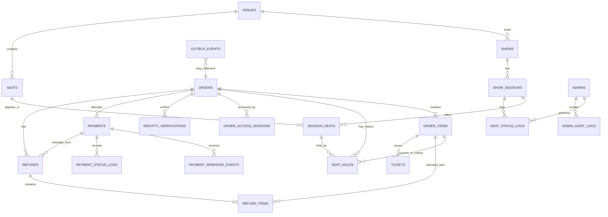

# NAZIR — DATABASE

> 문서 버전: 1.0  
> 기준일: 2026-11-13  
> 데이터베이스: PostgreSQL  
> 상태: 개발 전달 기준안 — Claude Code 독립 기술 검토 및 P0 검증 전 실제 판매 금지  
> 적용 범위: Phase 1 예매 MVP + Phase 2 이후 확장 기반

---

## 1. 문서 목적과 설계 원칙

이 문서는 NAZIR 티켓 예매 서비스의 데이터 구조, 데이터 무결성 규칙, 상태 전이, 동시성 제어 및 외부 연동 저장 방식을 정의한다.

### 1.1 핵심 원칙

1. **PostgreSQL이 유일한 Source of Truth다.** Google Sheets는 운영 편의를 위한 비동기 복제본이며 주문·결제·좌석 상태를 결정하지 않는다.
2. **중요한 상태 변경은 서버에서 검증한다.** 브라우저가 보낸 가격, 좌석 상태, 결제 성공 표시, 카운트다운은 신뢰하지 않는다.
3. **금전·좌석·티켓 이력은 보존한다.** 일반적인 운영 흐름에서 주문·결제·환불·점유 이력을 물리 삭제하지 않는다.
4. **결제 승인과 예매 확정은 별개다.** PG 거래가 확인되고 좌석 판매가 원자적으로 확정된 뒤 티켓을 발급한다.
5. **동시성은 DB 제약조건과 트랜잭션으로 통제한다.** 애플리케이션의 사전 조회만으로 중복 점유·판매를 방지했다고 간주하지 않는다.
6. **상태는 도메인별로 분리한다.** 주문, 좌석 점유, 결제, 환불, 티켓은 각자의 상태를 가진다. 한 상태를 다른 상태의 대용으로 사용하지 않는다.
7. **미정 사업 정책은 미결정으로 남긴다.** 공연장 배치, PG사, 인증사, 보관기간, 환불 수수료 등은 기술 설계에서 임의 확정하지 않는다.

### 1.2 명명 및 공통 규칙

- 테이블·컬럼은 `snake_case`, 테이블은 복수형을 사용한다.
- 기본 키는 UUID를 권장한다. 외부에 노출되는 주문번호·티켓번호는 별도 사람이 읽을 수 있는 식별자다.
- 시각은 `timestamptz`로 저장하고 서버는 UTC 기준으로 처리한다. 화면 표시만 `Asia/Seoul`로 변환한다.
- 금액은 부동소수점이 아닌 `bigint` 원화 정수로 저장한다.
- 상태값은 애플리케이션 상수와 DB 제약조건을 함께 관리한다. PostgreSQL enum 사용 여부는 migration 운영 편의에 따라 구현자가 결정하되, 상태 문자열의 의미는 이 문서를 따른다.
- 모든 주요 테이블에 `created_at`; 수정 가능한 레코드에는 `updated_at`을 둔다.
- 개인정보는 필요한 최소 항목만 수집하고 접근을 제한한다. 전화번호 등은 로그·오류 메시지에 평문으로 남기지 않는다.

---

## 2. 서비스 범위와 데이터 경계

### 2.1 Phase 1

- 비회원 예매
- 공연 및 회차 조회
- 개별 좌석 선택
- 좌석 7분 임시 점유
- 예매자 정보 입력 및 휴대폰 본인인증
- PG 결제 및 서버 측 결제 검증
- 주문 조회 및 모바일 예매 확인서
- 최소 관리자 기능
- Google Sheets 비동기 동기화
- PG 관리자 페이지를 통한 수동 환불 및 결과 기록

Phase 1 관객 화면에는 QR을 노출하지 않는다. 다만 티켓 데이터 모델은 QR 및 현장 체크인 확장을 고려한다.

### 2.2 Phase 2·3 확장

- 환불 운영 자동화 및 일부 관리자 고도화
- SMS 자동 발송
- QR 티켓 및 스태프 체크인
- 중복 입장 방지와 현장 예외 처리

### 2.3 데이터 소유권

| 데이터 | 정본 | 보조 시스템 |
|---|---|---|
| 공연·회차·좌석 | PostgreSQL | 관리자 UI |
| 점유·주문·결제·환불·티켓 | PostgreSQL | 관리자 UI, PG 조회 |
| 본인인증 결과 | PostgreSQL의 최소 검증 기록 + 인증사 | 인증사 원본 거래 |
| 운영 메모 | PostgreSQL 또는 명시적으로 지정된 운영 메모 필드 | Google Sheets |
| Sheets 동기화 상태 | PostgreSQL `outbox_events` | Google Sheets |

Sheets에서 수정한 메모가 주문·결제·좌석의 핵심 상태를 덮어쓰면 안 된다.

---

## 3. 전체 테이블 목록

v0.3 기준 테이블은 총 **21개**다.

| 영역 | 테이블 |
|---|---|
| 공연 및 좌석 | `venues`, `shows`, `show_sessions`, `seats`, `session_seats` |
| 예매 및 점유 | `orders`, `order_items`, `seat_holds`, `seat_status_logs`, `order_access_sessions` |
| 본인인증 및 멱등성 | `identity_verifications`, `idempotency_records` |
| 결제 및 환불 | `payments`, `payment_webhook_events`, `payment_status_logs`, `refunds`, `refund_items` |
| 티켓 | `tickets` |
| 관리자 | `admins`, `admin_audit_logs` |
| 외부 연동 | `outbox_events` |

### 3.1 ERD

> ERD는 핵심 관계를 나타낸다. `outbox_events`는 여러 도메인 이벤트를 담기 때문에 실제 구현에서는 특정 도메인 테이블에 강한 FK를 두지 않고 `aggregate_type`·`aggregate_id`로 연결할 수 있다.

---

## 4. 공연 및 좌석 테이블

### 4.1 `venues` — 공연장

공연장 기본 정보를 저장한다. 하나의 공연은 한 공연장에서 진행하며 공연장은 재사용할 수 있다.

| 컬럼 | 타입 | 제약 / 설명 |
|---|---|---|
| `id` | uuid | PK |
| `name` | varchar(200) | NOT NULL |
| `address` | text | NULL 가능 |
| `timezone` | varchar(64) | NOT NULL, 기본 `Asia/Seoul` |
| `seat_map_version` | varchar(50) | NULL 가능 |
| `seat_map_asset_url` | text | NULL 가능, SVG 원본/배포 파일 참조 |
| `created_at` | timestamptz | NOT NULL |
| `updated_at` | timestamptz | NOT NULL |

### 4.2 `shows` — 공연

| 컬럼 | 타입 | 제약 / 설명 |
|---|---|---|
| `id` | uuid | PK |
| `venue_id` | uuid | FK → `venues.id`, NOT NULL |
| `title` | varchar(200) | NOT NULL |
| `slug` | varchar(220) | UNIQUE, NOT NULL |
| `description` | text | NULL 가능 |
| `poster_url` | text | NULL 가능 |
| `status` | varchar(20) | `DRAFT`, `PUBLISHED`, `CLOSED` |
| `sales_opens_at` | timestamptz | NULL 가능 |
| `sales_closes_at` | timestamptz | NULL 가능 |
| `created_at` | timestamptz | NOT NULL |
| `updated_at` | timestamptz | NOT NULL |

공연 공개 여부와 예매 가능 여부는 구분한다. `PUBLISHED`여도 판매 기간이 아니거나 모든 회차가 닫혔으면 예매할 수 없다.

### 4.3 `show_sessions` — 공연 회차

| 컬럼 | 타입 | 제약 / 설명 |
|---|---|---|
| `id` | uuid | PK |
| `show_id` | uuid | FK → `shows.id`, NOT NULL |
| `starts_at` | timestamptz | NOT NULL |
| `ends_at` | timestamptz | NULL 가능 |
| `sales_status` | varchar(20) | `ON_SALE`, `PAUSED`, `CLOSED` |
| `created_at` | timestamptz | NOT NULL |
| `updated_at` | timestamptz | NOT NULL |

인덱스: `(show_id, starts_at)`. 회차는 공연에 종속된다.

### 4.4 `seats` — 공연장의 물리적 좌석

좌석의 물리적 정체성을 저장한다. SVG 좌석 ID와 DB 좌석 ID를 분리한다.

| 컬럼 | 타입 | 제약 / 설명 |
|---|---|---|
| `id` | uuid | PK |
| `venue_id` | uuid | FK → `venues.id`, NOT NULL |
| `svg_seat_id` | varchar(100) | NOT NULL |
| `section_name` | varchar(100) | NULL 가능 |
| `row_label` | varchar(30) | NULL 가능 |
| `seat_number` | varchar(30) | NOT NULL |
| `seat_label` | varchar(100) | 화면 표시명 |
| `created_at` | timestamptz | NOT NULL |
| `updated_at` | timestamptz | NOT NULL |

제약조건: `UNIQUE (venue_id, svg_seat_id)`, `UNIQUE (venue_id, section_name, row_label, seat_number)`.

SVG는 시각적 배치와 좌석 선택 UI를 담당한다. 판매 상태는 SVG 파일에 저장하지 않고 DB에서 조회한다. SVG 교체 시에도 물리적 좌석의 `id`는 유지한다.

### 4.5 `session_seats` — 회차별 판매 좌석

물리적 좌석을 회차별 판매 단위로 만든다. 회차마다 가격과 판매 가능 상태가 독립적이다.

| 컬럼 | 타입 | 제약 / 설명 |
|---|---|---|
| `id` | uuid | PK |
| `show_session_id` | uuid | FK → `show_sessions.id`, NOT NULL |
| `seat_id` | uuid | FK → `seats.id`, NOT NULL |
| `price` | bigint | NOT NULL, 0 이상 |
| `status` | varchar(20) | `AVAILABLE`, `SOLD`, `BLOCKED` |
| `created_at` | timestamptz | NOT NULL |
| `updated_at` | timestamptz | NOT NULL |

제약조건: `UNIQUE (show_session_id, seat_id)`, `CHECK (price >= 0)`. 인덱스: `(show_session_id, status)`.

`HELD`는 이 테이블의 영구 상태가 아니다. 유효한 `seat_holds`가 존재하는지로 판단한다. 화면 응답은 `SOLD`·`BLOCKED`·유효 점유 여부를 조합해 `AVAILABLE` / `HELD` / `SOLD` / `BLOCKED`로 표시할 수 있다.

---

## 5. 예매 및 좌석 점유 테이블

### 5.1 `orders` — 주문

주문은 하나의 예매 시도와 고객 정보를 묶는다. 한 주문에 여러 좌석이 포함될 수 있다.

| 컬럼 | 타입 | 제약 / 설명 |
|---|---|---|
| `id` | uuid | PK |
| `order_number` | varchar(40) | UNIQUE, NOT NULL, 예: `NZ-202702-000001` |
| `status` | varchar(30) | 아래 주문 상태 참조 |
| `customer_name` | varchar(100) | NULL 가능, 입력 전 |
| `pending_customer_phone` | varchar(30) | NULL 가능, 인증 전 임시 번호 |
| `customer_phone` | varchar(30) | NULL 가능, 인증 성공 후 확정 번호 |
| `customer_email` | varchar(254) | NULL 가능 |
| `total_amount` | bigint | NOT NULL, 주문 현재 좌석 합계 |
| `currency` | char(3) | NOT NULL, 기본 `KRW` |
| `paid_at` | timestamptz | NULL 가능 |
| `expired_at` | timestamptz | NULL 가능, 주문 종료 시각 |
| `created_at` | timestamptz | NOT NULL |
| `updated_at` | timestamptz | NOT NULL |

`orders.expires_at`은 두지 않는다. 좌석 점유 만료의 단일 기준은 각 `seat_holds.expires_at`이다. 주문은 좌석 점유 만료만으로 무조건 `EXPIRED`가 되지 않는다. 결제 결과 확인 중인 주문은 `PAYMENT_PENDING`으로 유지할 수 있다.

주문 상태:
- `PENDING`: 주문 생성, 결제 진행 전
- `PAYMENT_PENDING`: 결제 요청 또는 결과 확인이 진행 중
- `PAID`: PG 승인 확인 및 좌석 판매 확정 완료
- `EXPIRED`: 결제 미완료 상태에서 주문이 종료됨
- `REVIEW_REQUIRED`: 결제·좌석 상태 불일치 등 운영자 확인 필요
- `REFUNDED`: 전액 환불 완료. 부분 환불은 주문을 `PAID`로 유지하고 환불 테이블로 추적

주문 상태는 결제 상태나 점유 상태를 대신하지 않는다. `REVIEW_REQUIRED` 주문은 자동으로 티켓을 발급하지 않는다.

### 5.2 `order_items` — 주문 좌석 항목

**현재 주문에서 선택한 좌석의 집합**을 나타낸다. 좌석 변경 이력을 쌓기 위해 같은 주문에 동일 좌석 항목을 반복 삽입하지 않는다.

| 컬럼 | 타입 | 제약 / 설명 |
|---|---|---|
| `id` | uuid | PK |
| `order_id` | uuid | FK → `orders.id`, NOT NULL |
| `session_seat_id` | uuid | FK → `session_seats.id`, NOT NULL |
| `price` | bigint | NOT NULL, 구매 시 가격 snapshot |
| `created_at` | timestamptz | NOT NULL |
| `updated_at` | timestamptz | NOT NULL |

제약조건: `UNIQUE (order_id, session_seat_id)`, `CHECK (price >= 0)`.

좌석 변경 시 기존 `order_item`의 `session_seat_id`와 `price`를 새 좌석 기준으로 갱신한다. 변경 전 점유 이력은 `seat_holds`에 남긴다. 좌석이 최종 판매된 뒤에는 해당 `order_item`을 수정하지 않는다. 주문 확정 이후 좌석 변경은 별도의 교환/운영 정책이 필요하며 Phase 1 범위 밖이다.

### 5.3 `seat_holds` — 좌석 임시 점유 이력

좌석 점유 시도와 해제·만료 이력을 보존한다. 좌석 변경으로 이전 점유를 해제해도 행을 삭제하지 않는다.

| 컬럼 | 타입 | 제약 / 설명 |
|---|---|---|
| `id` | uuid | PK |
| `order_id` | uuid | FK → `orders.id`, NOT NULL |
| `order_item_id` | uuid | FK → `order_items.id`, NOT NULL |
| `session_seat_id` | uuid | FK → `session_seats.id`, NOT NULL |
| `status` | varchar(20) | `ACTIVE`, `RELEASED`, `EXPIRED`, `CONVERTED` |
| `expires_at` | timestamptz | NOT NULL |
| `released_at` | timestamptz | NULL 가능 |
| `created_at` | timestamptz | NOT NULL |
| `updated_at` | timestamptz | NOT NULL |

- `ACTIVE`: 현재 유효한 임시 점유 후보
- `RELEASED`: 좌석 변경 또는 사용자 취소 등으로 해제
- `EXPIRED`: 만료 처리됨
- `CONVERTED`: 결제 확정으로 판매 좌석으로 전환됨

부분 고유 인덱스: `UNIQUE (session_seat_id) WHERE status = 'ACTIVE'`. 유효기간 판정은 인덱스 조건에 `now()`를 넣지 않는다. 새 점유를 만들기 전 트랜잭션에서 해당 좌석의 만료된 `ACTIVE` hold를 `EXPIRED`로 갱신한 후 중복 여부를 확인한다.

`order_item_id`는 해당 점유가 연결된 주문 항목을 식별한다. 좌석 변경 시 기존 hold는 `RELEASED`, 현재 좌석 hold는 현재 `order_item_id`와 연결한다. 주문 항목은 현재 선택 좌석을 나타내며, hold는 그 항목이 시간에 따라 어떤 좌석을 점유했는지의 이력을 보존한다.

### 5.4 `seat_status_logs` — 좌석 운영 변경 로그

관리자 차단·해제와 시스템 판매 확정 등 좌석 상태 변경 이력을 기록한다.

| 컬럼 | 타입 | 제약 / 설명 |
|---|---|---|
| `id` | uuid | PK |
| `session_seat_id` | uuid | FK → `session_seats.id`, NOT NULL |
| `from_status` | varchar(20) | NULL 가능 |
| `to_status` | varchar(20) | NOT NULL |
| `reason` | text | NULL 가능 |
| `actor_type` | varchar(20) | `ADMIN`, `SYSTEM` |
| `admin_id` | uuid | FK → `admins.id`, NULL 가능 |
| `created_at` | timestamptz | NOT NULL |

관리자 차단은 `AVAILABLE`이고 유효 hold가 없을 때만 허용한다. `SOLD` 또는 유효 점유 좌석은 차단할 수 없다. 모든 변경은 상태 변경과 로그 삽입을 같은 트랜잭션에서 수행한다.

### 5.5 `order_access_sessions` — 비회원 주문 접근 세션

주문 생성 후 비회원 브라우저가 해당 주문에 접근할 권한을 증명하는 세션이다.

| 컬럼 | 타입 | 제약 / 설명 |
|---|---|---|
| `id` | uuid | PK |
| `order_id` | uuid | FK → `orders.id`, NOT NULL |
| `token_hash` | varchar(255) | UNIQUE, NOT NULL |
| `status` | varchar(20) | `ACTIVE`, `REVOKED`, `EXPIRED` |
| `expires_at` | timestamptz | NOT NULL |
| `last_used_at` | timestamptz | NULL 가능 |
| `created_at` | timestamptz | NOT NULL |

원문 토큰은 암호학적으로 안전한 난수로 생성하고 HttpOnly·Secure·적절한 SameSite 속성을 가진 쿠키로 전달한다. DB에는 토큰 hash만 저장한다. 토큰 원문을 로그나 응답 본문에 포함하지 않는다.

주문 생성 요청의 응답이 유실되어 같은 Idempotency-Key로 재요청한 경우:
1. 기존 주문을 새로 만들지 않는다.
2. 기존 접근 세션을 재사용하거나, 더 안전한 정책으로 기존 활성 세션을 폐기하고 새 접근 세션을 발급한다.
3. 새 쿠키를 다시 설정해 클라이언트가 기존 주문에 접근할 수 있게 한다.
4. 주문 소유권 검증 없이 주문번호만으로 접근을 허용하지 않는다.

세션 재발급 정책은 구현 시 원자적으로 처리한다. 접근 세션은 좌석 점유 만료와 별개로 만료 시간을 가진다.

---

## 6. 본인인증 및 멱등성 테이블

### 6.1 `identity_verifications` — 휴대폰 본인인증 기록

인증사의 거래 결과 중 서비스가 검증·감사에 필요한 최소 정보만 저장한다.

| 컬럼 | 타입 | 제약 / 설명 |
|---|---|---|
| `id` | uuid | PK |
| `order_id` | uuid | FK → `orders.id`, NOT NULL |
| `provider` | varchar(50) | 인증사 식별자 |
| `provider_transaction_id` | varchar(200) | 인증사 거래 ID, NULL 가능 |
| `requested_phone` | varchar(30) | 인증 요청 번호 |
| `verified_phone` | varchar(30) | 인증 성공 시 검증된 번호, NULL 가능 |
| `status` | varchar(20) | `PENDING`, `VERIFIED`, `FAILED`, `EXPIRED` |
| `verified_at` | timestamptz | NULL 가능 |
| `expires_at` | timestamptz | NULL 가능 |
| `failure_code` | varchar(100) | NULL 가능 |
| `created_at` | timestamptz | NOT NULL |
| `updated_at` | timestamptz | NOT NULL |

인증 전 번호는 `orders.pending_customer_phone` 또는 인증 요청 정보로 임시 취급한다. 인증 성공 후 인증사가 반환한 번호와 요청 번호가 일치하는지 확인하고, 성공한 번호를 `orders.customer_phone`에 확정 저장한다. 인증 실패/취소 시 `customer_phone`을 확정하지 않는다.

인증사 원본 응답 전체를 무조건 저장하지 않는다. 법적·계약상 필요한 최소 필드만 저장하고 민감한 식별정보는 저장 필요성을 별도 검토한다.

### 6.2 `idempotency_records` — 요청 멱등성 기록

중복 네트워크 요청이 동일한 주문·결제 동작을 중복 실행하지 않도록 한다.

| 컬럼 | 타입 | 제약 / 설명 |
|---|---|---|
| `id` | uuid | PK |
| `scope` | varchar(100) | 예: `POST:/orders`, `POST:/orders/{id}/payments` |
| `idempotency_key` | varchar(255) | NOT NULL |
| `request_hash` | varchar(255) | 요청 본문 정규화 hash |
| `resource_type` | varchar(50) | 예: `ORDER`, `PAYMENT` |
| `resource_id` | uuid | 생성된 리소스 ID |
| `response_status` | integer | NULL 가능 |
| `response_body` | jsonb | 최소 응답 스냅샷, 민감정보 제외 |
| `status` | varchar(20) | `PROCESSING`, `COMPLETED`, `FAILED` |
| `expires_at` | timestamptz | NOT NULL |
| `created_at` | timestamptz | NOT NULL |
| `updated_at` | timestamptz | NOT NULL |

제약조건: `UNIQUE (scope, idempotency_key)`. 같은 키에 다른 요청 본문 hash가 들어오면 충돌 오류를 반환한다. 동일 키의 동시 요청은 한 요청만 처리하고 나머지는 처리 결과를 조회하거나 안전하게 재응답한다.

멱등성 보관 기간은 운영·보안·결제 재시도 정책에 따라 정한다. 만료 레코드 삭제 정책은 별도 결정하되, 결제 추적에 필요한 데이터는 결제 원장에 남긴다.

---

## 7. 결제 및 환불 테이블

### 7.1 `payments` — PG 결제 시도 및 거래 원장

한 주문에 결제 시도가 여러 번 있을 수 있다. 다만 하나의 주문에 대해 예매 확정에 사용되는 정상 승인 결제는 하나만 허용한다. 중복 승인이나 금액 불일치 승인도 감사·환불을 위해 거래 기록으로 남긴다.

| 컬럼 | 타입 | 제약 / 설명 |
|---|---|---|
| `id` | uuid | PK |
| `order_id` | uuid | FK → `orders.id`, NOT NULL |
| `provider` | varchar(50) | PG사 식별자 |
| `provider_payment_id` | varchar(200) | PG 결제 객체 ID, NULL 가능 |
| `pg_transaction_id` | varchar(200) | PG 거래/승인 ID, NULL 가능 |
| `idempotency_key` | varchar(255) | 서비스 내부 결제 요청 키 |
| `status` | varchar(30) | 결제 상태 |
| `requested_amount` | bigint | NOT NULL, 서버가 PG에 요청한 금액 |
| `approved_amount` | bigint | NULL 가능, PG가 승인한 금액 |
| `currency` | char(3) | NOT NULL, 기본 `KRW` |
| `payment_method` | varchar(50) | NULL 가능 |
| `failure_code` | varchar(100) | NULL 가능 |
| `failure_message` | text | NULL 가능, 민감정보 제거 |
| `requested_at` | timestamptz | NULL 가능 |
| `approved_at` | timestamptz | NULL 가능 |
| `failed_at` | timestamptz | NULL 가능 |
| `last_verified_at` | timestamptz | NULL 가능 |
| `created_at` | timestamptz | NOT NULL |
| `updated_at` | timestamptz | NOT NULL |

금액 필드는 `requested_amount`와 `approved_amount`를 사용한다. 구버전의 일반 `amount` 컬럼은 두지 않는다.

결제 상태:
- `READY`: 결제 요청 전 또는 PG 결제창 준비
- `PENDING`: 결제 진행 중
- `UNKNOWN`: 클라이언트 종료·네트워크 오류 등으로 결과 불명확
- `SUCCEEDED`: PG 승인 거래 확인
- `FAILED`: PG 결제 실패 확인
- `CANCELED`: 승인 전 결제 취소 확인
- `PARTIALLY_REFUNDED`: 부분 환불 완료
- `REFUNDED`: 전액 환불 완료
- `REVIEW_REQUIRED`: 중복 승인·금액 불일치 등 자동 처리 중단

제약·인덱스:
- `UNIQUE (provider, pg_transaction_id)` — `pg_transaction_id IS NOT NULL`인 경우
- `UNIQUE (provider, provider_payment_id)` — 값이 존재하는 경우
- `UNIQUE (order_id, idempotency_key)` — 키가 존재하는 경우
- 주문별 정상 승인 결제 1건 보장은 단순 `status='SUCCEEDED'` partial unique로 처리하지 않는다. 승인 거래는 결제 시도별로 기록될 수 있고, 최종 예매 확정은 주문 행 잠금과 결제 원장 확인을 포함한 트랜잭션에서 결정한다. 초과 승인도 삭제하지 않고 `REVIEW_REQUIRED`로 분류한다.

카드번호·CVC 등 결제 민감정보는 저장하지 않는다. PG 토큰/거래 ID는 계약상 저장 가능한 범위에서만 보관한다.

### 7.2 `payment_webhook_events` — PG Webhook 수신 원장

PG Webhook을 수신한 사실과 처리 결과를 기록한다. Webhook은 중복·지연·순서 역전이 발생할 수 있다.

| 컬럼 | 타입 | 제약 / 설명 |
|---|---|---|
| `id` | uuid | PK |
| `provider` | varchar(50) | NOT NULL |
| `provider_event_id` | varchar(200) | NULL 가능 |
| `deduplication_key` | varchar(255) | NOT NULL |
| `payment_id` | uuid | FK → `payments.id`, NULL 가능 |
| `event_type` | varchar(100) | NOT NULL |
| `payload_hash` | varchar(255) | NOT NULL |
| `payload_redacted` | jsonb | 민감정보 제거된 payload |
| `status` | varchar(20) | `RECEIVED`, `PROCESSING`, `PROCESSED`, `FAILED`, `IGNORED` |
| `failure_reason` | text | NULL 가능 |
| `received_at` | timestamptz | NOT NULL |
| `processed_at` | timestamptz | NULL 가능 |

제약조건: `UNIQUE (provider, deduplication_key)`. PG가 event ID를 제공하면 이를 사용한다. 제공하지 않는 경우 PG adapter가 거래 ID, 이벤트 유형, PG 이벤트 시각 등 안정적인 필드를 조합해 결정적 중복 판별 키를 만든다. 실제 조합 규칙은 PG사 선정 후 확정한다.

Webhook 서명/인증을 검증하기 전에는 상태를 변경하지 않는다. 원본 payload 전체 저장은 개인정보·결제정보 노출 위험이 있으므로 금지하고, 필요한 필드만 redaction하여 저장한다. 최종 상태는 필요하면 PG API로 재조회한다.

### 7.3 `payment_status_logs` — 결제 상태 변경 로그

| 컬럼 | 타입 | 제약 / 설명 |
|---|---|---|
| `id` | uuid | PK |
| `payment_id` | uuid | FK → `payments.id`, NOT NULL |
| `from_status` | varchar(30) | NULL 가능 |
| `to_status` | varchar(30) | NOT NULL |
| `source` | varchar(30) | `API`, `WEBHOOK`, `PG_REQUERY`, `ADMIN`, `SYSTEM` |
| `source_event_id` | uuid | NULL 가능, Webhook 이벤트 등 참조 |
| `note` | text | NULL 가능 |
| `created_at` | timestamptz | NOT NULL |

상태 변경과 로그 삽입은 같은 트랜잭션에서 처리한다.

### 7.4 `refunds` — 환불 단위

Phase 1에서는 운영진이 PG 관리자 페이지에서 수동 환불하고, PG 조회로 성공 여부를 확인한 뒤 서비스 DB에 기록한다.

| 컬럼 | 타입 | 제약 / 설명 |
|---|---|---|
| `id` | uuid | PK |
| `order_id` | uuid | FK → `orders.id`, NOT NULL |
| `payment_id` | uuid | FK → `payments.id`, NOT NULL |
| `provider_refund_id` | varchar(200) | NULL 가능 |
| `total_amount` | bigint | NOT NULL, 0 초과 |
| `status` | varchar(20) | `REQUESTED`, `PROCESSING`, `COMPLETED`, `FAILED` |
| `reason` | text | NULL 가능 |
| `requested_by_admin_id` | uuid | FK → `admins.id`, NULL 가능 |
| `completed_at` | timestamptz | NULL 가능 |
| `created_at` | timestamptz | NOT NULL |
| `updated_at` | timestamptz | NOT NULL |

`refunds.order_id`와 `payments.order_id`가 일치해야 한다. 이 관계는 애플리케이션 검증뿐 아니라 트랜잭션 내 잠금·검증으로 보장한다. DB 복합 FK 적용 여부는 migration 설계 시 검토할 수 있다.

### 7.5 `refund_items` — 환불 대상 주문 항목

| 컬럼 | 타입 | 제약 / 설명 |
|---|---|---|
| `id` | uuid | PK |
| `refund_id` | uuid | FK → `refunds.id`, NOT NULL |
| `order_item_id` | uuid | FK → `order_items.id`, NOT NULL |
| `amount` | bigint | NOT NULL, 0 초과 |
| `created_at` | timestamptz | NOT NULL |

환불 단위의 `total_amount`는 해당 `refund_items.amount` 합계와 일치해야 한다. 환불 생성/완료 트랜잭션에서 검증한다. 한 주문 항목에 대한 누적 완료 환불액은 해당 항목의 결제 금액을 초과할 수 없다. 동시 환불 요청은 주문 및 관련 주문 항목을 잠그고 누적액을 확인한다.

부분 환불 시 주문은 `PAID` 상태를 유지하고 환불 상태는 `refunds`와 `payments`에서 추적한다. 전액 환불이 모두 완료되면 주문을 `REFUNDED`로 전환한다.

환불 완료는 운영자가 입력한 사실만으로 처리하지 않는다. PG 조회 또는 검증 가능한 PG 응답으로 환불 성공을 확인한 후 `COMPLETED`로 변경한다. 환불 실패 시 좌석과 티켓은 기존 상태를 유지한다.

---

## 8. 티켓 테이블

### 8.1 `tickets` — 좌석별 티켓

Phase 1에는 모바일 예매 확인서만 제공하며 QR 코드는 노출하지 않는다. 티켓 레코드는 좌석별로 생성해 추후 QR 기능을 확장한다.

| 컬럼 | 타입 | 제약 / 설명 |
|---|---|---|
| `id` | uuid | PK |
| `ticket_number` | varchar(40) | UNIQUE, NOT NULL |
| `order_item_id` | uuid | FK → `order_items.id`, UNIQUE, NOT NULL |
| `status` | varchar(20) | `ISSUED`, `USED`, `VOID` |
| `qr_token_hash` | varchar(255) | NULL 가능, QR 도입 시 사용 |
| `issued_at` | timestamptz | NOT NULL |
| `used_at` | timestamptz | NULL 가능 |
| `created_at` | timestamptz | NOT NULL |
| `updated_at` | timestamptz | NOT NULL |

티켓은 결제 승인만으로 발급하지 않는다. PG 거래 확인, 주문 상태 검증, 좌석 판매 확정이 하나의 DB 트랜잭션으로 완료된 경우에만 발급한다. `order_item_id` UNIQUE로 좌석 항목당 티켓이 중복 생성되지 않도록 한다.

환불 완료 시 해당 티켓은 `VOID`로 전환한다. QR 토큰은 예측 불가능한 난수로 생성하고 원문을 DB에 저장하지 않는다.

---

## 9. 관리자 테이블

### 9.1 `admins` — 관리자 계정

| 컬럼 | 타입 | 제약 / 설명 |
|---|---|---|
| `id` | uuid | PK |
| `email` | varchar(254) | UNIQUE, NOT NULL |
| `password_hash` | text | NOT NULL |
| `name` | varchar(100) | NOT NULL |
| `role` | varchar(30) | 예: `SUPER_ADMIN`, `STAFF` |
| `is_active` | boolean | NOT NULL, 기본 true |
| `last_login_at` | timestamptz | NULL 가능 |
| `created_at` | timestamptz | NOT NULL |
| `updated_at` | timestamptz | NOT NULL |

비밀번호 원문 저장 금지. 적절한 password hashing 알고리즘을 사용한다. 관리자 세션은 서버 측 검증 및 HttpOnly·Secure 쿠키를 사용한다.

### 9.2 `admin_audit_logs` — 관리자 작업 감사 로그

| 컬럼 | 타입 | 제약 / 설명 |
|---|---|---|
| `id` | uuid | PK |
| `admin_id` | uuid | FK → `admins.id`, NULL 가능 |
| `action` | varchar(100) | NOT NULL |
| `target_type` | varchar(50) | NOT NULL |
| `target_id` | uuid | NULL 가능 |
| `before_data` | jsonb | 민감정보 제거 |
| `after_data` | jsonb | 민감정보 제거 |
| `ip_address` | inet | NULL 가능, 보관 필요성 검토 |
| `user_agent` | text | NULL 가능 |
| `created_at` | timestamptz | NOT NULL |

관리자에 의한 좌석 차단·해제, 환불 기록, 수동 복구, 공연 설정 변경 등 주요 행위는 감사 로그를 남긴다. 로그에 비밀번호·인증 토큰·카드 정보·불필요한 개인정보를 넣지 않는다.

---

## 10. 외부 연동 테이블

### 10.1 `outbox_events` — 비동기 외부 연동 이벤트

DB 핵심 변경과 외부 전송 이벤트를 원자적으로 기록하기 위한 Outbox 패턴이다. Google Sheets 전송 실패가 예매·결제 성공을 취소시키면 안 된다.

| 컬럼 | 타입 | 제약 / 설명 |
|---|---|---|
| `id` | uuid | PK |
| `event_type` | varchar(100) | NOT NULL |
| `aggregate_type` | varchar(50) | NOT NULL |
| `aggregate_id` | uuid | NOT NULL |
| `payload` | jsonb | 전송에 필요한 최소 데이터 |
| `status` | varchar(20) | `PENDING`, `PROCESSING`, `SENT`, `RETRY`, `DEAD` |
| `attempt_count` | integer | NOT NULL, 기본 0 |
| `next_retry_at` | timestamptz | NULL 가능 |
| `locked_at` | timestamptz | NULL 가능 |
| `locked_by` | varchar(100) | NULL 가능 |
| `last_error` | text | NULL 가능 |
| `sent_at` | timestamptz | NULL 가능 |
| `created_at` | timestamptz | NOT NULL |
| `updated_at` | timestamptz | NOT NULL |

처리 규칙:
- 주문·결제 등 핵심 DB 변경과 outbox 이벤트 삽입은 같은 트랜잭션에서 수행한다.
- 작업자는 `FOR UPDATE SKIP LOCKED` 등을 이용해 이벤트를 원자적으로 claim한다.
- lease가 만료된 `PROCESSING` 이벤트는 재시도 대상으로 회수한다.
- 재시도 횟수와 지수형 backoff를 적용하고, 최대 횟수 초과 시 `DEAD`로 이동한다.
- 성공 시 `SENT`, 실패 시 `RETRY`와 `next_retry_at`을 기록한다.
- Google Sheets 전송은 중복 호출되어도 데이터가 중복 생성되지 않도록 event ID 또는 aggregate ID 기반 upsert 전략을 사용한다.
- Sheets 장애는 주문/결제 API 응답의 성공 여부에 영향을 주지 않는다.

---

## 11. 핵심 상태 및 업무 규칙

### 11.1 좌석 상태의 우선순위

회차별 좌석의 최종 표시 상태는 다음 우선순위로 계산한다.

1. `session_seats.status = SOLD` → 판매 완료
2. `session_seats.status = BLOCKED` → 관리자 차단
3. 만료되지 않은 `ACTIVE` hold 존재 → 임시 점유
4. 그 외 → 예약 가능

`HELD`를 `session_seats.status`에 영구 저장하지 않는다. 점유 만료 시각은 `seat_holds.expires_at`이 기준이다.

### 11.2 임시 점유 생성

1. 사용자가 선택 좌석을 다음 단계로 진행할 때 서버가 요청을 받는다.
2. 서버는 선택 좌석을 안정적인 ID 순서로 잠근다.
3. 해당 좌석의 만료된 `ACTIVE` hold를 `EXPIRED`로 변경한다.
4. 모든 좌석이 `AVAILABLE`이고 유효 hold가 없는지 확인한다.
5. 한 좌석이라도 확보할 수 없으면 전체 트랜잭션을 롤백한다.
6. 전부 확보 가능하면 주문·주문 항목·hold·접근 세션을 원자적으로 생성한다.
7. 점유 만료는 생성 시각 기준 7분으로 설정한다. 이후 뒤로 가기나 결제창 취소로 만료 시각을 연장하지 않는다.

여러 좌석은 모두 확보되거나 모두 확보되지 않아야 한다. 일부 좌석만 점유하는 상태를 만들지 않는다.

### 11.3 좌석 변경

1. 현재 주문과 관련 좌석을 잠근다.
2. 기존 `ACTIVE` hold를 `RELEASED`로 변경한다.
3. 기존 `order_item`을 현재 선택 좌석 기준으로 갱신한다.
4. 새 좌석을 잠그고 상태 및 유효 hold를 검증한다.
5. 새 좌석 확보가 실패하면 전체 변경을 롤백해 기존 좌석 점유를 유지한다.
6. 성공하면 새 `ACTIVE` hold를 생성한다.
7. 기존 hold는 이력으로 보존한다.

좌석 변경은 가능한 한 원자적으로 처리한다. 구현 시 기존 좌석 해제와 새 좌석 확보 순서 및 동시 요청 잠금 범위를 Claude Code가 검토해야 한다.

### 11.4 7분 만료와 결제 상태 분리

- 결제 요청 전 점유가 만료되면 hold를 `EXPIRED`, 주문을 `EXPIRED`로 전환한다.
- 결제 진행 중 결과가 불명확하면 hold가 만료되어도 주문은 `PAYMENT_PENDING`, 결제는 `UNKNOWN`으로 유지한다.
- 결과 확인 전에는 같은 주문에 새 결제 요청을 허용하지 않는다.
- PG 조회로 승인되지 않았음이 확인되면 결제 실패 처리 후 주문 종료 또는 새 결제 가능 여부를 판단한다.
- PG 승인 성공이 확인되면 DB 트랜잭션에서 좌석 상태를 다시 확인한다.
- 좌석이 여전히 판매 가능하고 다른 유효 점유/판매가 없으면 판매 확정 및 티켓 발급을 진행한다.
- 좌석을 다른 주문이 이미 판매했다면 자동 발권하지 않고 주문을 `REVIEW_REQUIRED`로 전환한다. 운영자가 PG 환불 등 후속 조치를 한다.

브라우저 타이머는 표시용이다. 만료 판정은 서버 시각과 DB 상태를 기준으로 한다. Cron은 만료 이력 정리와 후처리에 사용할 수 있지만, 새 점유 생성과 결제 확정 시점에 서버가 직접 만료 여부를 재검증한다.

### 11.5 결제 성공 확정

결제 성공 확정은 다음을 하나의 DB 트랜잭션으로 수행한다.

1. 주문 행 잠금
2. 결제 거래 및 금액의 PG 서버 측 검증 결과 확인
3. 결제 금액과 `orders.total_amount` 대조
4. 주문의 현재 좌석 항목 및 hold 확인
5. 좌석이 판매 가능한지 재검증
6. `session_seats.status = SOLD` 변경
7. 해당 hold를 `CONVERTED`로 변경
8. `payments.status = SUCCEEDED`, `orders.status = PAID` 반영
9. 좌석별 티켓 생성
10. 관련 로그 및 outbox 이벤트 생성

PG 승인 금액이 주문 금액과 다르면 자동 확정하지 않고 `REVIEW_REQUIRED`로 전환한다. 중복 Webhook이나 브라우저 복귀 요청이 반복되어도 티켓은 한 번만 생성되어야 한다.

### 11.6 결제 중복 및 UNKNOWN

- 결제 결과가 `UNKNOWN`이면 PG 거래 조회 전 재결제를 허용하지 않는다.
- 동일 주문에서 승인된 결제가 이미 확인되면 추가 결제 승인을 예매 확정에 사용하지 않는다.
- 중복 승인 거래는 기록을 보존하고 `REVIEW_REQUIRED`로 분류해 운영자 확인 및 환불 대상으로 처리한다.
- PG Webhook의 도착 순서를 신뢰하지 않는다. 최종 상태가 불명확하거나 역전된 경우 PG API로 재조회한다.

### 11.7 환불

- 환불 요청·진행 중에는 좌석을 `SOLD`로 유지한다.
- PG 환불 성공을 확인한 뒤 해당 주문 항목의 티켓을 `VOID`로 변경한다.
- 환불된 좌석은 운영 정책에 따라 `AVAILABLE` 또는 `BLOCKED`로 변경한다. 기본 권고는 판매 재개가 가능한 경우 `AVAILABLE`이나, 실제 정책은 운영진이 결정한다.
- 부분 환불은 해당 `order_item` 단위로 기록한다.
- 환불 실패 시 티켓과 좌석의 기존 판매 상태를 유지한다.
- 환불 완료 금액의 합계 및 중복 환불 가능성을 트랜잭션 내에서 검증한다.

### 11.8 Google Sheets 동기화

- DB 트랜잭션 안에서 outbox 이벤트만 생성한다.
- 별도 작업자가 Sheets로 비동기 전송한다.
- 실패 시 재시도하고, 최대 재시도 초과 시 `DEAD` 상태로 운영자 확인을 요청한다.
- Sheets의 편집 가능한 운영 메모는 명시적으로 허용한 필드만 역반영한다. 주문 상태·결제 상태·좌석 판매 상태를 Sheets 값으로 갱신하지 않는다.

---

## 12. 인덱스 및 무결성 요약

필수 인덱스·제약조건:

| 테이블 | 제약 / 인덱스 |
|---|---|
| `shows` | `UNIQUE (slug)` |
| `show_sessions` | `(show_id, starts_at)` |
| `seats` | `UNIQUE (venue_id, svg_seat_id)` |
| `session_seats` | `UNIQUE (show_session_id, seat_id)`, `(show_session_id, status)` |
| `orders` | `UNIQUE (order_number)`, `(customer_phone, created_at)` |
| `order_items` | `UNIQUE (order_id, session_seat_id)` |
| `seat_holds` | partial unique `session_seat_id WHERE status='ACTIVE'`; `(order_id, status)`; `(expires_at, status)` |
| `order_access_sessions` | `UNIQUE (token_hash)`, `(order_id, status)` |
| `identity_verifications` | `(order_id, status)`, provider 거래 ID의 nullable unique 검토 |
| `idempotency_records` | `UNIQUE (scope, idempotency_key)`, `(expires_at)` |
| `payments` | nullable unique `(provider, pg_transaction_id)`, nullable unique `(provider, provider_payment_id)`, `(order_id, created_at)` |
| `payment_webhook_events` | `UNIQUE (provider, deduplication_key)`, `(status, received_at)` |
| `payment_status_logs` | `(payment_id, created_at)` |
| `refunds` | `(order_id, created_at)`, nullable unique `(provider_refund_id)` |
| `refund_items` | `(order_item_id)` |
| `tickets` | `UNIQUE (ticket_number)`, `UNIQUE (order_item_id)` |
| `admin_audit_logs` | `(admin_id, created_at)`, `(target_type, target_id)` |
| `outbox_events` | `(status, next_retry_at)`, `(aggregate_type, aggregate_id)` |

인덱스의 구체적인 partial predicate와 FK cascade 정책은 실제 migration에서 확정한다. 주문·결제·환불·티켓 이력은 cascade delete로 삭제하지 않는다.

---

## 13. 트랜잭션 및 동시성 요구사항

다음 동작은 반드시 DB 트랜잭션으로 처리한다.

- 여러 좌석 임시 점유
- 좌석 변경
- 관리자 좌석 차단·해제
- 결제 성공에 따른 좌석 판매 확정 및 티켓 발급
- 환불 완료에 따른 티켓 무효화 및 좌석 상태 변경
- 주문/결제 상태와 관련 로그 생성
- 핵심 변경과 outbox 이벤트 생성

동시성 제어 기준:
- 여러 좌석은 `session_seat_id` 정렬 순서로 잠가 deadlock 위험을 줄인다.
- 좌석 점유 중복은 partial unique index로 최종 방어한다.
- 결제 확정 시 주문 및 좌석 행을 잠그고 현재 상태를 재검증한다.
- 환불 누적액 검증은 관련 주문 항목/결제 행 잠금으로 직렬화한다.
- 애플리케이션에서 조회 후 변경하는 것만으로 동시성 안전성을 주장하지 않는다.
- PostgreSQL 실제 환경에서 동시성 테스트를 수행한다. SQLite로 대체 검증하지 않는다.

---

## 14. 개인정보 및 보안

- 이름·전화번호·이메일은 예매 및 고객 응대에 필요한 최소 범위만 수집한다.
- 전화번호는 본인인증 전 `pending_customer_phone`, 인증 성공 후 `customer_phone`으로 구분한다.
- 인증 완료 후 요청 번호와 인증 결과 번호가 일치하는지 확인한다.
- 동행자 개인정보는 수집하지 않는다.
- 인증 토큰, 접근 세션 토큰, QR 토큰 원문은 DB에 저장하지 않는다. hash만 저장한다.
- PG 카드번호·CVC 등 결제정보를 저장하지 않는다.
- 로그·Webhook payload·감사 로그에 민감정보를 남기지 않는다.
- 관리자 비밀번호는 강한 password hash로 저장한다.
- 주문 조회는 주문번호만으로 허용하지 않는다. 유효한 주문 접근 세션 또는 휴대폰 본인인증을 거친 조회 세션을 요구한다.
- 개인정보 보관·파기 기간은 관련 법령, PG/인증사 계약, 회계·분쟁 대응 의무를 검토한 뒤 확정한다.

---

## 15. 미결정 사항

다음은 기술 설계에서 임의로 확정하지 않는다.

| 항목 | 미결정 내용 | 확정 시점 |
|---|---|---|
| PG사 | PG사 및 간편결제 지원 범위, Webhook 규격, 부분 취소 API | 계약 전 |
| 본인인증사 | 인증사, 비용, 결과 필드, 거래 검증 방식 | 계약 전 |
| 공연장 | 최종 공연장 및 좌석 배치도 | 공연장 확정 후 |
| SVG | 좌석 ID 규칙 및 실제 배치 구현 | 좌석 배치도 수령 후 |
| 가격 | 구역별 가격, 특석, 할인·수수료 정책 | 판매 정책 확정 시 |
| 환불 | 취소 가능 기간, 수수료, 재판매 정책 | 판매 전 |
| 개인정보 | 보관 기간, 파기 기준, 위탁·제공 고지 | 법률·계약 검토 후 |
| 주문 제한 | 1인당 구매 가능 좌석 수 | 운영 정책 확정 시 |
| Sheets | 실제 컬럼, 접근 권한, 역반영 허용 필드 | 운영 시트 설계 시 |
| SMS | 공급사 및 자동 발송 범위 | Phase 2 |
| QR | 토큰 규격, 스캔 앱, 현장 예외 정책 | Phase 2~3 |

---

## 16. 구현 전 필수 검토 및 테스트 조건

Claude Code는 구현 전에 다음 항목을 검토하고, 설계상 문제가 있으면 코드 작성보다 먼저 근거와 대안을 보고해야 한다.

1. Prisma 모델과 PostgreSQL partial unique index를 함께 관리하는 migration 전략
2. `order_items` 갱신과 `seat_holds` 이력 연결이 좌석 변경을 정확히 표현하는지
3. 좌석 변경 실패 시 기존 hold가 유지되는 원자성
4. `seat_holds` 만료와 결제 `UNKNOWN`의 경합 처리
5. 결제 승인·Webhook 중복·상태 역전·중복 승인 처리
6. 주문 생성 Idempotency 재요청 시 접근 쿠키 재발급
7. 인증 전 전화번호와 인증 완료 번호의 저장·검증
8. 환불 항목 합계, 누적 환불액, 동시 환불 방지
9. Outbox 원자적 claim, lease 만료, 재시도, dead-letter 복구
10. 주문 조회의 인증 세션 검증 및 rate limit
11. 개인정보 로그 마스킹 및 보관·파기 전략

### 필수 시나리오

- 같은 좌석을 여러 사용자가 동시에 점유하려는 경우 한 명만 성공한다.
- 한 주문의 여러 좌석 중 하나라도 확보 불가하면 전체 점유가 실패한다.
- 좌석 변경 도중 새 좌석 확보에 실패하면 기존 좌석 점유가 유지된다.
- 같은 좌석으로 A→B→A 변경을 해도 unique 충돌이 발생하지 않는다.
- 7분 만료와 결제 승인 Webhook이 동시에 도착해도 좌석 중복 판매/티켓 중복 발급이 없다.
- 결제 결과 UNKNOWN 상태에서는 재결제가 차단된다.
- 같은 Webhook이 여러 번 도착해도 주문과 티켓은 한 번만 확정된다.
- PG 승인 금액과 주문 금액이 다르면 자동 발권되지 않는다.
- 결제 승인 후 좌석 재확보 실패 시 `REVIEW_REQUIRED`가 된다.
- 주문 생성 응답 유실 후 같은 Idempotency-Key 재요청 시 새 주문 없이 접근 쿠키를 다시 발급받는다.
- 인증 전 번호와 인증 결과 번호가 다르면 주문의 확정 전화번호가 변경되지 않는다.
- 부분 환불 금액 합계가 환불 총액과 다르면 환불 완료가 거부된다.
- 동시 환불 요청으로 누적 환불액이 결제 금액을 초과하지 않는다.
- PG 환불 실패 시 좌석과 티켓이 판매 상태를 유지한다.
- Sheets 장애가 주문·결제 성공에 영향을 주지 않으며 outbox 재시도가 가능하다.
- 만료된 outbox lease가 회수되고 재시도 한도 초과 이벤트가 `DEAD`로 이동한다.

---

## 17. 버전 변경 이력

| 버전 | 변경 내용 |
|---|---|
| 0.1 | 초기 16개 테이블과 기본 예매·결제 모델 정의 |
| 0.2 | 접근 세션, 본인인증, 멱등성, Webhook 및 결제 상태 추적 구조 추가 |
| 0.3 | 부록형 문서를 통합 구조로 재작성. 좌석 변경 모델, 점유/주문/결제 상태 분리, 접근 세션 재발급, 전화번호 인증 순서, 결제 금액 원장, 환불 무결성, Outbox 재시도 및 21개 테이블 관계를 정리 |

## 18. 구현 전 데이터 모델 검토 게이트

Claude Code는 구현 전에 아래 사항을 검증하고 근거를 기술 검토 보고서에 남긴다.

- `seat_holds.order_id`와 `order_items.order_id`의 소속 일치가 보장되는지. 단순 FK만으로는 두 FK 사이의 소속 일치가 보장되지 않으므로 트랜잭션 검증 또는 복합 FK를 검토한다.
- `session_seats`가 해당 회차의 공연장에 속한 좌석만 참조하는지.
- 한 주문의 모든 `order_items`가 동일 회차에 속하는지.
- `order_items`는 현재 선택 좌석으로 갱신되고, 과거 좌석은 `seat_holds.session_seat_id`에 남는다는 이력 모델이 모든 조회·환불·감사 흐름에서 일관되는지.
- 좌석 변경 실패 시 기존 hold와 order item이 모두 rollback되어 유지되는지.
- 주문별 정상 승인 결제 1건 원칙과 중복 승인 이력 보존이 모순 없이 동작하는지.
- 환불 누적액을 잠금으로 보호하고 PG 외부 환불과 DB 기록 사이 장애를 복구할 수 있는지.
- 접근 세션 재발급이 CSRF/session fixation 위험을 만들지 않는지.
- Prisma migration에서 partial unique index와 필요한 CHECK/복합 제약이 실제 PostgreSQL에 생성되는지.

> v1.0은 개발 착수 기준선이며, PG·인증사 계약, 법률 검토, 실제 좌석 자료 및 Claude Code 기술 검토에 따라 수정될 수 있다.
