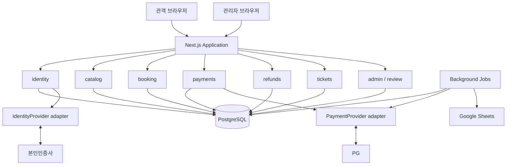
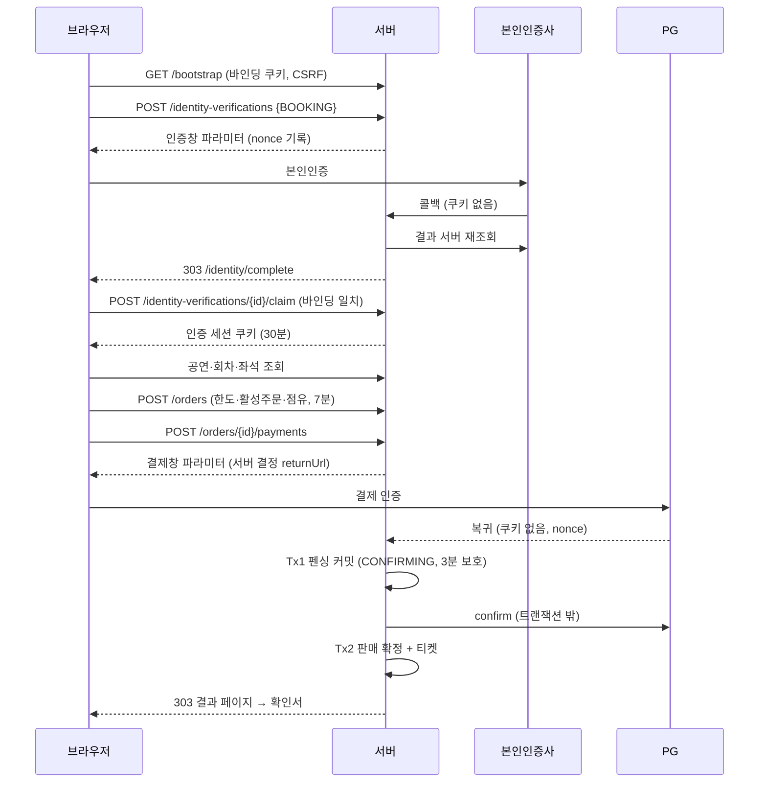

# NAZIR — SYSTEM ARCHITECTURE

> 문서 버전: 1.1 · 기준일: 2026-11-14 · 개발 전달 기준안
> 관련 문서: `DATABASE.md`, `API_SPEC.md`, `DECISIONS.md`, `IMPLEMENTATION_PLAN.md`, `TEST_PLAN.md`
> 이전 버전 원문: `docs/archive/v1.0/ARCHITECTURE`

표기: **[확정]** 사용자 확정 정책 · **[채택]** 설계 채택안(승인 대기) · **[권장]** 미결정 기본값 · **[외부 확인]**

## 1. 목표와 품질 속성

NAZIR은 뮤지컬/연극 예매 웹사이트다. 초기에는 제한된 공연·회차를 안정적으로 판매한다.

핵심 품질 속성: 좌석 중복 판매 방지, 동일인 구매 한도 보장, PG 서버 검증, 결제 중 좌석 보호, 이력 추적, 외부 장애 격리, 빠른 MVP, QR 확장성.

## 2. 기술 결정

| 영역 | 기술/방향 | 상태 |
|---|---|---|
| Web/API | Next.js + TypeScript + React | 채택 |
| DB | PostgreSQL(15 이상 권장 — `NULLS NOT DISTINCT`) | 채택, 상품 미선정 |
| ORM | Prisma(일반 CRUD, 기본 관계) | 채택 |
| 고급 DB | raw SQL migration(partial unique, CHECK, 복합 FK, 잠금 쿼리) + 스키마 계약 테스트 | 채택 A-019 |
| 배포 | Vercel 우선 검토 | **외부 확인 E-007**: 상업적 이용 가능 플랜, 1분 주기 스케줄 지원, 함수 실행시간, 서울 리전 |
| DB 호스팅 | 관리형 PostgreSQL, 앱과 같은 리전(서울 권장) | 미선정 |
| 소스 | NAZIR GitHub 저장소(`kkkkmini/NAZIR`) | 채택 |
| 파일 | 객체 저장소 또는 정적 asset(포스터/SVG) | 미선정 |
| 백그라운드 작업 | 스케줄러(1분 주기 필요) + 작업 루틴 | 상품 미선정 |
| Rate limit 저장소 | PostgreSQL 또는 관리형 Redis | 권장 Q-013 |
| 운영 mirror | Google Sheets(읽기 전용 권장 Q-014) | 채택 |

버전과 호스팅 상품은 개발 시작 시 공식 문서·계약 조건을 확인하고 고정한다. 확인되지 않은 플랜 제약을 전제로 구현하지 않는다.

## 3. 모듈형 모놀리스



도메인 모듈:

| 모듈 | 책임 |
|---|---|
| `identity` | 브라우저 바인딩, 본인인증 시작·콜백·claim, 인증 세션, 동일인 주체(subject) |
| `catalog` | 공연·회차·좌석·판매 가능 조건 |
| `booking` | 주문 생성(한도·활성 주문·점유), 취소, 만료(`expireOrder`), 주문 접근 권한 |
| `payments` | 결제 시작, 복귀·펜싱(Tx1/Tx2/Tx3), 판매 확정 호출, 재조회, webhook |
| `tickets` | 판매 확정 트랜잭션 내 티켓 발급, 확인서 |
| `refunds` | 환불 요청·PG 실행 기록·검증·완료, 대사 |
| `admin` | 관리자 인증·권한, 좌석 차단, review case action, 감사 로그 |
| `integrations` | outbox worker, Sheets |

초기에는 마이크로서비스로 분리하지 않는다. 다른 모듈의 데이터를 직접 수정하지 않고 use case 경계를 통해 변경한다. 판매 확정은 `payments`가 `booking`·`tickets`의 use case를 **같은 DB 트랜잭션 안에서** 호출한다(트랜잭션 객체 전달).

## 4. 정상 예매 데이터 흐름 [확정 D-004]



1. 브라우저 바인딩 쿠키 발급.
2. 본인인증(좌석 선택 전 필수) → 서버가 인증사 결과 검증 → 같은 브라우저에서 claim → 인증 세션 발급.
3. 공연·회차·좌석 조회(DB 기반 상태·가격).
4. 주문 생성: 동일인·회차 한도 잠금 → 활성 주문 확인 → 좌석 잠금 → 주문·항목·hold(7분)·접근 세션 원자 생성.
5. 결제 시작: 서버가 DB 금액·허용 수단(카드·간편결제)으로 결제 시도 생성.
6. PG 복귀: hold 유효성 확인 → 펜싱 커밋 → PG confirm(트랜잭션 밖) → 결과 반영.
7. 판매 확정 트랜잭션에서 주문·좌석·결제·티켓·로그·outbox 확정.
8. 모바일 예매 확인서.

좌석을 바꾸려면 주문을 취소하고 4단계부터 다시 진행한다 [확정 D-001].

## 5. 점유·결제 보호·UNKNOWN [확정 D-002, D-003 / 채택 A-001~A-003]

### 5.1 두 종류의 보호 시간

| 구분 | 시간 | 기준 컬럼 | 의미 |
|---|---|---|---|
| 일반 점유 | 7분(연장 없음) | `orders.hold_expires_at` | 결제 확인 진입 전 좌석 보호. 지나면 `expireOrder`로 회수 가능 |
| 결제 확인 보호 | 최대 3분 | `orders.confirm_protected_until` | PG confirm 결과 대기. **지나도 실패·해제하지 않고 UNKNOWN으로 전환**하며 좌석 보호 유지 |

브라우저 타이머는 표시용이다. 판정은 DB 시각(Clock 인터페이스) 기준이다.

### 5.2 트랜잭션과 PG 호출 사이의 상태 전이

```
PENDING/ACTIVE/READY
   │ Tx1 (짧은 트랜잭션: 검증 + 펜싱) ─ 커밋
   ▼
PAYMENT_CONFIRMING/CONFIRMING/CONFIRMING   ← 일반 만료 작업이 회수 불가
   │ PG confirm 호출 (트랜잭션 밖, timeout ≤ 권장 20초)
   ├─ 승인 확인 → Tx2 → PAID/CONVERTED/SUCCEEDED(PRIMARY) + 티켓
   ├─ 실패 확정 → Tx2 → (점유 남음) PENDING/ACTIVE/FAILED
   │                    (점유 만료) EXPIRED/EXPIRED/FAILED + 한도 복구
   ├─ 승인 + 금액 불일치 → Tx2 → REVIEW_REQUIRED/CONFIRMING/SUCCEEDED(EXCESS)
   └─ 불명확 → 상태 유지
         │ 3분 경과 → Tx3 → PAYMENT_UNKNOWN/CONFIRMING/UNKNOWN
         ▼
      재조회 작업(백오프) → Tx2 규칙으로 반영
      장기화 → 경보 → review case → 관리자 복구 절차(DECISIONS Q-005)
```

안전성 근거:
- 서버 승인형 PG에서는 confirm을 호출하지 않으면 결제가 발생하지 않는다. 따라서 Tx1 검증 실패, 주문 만료, 새 결제 시도로 대체된 `READY` 결제는 안전하게 폐기할 수 있다. **PG가 서버 승인형을 지원하지 않으면 이 설계는 성립하지 않으므로 PG 선정 필수 요건이다**[외부 확인 E-002].
- Tx1 커밋 후 hold는 `CONFIRMING`이 되어 좌석 partial unique를 계속 점유하고, `expireOrder`는 `PENDING` 주문만 회수한다. 따라서 confirm 호출 중이나 UNKNOWN 중에 좌석이 재판매되지 않는다.
- Tx1과 `expireOrder`는 주문 행 잠금으로 직렬화된다.
- Tx2는 결제가 `CONFIRMING`/`UNKNOWN`일 때만 반영하므로, 복귀·webhook·재조회가 동시에 와도 한 번만 확정된다.
- 프로세스가 confirm 호출 직후 죽어도 상태는 `CONFIRMING`으로 남고, 재조회 작업이 3분 후 UNKNOWN으로 전환해 PG 재조회로 해소한다.

### 5.3 UNKNOWN이 방치되지 않게 하는 장치

- 재조회 작업: `next_requery_at` 백오프(권장 Q-003).
- 경보: UNKNOWN 진입, 10분, 30분(review case), 회차 24시간 이내 상향.
- 관리자: `REQUERY`, 증빙 기반 확정(SUPER_ADMIN, Q-005 미결정).
- 사용자 화면: "결제 결과 확인 중, 좌석 보호 중", 재결제 불가, 조회 경로 안내.

## 6. 외부 연동과 Provider Adapter [채택 / Q-008]

PG·본인인증은 adapter로 격리한다. 외부 응답의 중복·지연·순서 역전·timeout을 정상 예외로 처리한다. **PG·인증사 네트워크 호출을 DB 트랜잭션 안에서 수행하지 않는다.**

### 6.1 IdentityProvider

| 메서드 | 설명 |
|---|---|
| `startVerification(purpose, nonce, callbackUrl)` | 인증창 파라미터 생성 |
| `handleCallback(rawRequest)` | 콜백 파싱(위조 불신, 식별자 추출만) |
| `fetchVerifiedResult(transactionId)` | **서버 측 결과 재조회**: 성공 여부, 이름, 전화번호, 동일인 식별값(DI/CI 중 계약상 제공되는 것) |
| `capabilities()` | DI/CI 제공 여부, 결과 유효시간, 팝업/리다이렉트, 콜백 HTTP 메서드 |

동일인 식별값은 adapter 밖으로 원문을 넘기지 않고, identity 모듈이 즉시 HMAC 처리한다.

### 6.2 PaymentProvider

| 메서드 | 설명 |
|---|---|
| `createCheckout(ref, amount, methods, returnUrl, expiresAt)` | 결제창 파라미터 |
| `confirm(ref, providerPaymentKey, amount, idempotencyKey)` | 서버 승인. 결과: `APPROVED` / `DECLINED` / `INDETERMINATE` |
| `getPayment(ref | providerPaymentId)` | 거래 재조회: 승인 여부, 승인 금액, 결제수단, 취소 내역 |
| `verifyWebhook(rawRequest)` / `parseWebhook` | 서명 검증(지원 시), 재조회 키 추출 |
| `getRefunds(providerPaymentId)` | 환불 거래 조회(대사·검증) |
| `capabilities()` | 서버 승인형 여부(필수), 승인 유효시간, confirm 멱등성, webhook 서명, 취소 webhook, 지원 수단, 결제창 유효시간 지정 |

`INDETERMINATE`는 timeout·네트워크 오류·판독 불가 응답이며, 실패로 취급하지 않는다.

### 6.3 Mock adapter

업체 미정 기간에는 mock adapter만 구현하고 production 흐름은 비활성화한다. Mock은 다음 장애 주입을 지원해야 한다: confirm timeout, INDETERMINATE 후 지연 승인, 중복 승인, 금액 불일치, 허용 외 수단, webhook 중복·순서 역전·서명 위조·미매칭, 재조회 장애, 인증 실패·만료·결과 재사용, 콜백 위조.

### 6.4 Google Sheets

핵심 DB 변경과 outbox 이벤트는 같은 트랜잭션, Sheets 전송은 비동기. aggregate 단위 순차 처리와 version 비교로 오래된 이벤트가 최신 행을 덮어쓰지 않게 한다. 전화번호는 마스킹. Phase 1 역반영 없음 권장(Q-014).

## 7. 트랜잭션·동시성 경계

트랜잭션 필수: 주문 생성(한도·활성 주문·다중 좌석 점유), 취소, `expireOrder`, 결제 시작, Tx1/Tx2/Tx3, 판매 확정·티켓, 관리자 차단·해제, 환불 요청·완료, review action, 인증 claim, 로그·감사·outbox 생성.

- **전역 잠금 순서**: `purchase_quotas` → `orders` → `payments` → `refunds` → `session_seats`(id 순) → `seat_holds` → `tickets` (DATABASE §13.2).
- 한 트랜잭션은 한 주문의 상태만 바꾼다. 다른 주문의 만료 회수는 `expireOrder` 별도 트랜잭션.
- 동일인 한도: `purchase_quotas` 행 잠금 + CHECK. 단순 COUNT 후 INSERT 금지.
- 최종 방어: partial unique(좌석 유효 점유, 활성 주문, 진행 중 결제, 유효 티켓), 확정 결제 FK, 소유 FK, 환불 CHECK.
- deadlock 발생 시 PostgreSQL이 한쪽을 중단하며, 서비스는 제한 횟수 재시도.
- interactive transaction timeout을 명시하고 트랜잭션 안에서 외부 호출 금지.
- 실제 PostgreSQL에서 동시성 테스트.

## 8. 백그라운드 작업

| 작업 | 주기(권장) | 역할 |
|---|---|---|
| hold 만료 | 1분 | `PENDING` + `hold_expires_at` 경과 주문 `expireOrder` |
| 결제 확인·재조회 | 1분 | CONFIRMING 3분 경과 → UNKNOWN(Tx3), UNKNOWN 재조회, 경보 |
| READY 정리 | 1분 | `checkout_expires_at` 경과 READY → CANCELED |
| 인증 정리 | 5분 | 만료 인증·세션 상태 전이 |
| 환불 검증 | 5분 | `VERIFYING` 재검증, 장기화 review case |
| Webhook 재처리 | 1분 | `RECEIVED`/`FAILED`/lease 만료 이벤트 |
| Outbox worker | 1분 | Sheets 전송(P1) |
| 정합성 검사 | 1시간 | quota 카운터 vs 파생 값, SOLD 소유·유효 티켓 일치 |
| PG 대사 | 1일 | PG 승인·취소 내역 vs DB(미기록 환불, 미매칭 승인) |

작업은 중복 실행돼도 안전해야 한다(행 단위 claim, `SKIP LOCKED`, 상태 조건부 갱신). 주기는 호스팅 스케줄러 제약 확인 후 확정[E-007]. 1분 주기를 지원하지 않는 플랜이면 외부 스케줄러 또는 별도 worker가 필요하다.

## 9. 환경/배포

`local`, `test/staging`, `production`을 분리하고 서로 다른 DB·credential 사용. 운영 secret(PG 키, 인증사 키, HMAC 키, 암호화 키)은 secret manager. migration은 `migrate deploy`로만 적용하며 배포 전 staging에서 검증하고 스키마 계약 테스트를 통과해야 한다. 서버리스 커넥션 풀링(트랜잭션 모드)과 interactive transaction·row lock 호환성, region latency, 함수 timeout을 확인한다. 예상 최대 동시 접속을 정의하고 부하 테스트를 수행한다(TEST LOAD-*). 운영 배포 전 백업·복구 리허설.

## 10. 보안·관측·복구

- HTTPS, `__Host-` 쿠키(HttpOnly·Secure·SameSite=Lax/관리자 Strict), CSRF(Origin + 토큰), XSS, SQL injection(parameterized query), CORS allowlist.
- 브라우저 바인딩: 인증 세션·접근 세션·Idempotency가 바인딩과 묶여 다른 브라우저에서 재사용 불가.
- 외부 복귀 경로는 쿠키 비의존, 단일 사용 nonce + provider 재조회, 303 이동. `returnUrl`은 서버 결정.
- PG webhook: 서명(지원 시), dedupe, payload 불신·재조회 기반.
- Rate limit: 공유 저장소 기반(서버리스 메모리 금지).
- 로그에 전화번호·토큰·인증 원문·카드정보 저장 금지(마스킹).
- 추적: correlation ID, 주문번호, `merchant_payment_ref`, PG 거래 ID, webhook ID, outbox ID, review case ID.
- 알림: UNKNOWN 장기화, `REVIEW_REQUIRED`, `review_cases` CRITICAL, webhook 실패·미매칭, outbox DEAD, quota 불일치, DB 오류, 작업 중단.
- DB 직접 수정 금지. 관리자 action과 감사 로그로 복구.

## 11. 단계 범위

- **Phase 1:** 본인인증 선행, 공연/회차/좌석, 동일인 4석·활성 주문 1건, 7분 점유·취소 후 재예매, 카드·간편결제, 결제 확인 3분 보호·UNKNOWN 해소, webhook, 모바일 확인서, 조회, 최소 관리자, review case, 수동 환불 요청·검증 기록, Sheets mirror.
- **Phase 2:** 관리자 고도화, 관리자 수동 판매(한도 적용 여부 Q-010), PG 취소 API 기반 환불, SMS, QR 티켓 관리.
- **Phase 3:** QR 스캔, 중복 입장 방지, 현장 예외 및 리허설.

## 12. 미결정

`DECISIONS.md` §3, §4: PG사(서버 승인형 필수), 인증사, 동일인 식별값, 세션 TTL, DB/호스팅 상품, 스케줄러, rate limit 저장소, 공연장/SVG, 파일 저장소, SMS, 개인정보 보관기간·암호화, 환불 좌석 재판매 정책.

## 13. 변경 이력

| 버전 | 일자 | 변경 내용 |
|---|---|---|
| 1.0 | 2026-11-13 | 개발 전달 기준안. 원문: `docs/archive/v1.0/ARCHITECTURE` |
| 1.1 | 2026-11-14 | 파일명 `ARCHITECTURE.md`로 정정. 인증 선행 흐름(시퀀스 다이어그램), identity 모듈, 7분 점유와 3분 결제 확인 보호 구분, Tx1/confirm/Tx2/Tx3 상태 전이와 안전성 근거, UNKNOWN 해소 장치, Provider adapter 인터페이스와 mock 장애 주입 요건, 전역 잠금 순서, 백그라운드 작업 목록, 호스팅 확인 항목, 보안(바인딩·복귀 경로·rate limit 저장소) 추가 |
