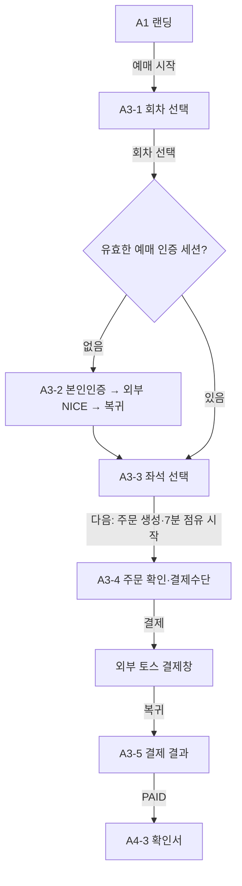

# NAZIR 디자인 — Phase 2 User Flow 초안

> 작성: 2026-11-17 · 디자인 세션 · 상태: **초안(사용자 검토 대기, 미확정)**
> 기준: `main` 개발 문서 v1.2, `docs/design/01_IA.md`(승인됨)
> 범위: 사용자 유형별 이용 흐름과 예외 처리. 화면 배치·문구·시각 디자인은 다루지 않는다.
> 페이지 ID(A1, A3-3, B4 등)는 `01_IA.md`를 따른다. 오류 코드는 `API_SPEC.md` §2.1을 따른다.
> 모든 흐름은 API 명세 기준이며, API·화면은 아직 구현되지 않았다.

## 0. 공통 원칙

- 좌석·주문·결제 상태는 **서버 응답만** 기준으로 한다. 화면의 타이머는 표시용이다.
- 확정 정책은 바꾸지 않는다: 점유 7분·연장 없음(D-002), 결제 확인 3분 보호(D-003), 좌석 선택 전 본인인증(D-004), 동일 회차 4석(D-006), 활성 주문 1건(D-008), 좌석 변경 없음·취소 후 재예매(D-001), 예매 인증 세션 고정 30분·주문 생성 시 잔여 10분 이상(D-015).
- **[검증]** 표시는 현재 문서만으로 확정할 수 없어 개발팀 확인이 필요한 항목이다.

---

## 1. 관객

### 1.1 정상 예매 흐름 (AF-1)

| 단계 | 화면 | 관객 행동 | 서버 처리 | 다음 |
|---|---|---|---|---|
| 1 | A1 | 공연 정보 확인, 예매 시작 | 공연·회차 조회 | A3-1 |
| 2 | A3-1 | 회차 선택 | 회차 판매 상태 조회 | 인증 세션 없으면 A3-2, 있으면 A3-3 |
| 3 | A3-2 | 본인인증 시작 → 외부 인증 | 인증 결과 서버 검증 → 같은 브라우저에서 1회 claim → 예매 인증 세션(30분 고정) 발급 | A3-3 (선택한 회차 유지) |
| 4 | A3-3 | 좌석 선택(남은 구매 가능 수 안에서), 다음 | 좌석 상태·`my-quota` 조회. **다음을 누를 때 주문 생성 + 7분 점유 시작**(`POST /orders`) | A3-4 |
| 5 | A3-4 | 좌석·금액 확인, 결제수단 선택, 이메일(선택), 결제 | 활성 결제수단 목록 제공. 결제 시작(`POST /payments`) — 남은 점유 시간이 최소 기준 이상일 때만(권장 60초, Q-011) | 외부 결제창 |
| 6 | 외부 | 결제 | — | 복귀 |
| 7 | A3-5 | 결과 확인 | 복귀 검증 → 확인 진입(좌석 보호) → PG 승인 확인 → 판매 확정·티켓 발급 | PAID면 A4-3 |

- 좌석 점유는 **좌석을 고르는 순간이 아니라 "다음"을 눌러 주문이 생성될 때** 시작된다. 좌석 선택 화면에서 본 좌석은 아직 확보되지 않은 상태다.
- 7분 타이머는 A3-4부터 표시한다. 기준은 서버의 `holdExpiresAt`이다.

### 1.2 예외 흐름

| ID | 상황 | 발생 지점 | 서버 응답 | 관객 화면 처리 (초안) |
|---|---|---|---|---|
| AF-2 | 본인인증 실패·취소·만료 | A3-2 | `IDENTITY_VERIFICATION_FAILED` | 실패 사유 안내, 다시 인증. 선택한 회차는 유지 |
| AF-2b | 인증사 장애 | A3-2 | `PROVIDER_UNAVAILABLE` | 잠시 후 다시 시도 안내. 예매 진행 불가 |
| AF-3 | 고른 좌석을 다른 사람이 먼저 확보 | A3-3 "다음" | `SEAT_UNAVAILABLE` (확보 실패 좌석 목록) | 해당 좌석 표시 후 다시 선택. 나머지 선택 유지 여부는 [검증]: 서버는 전체를 롤백함 |
| AF-4 | 4석 초과 | A3-3 | `PURCHASE_LIMIT_EXCEEDED` (남은 수) | 선택 전에 남은 가능 수를 보여줘서 예방. 초과 시 남은 수 안내 |
| AF-5 | **중복 주문**: 같은 회차에 진행 중인 예매가 이미 있음 | A3-3 "다음" | `ACTIVE_ORDER_EXISTS` (기존 주문 ID) | 기존 예매 상태 안내. 기존 주문이 결제 전(PENDING)이면 "기존 예매 확인 / 취소하고 새로 고르기", 결제 확인 중이면 "결과 확인 중이라 새 예매 불가" 안내. **기존 주문으로 이어서 결제하는 경로는 [검증]** (V-2) |
| AF-6 | **점유 만료**: 7분 안에 결제를 시작하지 않음 | A3-4 | 주문 `EXPIRED` / `HOLD_EXPIRED` | 만료 안내, 회차 선택 또는 좌석 선택부터 다시. 좌석은 다시 잡아야 함 |
| AF-6b | 남은 점유 시간이 최소 기준 미만에서 결제 시작 | A3-4 | `HOLD_TIME_INSUFFICIENT` (권장 60초, Q-011 미결정) | 결제 버튼 비활성 또는 거부 안내 → 취소 후 다시 예매 |
| AF-6c | 결제창에 있는 동안 점유 만료 | 복귀 | 서버가 승인을 요청하지 않음 → 결제 미발생, 주문 `EXPIRED` | "시간이 지나 결제되지 않았습니다" + 다시 예매. **결제가 되지 않았다는 점을 분명히** |
| AF-7 | **결제 실패·결제창 닫기** (점유 시간 남음) | 복귀(failUrl) | 결제 `FAILED`/`CANCELED`, 주문 `PENDING` 유지 | A3-4로 돌아가 다른 결제수단으로 재시도. 만료 시각은 그대로 |
| AF-7b | 결제 실패 (점유 시간 끝남) | 복귀 | 주문 `EXPIRED` | AF-6과 같음 |
| AF-7c | 비활성 결제수단 선택 | A3-4 | `PAYMENT_METHOD_UNAVAILABLE` | 목록 새로 고침, 다른 수단 선택 |
| AF-8 | **결제 결과 확인 중** (3분 이내) | A3-5 | 주문 `PAYMENT_CONFIRMING` | "결제 결과 확인 중, 좌석은 보호 중" + 자동 상태 확인. 다시 결제·취소 불가 |
| AF-8b | **결제 결과 UNKNOWN** (3분 경과) | A3-5 | 주문 `PAYMENT_UNKNOWN`, 좌석 계속 보호 | "확인에 시간이 걸리고 있음, 좌석은 보호 중, 다시 결제하지 마세요" + 나중에 예매 확인(A4)에서 보는 방법 안내. 페이지를 닫아도 됨 |
| AF-8c | UNKNOWN 해소 | 이후 | PAID / 실패(점유 남으면 PENDING, 아니면 EXPIRED) / REVIEW_REQUIRED | 예매 확인에서 결과 확인. 결과를 관객에게 알리는 수단(문자·이메일)은 Phase 1에 없음 → [검증] V-5 |
| AF-8d | 승인됐지만 금액 불일치 등 자동 확정 불가 | 이후 | `REVIEW_REQUIRED` | 운영팀 확인 중 안내, 문의 채널(U4 미결정) |
| AF-9 | **세션 만료·잔여 부족**: 주문 생성 시 인증 세션 잔여 10분 미만 | A3-3 "다음" | `IDENTITY_SESSION_TIME_INSUFFICIENT` | 재인증 안내. 재인증 후 같은 회차로 돌아오기. 좌석은 다시 선택해야 할 수 있음 |
| AF-9b | 세션 만료 후 예매 화면 조작 | A3-3·A3-4 | `IDENTITY_SESSION_REQUIRED` | 재인증 안내. **진행 중 주문에 재인증으로 다시 접근할 수 있는지는 [검증]** (V-1) |
| AF-9c | 결제 실패 후 재시도·취소 후 재예매 시점에 세션 잔여 부족 | A3-4 | 재예매는 `IDENTITY_SESSION_TIME_INSUFFICIENT` | 재인증 안내 |
| AF-9d | 주문 생성 횟수 제한 초과 | A3-3 | `ORDER_CREATION_LIMITED` | 잠시 후 다시 시도 또는 재인증 안내(수치는 Q-013) |
| AF-10 | 예매 도중 회차 판매 중지·종료 | A3-3·A3-4 | `SALES_NOT_OPEN` | 해당 회차 예매 불가 안내, 회차 선택으로. 이미 결제 확인 단계에 들어간 주문은 그대로 확정 절차 진행 |
| AF-11 | 다른 브라우저·기기로 링크를 열거나 세션 복사 | 모든 인증 화면 | `BROWSER_BINDING_MISMATCH` | 이 기기에서 조회 인증(A4-1) 안내 |

### 1.3 좌석 변경 대신 취소 후 재예매 (AF-12)

| 단계 | 화면 | 처리 |
|---|---|---|
| 1 | A3-4 | "좌석 다시 고르기" → 확인 단계(점유가 풀린다는 안내) |
| 2 | 서버 | 주문 취소(`CANCELED`), 점유 해제, 구매 가능 수 복구. 결제 확인 중이면 불가(`PAYMENT_IN_PROGRESS`) |
| 3 | A3-3 | 같은 회차로 돌아와 다시 선택. 방금 놓은 좌석을 다른 사람이 가져갈 수 있음 |
| 4 | — | 새 주문 생성 시 세션 잔여 10분 조건 다시 적용 (AF-9) |

### 1.4 예매 확인 (AF-13)

| 경우 | 흐름 |
|---|---|
| 예매한 브라우저에서 바로 | A3-5 → A4-3 (주문 접근 세션) |
| 같은 브라우저에서 나중에 | A4 → 예매 인증 세션이 살아 있으면 목록, 아니면 조회 인증(A4-1) → A4-2 → A4-3. 주문 접근 세션만으로 해당 주문을 볼 수 있는지와 그 기간은 Q-013 |
| 다른 기기에서 | A4-1 조회 인증 → A4-2 → A4-3 |
| 결제 전 주문(PENDING)을 목록에서 연 경우 | 결제 계속·취소는 예매 인증 세션이 필요(조회 세션으로는 불가). [검증] V-2 |
| 결제 후 취소·환불을 원함 | A4-3에서 문의 안내만(관객 API 없음). 채널은 U4 미결정 → 운영팀 환불 흐름(MF-4)으로 연결 |

---

## 2. 기획팀 관리자 (운영 콘솔)

| ID | 흐름 | 단계 | 범위 |
|---|---|---|---|
| MF-1 | 로그인 | B0 로그인(MFA는 Q-015) → B1 운영 현황. 유휴 만료 시 재로그인 후 원래 화면 | P1 |
| MF-2 | 일상 점검 | B1에서 미해결 확인 필요 사안·결과 확인 중 결제·검증 중 환불·연동 실패 확인 → 각 목록으로 이동 | P1·확인 필요(B1 구성 API) |
| MF-3 | 고객 문의 대응 | 문의 접수(채널 U4) → B4 주문번호 검색 → 상세에서 상태·결제·티켓 확인 → 안내 또는 환불·사안 처리로 이동 | P1 |
| MF-4 | **수동 환불** | B4 상세에서 환불 요청 기록(REQUESTED, 사유) → **외부 PG 관리자 페이지에서 실제 환불** → B6에서 "PG 실행 기록"(VERIFYING) → 서버가 PG 재조회 → 완료(COMPLETED: 티켓 무효, 좌석 해제, 구매 가능 수 복구) / 실패(FAILED: 티켓·좌석 유지) / 조회 불가(VERIFYING 유지 → 재검증). PG 실행 전에는 요청 철회 가능 | P1 |
| MF-4b | 환불 좌석 처리 | 환불 완료 후 좌석을 다시 팔지 차단할지 | Q-012 미결정(권장: 차단 후 운영자 해제) |
| MF-5 | 결제 UNKNOWN 장기화 | 30분 경과 시 확인 필요 사안 생성 → B7 상세 → PG 재조회 → 해소되지 않고 PG 조회 장애가 계속되면 SUPER_ADMIN이 PG 관리자 페이지 증빙으로 승인·실패 확정 | 재조회 P1, 증빙 확정은 Q-005 미결정 |
| MF-6 | 기타 확인 필요 사안 | B7 목록 → 상세 → 허용된 처리만(재조회, 확인 후 확정, 좌석 해제, 초과 결제 환불 요청 생성, 미기록 환불 연결, 확인 종료). 모든 처리에 사유 입력 | P1 |
| MF-7 | 좌석 차단·해제 | B3 회차 선택 → 좌석 선택 → 차단(판매 가능하고 점유 없는 좌석만) / 해제 | P1 |
| MF-8 | 회차 판매 상태 변경 | B2 회차 선택 → 판매 중·중지·종료·취소 변경 → 확인. 이미 결제 확인 단계의 주문은 계속 확정 절차 진행 | **API 없음** (흐름만 정의) |
| MF-9 | 연동 실패 재시도 | B8 연동 실패 목록 → 재시도 | P1 |
| MF-10 | 공연 당일 현장 명단 준비 | 회차별 명단 준비 → 현장 스태프에게 전달 | 제공 방식 U7 후속 검토 |

---

## 3. 현장 스태프 (Phase 1 수동 확인)

Phase 1에는 현장 화면이 없다. 관객의 모바일 확인서(A4-3)와 별도 명단을 대조한다. 현장 스태프는 콘솔 계정을 쓰지 않는 것을 기본으로 한다.

| ID | 흐름 | 단계 |
|---|---|---|
| SF-1 | 공연 전 준비 | 기획팀에게 회차별 명단 수령(MF-10). 명단의 기준 시각 확인 |
| SF-2 | 정상 입장 | 관객이 확인서 제시 → 회차·좌석·주문번호 등을 명단과 대조 → 입장 |
| SF-3 | 확인서를 열 수 없음(다른 기기, 배터리 등) | 관객이 현장에서 조회 인증(A4-1)으로 확인서 열기, 또는 명단의 본인 확인 기준으로 대조. 기준은 [검증] V-7 |
| SF-4 | 명단에 없음(직전 예매, 미러 지연) | 기획팀에 연락 → 기획팀이 콘솔에서 주문 검색(MF-3) → 결과 전달 |
| SF-5 | 결제 결과 확인 중인 주문 | 기획팀에 연락. 처리 기준은 운영 매뉴얼의 현장 처리 절차(Q-005 4단계, 좌석 확보 유지) |
| SF-6 | 환불·무효 티켓 제시, 같은 확인서로 두 번 입장 시도 | 명단 대조로 발견. 체계적 중복 방지는 후속(QR·입장 처리) |
| (후속) | QR 스캔 입장 | C1 회차 선택 → C2 스캔 → C3 사용 처리 → C4 예외 |

---

## 4. [검증] 항목 — 개발팀·사용자 확인 필요

| ID | 질문 | 관련 |
|---|---|---|
| V-1 | 인증 세션이 만료된 뒤 재인증하면 진행 중 주문에 다시 접근(결제 계속·취소)할 수 있는가. API §3.2·DATABASE §11.10의 "같은 주체 세션" 규정이 재인증 세션에도 적용되는가 | AF-9b, IA F-4 |
| V-2 | 중복 주문(`ACTIVE_ORDER_EXISTS`) 시 기존 주문으로 이동해 결제를 이어갈 수 있는가, 취소만 가능한가 | AF-5, AF-13 |
| V-3 | 좌석 확보 실패(`SEAT_UNAVAILABLE`) 시 남은 좌석 선택을 화면에서 유지해도 되는가(서버는 전체 롤백) | AF-3 |
| V-4 | 결제 시작 최소 잔여 점유 시간(Q-011, 권장 60초) 확정 | AF-6b |
| V-5 | UNKNOWN 해소·REVIEW_REQUIRED 결과를 관객에게 알리는 수단이 Phase 1에 없음. 예매 확인 재방문만으로 충분한가 | AF-8c |
| V-6 | 확인서에 표시할 항목(회차, 좌석, 주문번호, 티켓번호, 마스킹된 이름 등)과 현장 대조 기준 | SF-2 |
| V-7 | 확인서를 열 수 없는 관객의 현장 본인 확인 기준 | SF-3 |
| V-8 | 결제 확인 중 주문의 현장 처리 기준(운영 매뉴얼) | SF-5 |

## 5. 미결정 사항 (기존 유지)

U4 문의 채널, U6 판매 상태 변경 권한, U7 현장 명단, U8 현장 권한, D4 공연 전체 취소 표현, Q-005, Q-011, Q-012, Q-013, Q-015.
