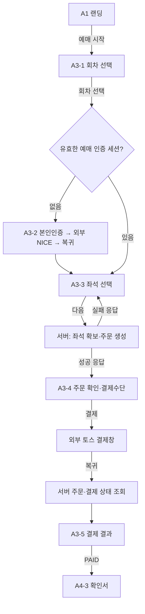

# NAZIR 디자인 — Phase 2 User Flow

> 작성: 2026-11-17 · 수정: 2026-11-17 (2차 검토 반영: 재인증 접근, v1.2 결제 처리 순서, 주문 생성 제한 / 3차: 판매 확정 불가 테스트 누락, 중복 주문 상태별 행동, 결제 재시도 / 4차: 중복 주문 PAID 경로, 기존 결제 시도 취소의 근거 구분, 유효 결제 시도 원칙) · 디자인 세션 · 상태: **확정 (2026-11-17, 사용자 승인)**. DQ-1~DQ-6은 개발팀 확인 사항으로 유지
> 기준: `main` 개발 문서 v1.2, `docs/design/01_IA.md`(승인됨)
> 범위: 사용자 유형별 이용 흐름과 예외 처리. 화면 배치·문구·시각 디자인은 다루지 않는다.
> 페이지 ID(A1, A3-3, B4 등)는 `01_IA.md`, 오류 코드는 `API_SPEC.md` §2.1을 따른다.
> 모든 흐름은 API 명세 기준이며, API·화면은 아직 구현되지 않았다.

## 0. 공통 원칙

- 좌석·주문·결제 상태는 **서버 응답만** 기준으로 표시한다. 화면의 타이머·추정으로 상태를 바꾸지 않는다.
- 외부 화면(본인인증, 결제창)에서 돌아오면 **서버의 주문·결제 상태를 조회한 결과로만** 다음 화면을 정한다. 결제창에서 돌아왔다는 사실, 복귀 URL, 결제창의 표시만으로 결제 성공·실패를 판단하지 않는다.
- 확정 정책은 바꾸지 않는다: 점유 7분·연장 없음(D-002), 결제 확인 3분 보호(D-003), 좌석 선택 전 본인인증(D-004), 동일 회차 4석(D-006), 활성 주문 1건(D-008·D-014), 좌석 변경 없음·취소 후 재예매(D-001), 예매 인증 세션 고정 30분·주문 생성 시 잔여 10분 이상·주문 생성 횟수 제한(D-015).
- **[검증]** = 현재 문서만으로 확정할 수 없는 동작. **[개발 확인]** = 개발팀 답변이 필요한 항목. 둘 다 이 문서에서 확정하지 않는다.

### 0.1 예매 이벤트 구분

| 이벤트 | 서버 동작 | 주문 상태 | 좌석 | 7분 점유 만료 대상 |
|---|---|---|---|---|
| ① 좌석 확보·주문 생성 | 선택 좌석 전체를 한 번에 확보하고 주문 생성. 하나라도 실패하면 전체 미확보 | `PENDING` | 점유(ACTIVE). 만료 시각 = 생성 + 7분, 고정 | 예 |
| ② 결제 시작 | 결제 시도 생성, 결제창 정보 반환. 최소 잔여 점유 시간 조건(권장 60초, Q-011) | `PENDING` 유지 | 점유 유지, 만료 시각 불변 | 예 |
| ③ 결제 승인 확인 진입 | 결제창 복귀 후 서버가 점유 유효성 등을 확인하고 확인 단계로 전환 | `PAYMENT_CONFIRMING` | 보호(CONFIRMING), 3분 보호 | **아니오** |
| ③′ 3분 경과, 결과 미확정 | 결과 확인 계속 | `PAYMENT_UNKNOWN` | 보호 유지 | **아니오.** 3분 경과는 실패가 아님 |
| ④ 결제 완료 | 승인 확인 + 좌석 확정 → 판매 확정·티켓 발급 | `PAID` | 판매 완료 | — |
| (예외) 승인 확인됐으나 좌석 확정 불가 등 | 자동 발권하지 않음 | `REVIEW_REQUIRED` | 운영자 해결까지 보호 | 아니오 |

7분 만료는 ③에 들어가기 전(`PENDING`)에만 적용된다. 결제창에 머무는 시간도 `PENDING`이다.

### 0.2 결제창 복귀 후 서버 처리 순서 (v1.2 DATABASE §11.6·§11.7)

| 순서 | 조건 | 서버 처리 | 결과 주문 상태 |
|---|---|---|---|
| 1 | 승인 확인 진입 전에 점유가 이미 만료 | **승인 요청(confirm)을 호출하지 않음.** 결제 시도 취소 | `EXPIRED` |
| 2 | 점유 유효 → 승인 확인 진입 | 좌석 CONFIRMING, 3분 보호 시작, 승인 요청 | `PAYMENT_CONFIRMING` |
| 3 | 승인 확인 + 좌석 확정 가능 | 판매 확정, 티켓 발급 | `PAID` |
| 4 | 결과 불명확(응답 없음 등)이 3분 넘게 지속 | 좌석 보호 유지, 재조회 계속 | `PAYMENT_UNKNOWN` |
| 5 | 승인은 확인됐으나 좌석 확정 불가(또는 금액 불일치·허용 외 수단) | 자동 발권하지 않음, 운영자 확인 사안 생성 | `REVIEW_REQUIRED` |
| — | 실패 확정 | 점유 시간이 남았으면 결제 전으로 복귀, 아니면 만료 | `PENDING` 또는 `EXPIRED` |

- v1.0의 "좌석 재확보 시도" 절차는 v1.2의 동작으로 쓰지 않는다.
- 화면은 이 결과 상태를 조회해 표시할 뿐, 위 판단을 화면에서 하지 않는다.

---

## 1. 관객

### 1.1 정상 흐름 (AF-1)

| 단계 | 화면 | 관객 행동 | 서버 처리 | 화면 표시 원칙 |
|---|---|---|---|---|
| 1 | A1 | 공연 정보 확인, 예매 시작 | 공연·회차 조회 | — |
| 2 | A3-1 | 회차 선택 | 회차 판매 상태 조회 | 유효한 예매 인증 세션이 없으면 A3-2, 있으면 A3-3 |
| 3 | A3-2 | 본인인증 | 서버 검증 → 같은 브라우저 1회 교환 → 예매 인증 세션(30분 고정) | 인증 후 선택한 회차로 복귀 |
| 4 | A3-3 | 좌석 선택(남은 구매 가능 수 안에서) | 좌석 상태·남은 구매 가능 수 조회 | 선택은 **확보 전**. "확보됨"으로 표시하지 않음 |
| 5 | A3-3 → A3-4 | "다음" | **①** 좌석 전체 확보 + 주문 생성(원자적) | 요청 중 처리 중 표시. **성공 응답 후에만** 확보 좌석과 주문 확인 화면 표시 |
| 6 | A3-4 | 좌석·금액 확인, 결제수단 선택, 이메일(선택) | 활성 결제수단 목록 | 남은 점유 시간은 서버 만료 시각 기준 |
| 7 | A3-4 → 외부 | "결제" | **②** 결제 시작 | 결제창으로 이동 |
| 8 | 외부 → A3-5 | 결제 후 복귀 | 0.2의 처리 순서 | 서버 상태 조회 결과로만 결과 표시 |
| 9 | A4-3 | 확인서 확인 | — | `PAID`일 때만 확인서 |

### 1.2 예외 흐름

#### 인증

| ID | 상황 | 서버 응답 | 화면 처리 (초안) |
|---|---|---|---|
| AF-2 | 본인인증 실패·취소·만료 | `IDENTITY_VERIFICATION_FAILED` | 실패 안내, 다시 인증. 선택한 회차 유지 |
| AF-2b | 인증사 장애 | `PROVIDER_UNAVAILABLE` | 잠시 후 다시 시도 안내. 예매 진행 불가 |

#### 좌석 확보 (①)

| ID | 상황 | 서버 응답 | 화면 처리 (초안) |
|---|---|---|---|
| AF-3 | 선택 좌석 중 일부 확보 실패 | `SEAT_UNAVAILABLE` (실패 좌석 목록). 서버는 선택 전체를 확보하지 않음 | 확보된 좌석이 없다는 전제로 A3-3에 머무름. 실패 좌석 표시. 나머지 선택을 화면에 남길지는 [검증] V-3 |
| AF-4 | 4석 초과 | `PURCHASE_LIMIT_EXCEEDED` (남은 수) | 선택 전에 남은 가능 수를 보여줘 예방. 초과 시 남은 수 안내 |
| AF-5 | 같은 회차에 진행 중인 예매가 있음 | `ACTIVE_ORDER_EXISTS` (기존 주문 ID) | 새 주문은 만들어지지 않음. 기존 주문을 서버에서 조회해 상태별로 허용된 행동만 제공 — 1.7. 화면 흐름 확정은 [검증] V-2 |
| AF-6 | 인증 세션 잔여 10분 미만 | `IDENTITY_SESSION_TIME_INSUFFICIENT` | 주문이 만들어지지 않음. 좌석 선택 전 재인증 안내(DATABASE §6.3). 재인증 후 같은 회차 A3-3으로 복귀, 좌석은 다시 확인 |
| AF-7 | 주문 생성 횟수 제한 초과 | `ORDER_CREATION_LIMITED` (v1.2 정의 오류 코드) | 주문이 만들어지지 않음. **관객 안내·다음 행동은 미정** — 1.6 참고 |
| AF-8 | 회차 판매 중지·종료 | `SALES_NOT_OPEN` | 해당 회차 예매 불가 안내, 회차 선택으로 |

#### 좌석 점유 만료 (`PENDING`에서 7분 경과)

| ID | 상황 | 서버 상태 | 화면 처리 (초안) |
|---|---|---|---|
| AF-9 | 결제 승인 확인 단계(③)에 들어가기 전에 7분이 지남. 결제 시작 전, 결제창에 머무는 중, 결제 실패 후 재시도 전 모두 포함 | `EXPIRED`, 좌석 해제 | 만료 안내 후 다시 예매. 만료 시각은 연장되지 않음 |
| AF-9b | 남은 점유 시간이 최소 기준 미만에서 결제 시작 | `HOLD_TIME_INSUFFICIENT` | 결제를 시작할 수 없다는 안내. 수치는 [검증] V-4 (Q-011) |
| AF-9c | 결제창에서 복귀했는데 그 시점에 점유가 이미 만료 | 0.2의 1번: 승인 요청 없이 `EXPIRED` | 서버가 준 `EXPIRED`를 그대로 표시. 결제창에서 돌아왔다는 사실만으로 "결제 실패"라고 판단하지 않음. "결제가 이루어지지 않았다"고 안내할 수 있는지는 서버 응답이 이를 구분해 줄 때만 가능 — DQ-4 |

#### 결제 결과 (③ 이후, A3-5·A4-3 공통)

| ID | 서버 상태 | 관객 안내 (초안) | 허용 행동 | 금지 |
|---|---|---|---|---|
| AF-10 | 결제 실패·결제창 닫기, 주문 `PENDING`(점유 시간 남음) | 결제가 완료되지 않았고 좌석은 남은 시간 동안 유지됨 | 같은 주문에서 새 결제 시도(다른 수단 가능, 1.8), 취소 | — |
| AF-10b | 결제 실패, 주문 `EXPIRED` | 예매 시간이 끝났음 | 처음부터 다시 예매 | — |
| AF-10c | 비활성 결제수단 `PAYMENT_METHOD_UNAVAILABLE` | 해당 수단을 지금 쓸 수 없음 | 목록 새로 고침, 다른 수단 | — |
| AF-11 | `PAYMENT_CONFIRMING` | **결제 결과 확인 중 · 좌석 보호 중** | 기다리기, 화면을 닫고 나중에 예매 확인(A4)에서 보기 | 재결제, 취소 |
| AF-11b | `PAYMENT_UNKNOWN` | **결제 결과 확인 중 · 좌석 보호 중.** 확인이 계속 진행 중이므로 다시 결제하지 말 것 | 기다리기, 나중에 예매 확인에서 보기 | 재결제, 취소. 3분 경과를 실패로 표시하지 않음 |
| AF-11c | 결과 확인 후 상태 변화 | 서버 결과(`PAID` / 실패 후 `PENDING`·`EXPIRED` / `REVIEW_REQUIRED`)를 예매 확인에서 표시 | 결과에 따른 행동 | 결과 통지 방식은 [검증] V-5 |
| AF-12 | `REVIEW_REQUIRED` | 운영팀 확인이 필요한 상태, 좌석 보호 중 | 문의(채널 U4 미결정) | 재결제, 취소 |
| AF-13 | `PAID` | 예매 완료 | 확인서 보기 | — |
| AF-13b | `UNFULFILLED` | 결제는 되었으나 발권되지 않음, 환불 대상 | 문의 | — |

#### 세션·브라우저

| ID | 상황 | 서버 응답 | 화면 처리 (초안) |
|---|---|---|---|
| AF-14 | 인증 세션 만료 후 예매 화면 조작 | `IDENTITY_SESSION_REQUIRED` | 재인증 안내 → 1.5의 재인증 후 복귀 흐름 |
| AF-15 | 다른 브라우저·기기에서 링크를 열거나 세션 복사 | `BROWSER_BINDING_MISMATCH` | 이 기기에서 인증 안내(예매 확인은 A4-1) |

### 1.3 좌석 변경 대신 취소 후 재예매 (AF-16)

| 단계 | 처리 |
|---|---|
| 1 | A3-4에서 "좌석 다시 고르기" → 확인 단계(확보한 좌석이 풀린다는 안내) |
| 2 | 서버가 주문 취소(`CANCELED`), 좌석 해제, 구매 가능 수 복구. `PENDING`일 때만 가능, 결제 확인 단계면 `PAYMENT_IN_PROGRESS`로 불가 |
| 3 | 같은 회차 A3-3으로 복귀. 방금 놓은 좌석을 다른 사람이 가져갈 수 있음 |
| 4 | 새 주문은 ①부터. 같은 브라우저·유효 세션이면 재인증 없이 가능하나 잔여 10분 조건과 주문 생성 횟수 제한이 다시 적용(AF-6, AF-7) |

### 1.4 예매 확인 (AF-17)

| 경우 | 흐름 |
|---|---|
| 예매한 브라우저에서 바로 | A3-5 → A4-3 |
| 같은 브라우저에서 나중에 | A4 → 유효한 인증 세션이면 목록, 아니면 조회 인증(A4-1) → A4-2 → A4-3. 주문 접근 세션만으로 볼 수 있는 기간은 Q-013 |
| 다른 기기에서 | A4-1 → A4-2 → A4-3 |
| 결제 확인 중 주문 | "결제 결과 확인 중 · 좌석 보호 중". 재결제·취소 없음 |
| 결제 전 주문(`PENDING`) | 조회는 조회용 세션으로 가능. **결제 시도·취소에는 유효한 예매 인증(BOOKING) 세션이 필요**(DATABASE §11.10). 결제 시도는 1.8. 조회용 세션만 있으면 "결제하려면 예매용 인증 필요" 안내 → 예매용 인증 후 같은 주문으로 복귀 |
| 결제 후 취소·환불 | 문의 안내만(관객 API 없음). 채널 U4 미결정 → 운영팀 수동 환불(MF-4) |

### 1.5 인증 세션 만료 후 재인증 (AF-18)

**v1.2 규정** (API_SPEC §3.2, DATABASE §6.3): 세션이 만료돼도 진행 중 주문은 인증 주체에 귀속된다. 같은 사람이 재인증하면 새 세션으로 같은 주문을 이어갈 수 있다.

- 같은 인증 주체가 **같은 브라우저**에서 재인증하면 기존 주문에 접근할 수 있다.
- 기존 주문의 **결제·취소에는 유효한 예매 인증(BOOKING) 세션**이 필요하다. 조회 인증(LOOKUP) 세션으로는 조회만 된다.
- 재인증으로 점유 만료 시각(D-002)이나 결제 보호 시간은 늘어나지 않는다.
- 참고: 주문 생성 시 세션 잔여 10분 이상(D-015)이므로, 결제 전 주문이 진행되는 동안 세션이 먼저 끝나는 경우는 드물다. 재인증은 주로 좌석 선택 단계, 또는 결제 결과 확인 중·운영자 확인 주문을 나중에 볼 때 생긴다.

| 재인증 전 위치 | 재인증 후 복귀 화면 | 표시할 주문 상태 (서버 조회 결과) |
|---|---|---|
| A3-3 좌석 선택 (주문 없음) | 같은 회차의 A3-3 | 좌석 상태를 새로 조회. 이전 선택은 확보된 적이 없음 |
| A3-4 주문 확인 | 서버가 판단한 그 주문의 상태 화면 | `PENDING`·점유 유효 → A3-4(남은 시간은 원래 만료 시각 기준, 새 결제 시도·취소 — 1.8) / `EXPIRED`·`CANCELED` → 만료·취소 안내 후 같은 회차로 다시 예매 / 그 밖의 상태 → 아래 행과 같음 |
| A3-5 결제 결과 | 그 주문의 A3-5 | `PAYMENT_CONFIRMING`·`PAYMENT_UNKNOWN` → "결제 결과 확인 중 · 좌석 보호 중", 재결제·취소 없음 / `REVIEW_REQUIRED` → 운영팀 확인 안내 / `PAID` → A4-3 확인서 / 실패 후 `PENDING` → A3-4(새 결제 시도 — 1.8) / `EXPIRED` → 다시 예매 |
| 위치를 모름(나중에 재방문) | A4-2 내 예매 목록 → A4-3 | 위와 같은 상태별 처리 |

### 1.6 주문 생성 횟수 제한 (AF-7)

| 구분 | 내용 | 상태 |
|---|---|---|
| 정책 | 세션당·인증 주체/회차별 시간당 주문 생성 횟수를 제한한다 | 확정(D-015) |
| 오류 코드 | `ORDER_CREATION_LIMITED` (429) | v1.2 정의 |
| 수치 | 세션당 3회, 주체·회차당 시간당 5회 | **권장안**(Q-013), 미확정 |
| 제한 초과 시 관객 안내·다음 행동 | 재인증으로 풀리는지, 시간이 지나야 풀리는지, 안내 문구 | **미정**. 이 문서에서 정하지 않음 → DQ-1 |

### 1.7 중복 주문 시 기존 주문 상태별 행동 (AF-5)

`ACTIVE_ORDER_EXISTS`를 받으면 화면은 응답의 기존 주문 ID로 **서버에서 그 주문을 조회**하고, 조회된 상태에 따라 아래 화면으로 보낸다. 새 주문은 만들어지지 않는다. 결제 시도·취소에는 유효한 예매 인증(BOOKING) 세션이 필요하다(DATABASE §11.10). 오류를 받은 시점과 조회 시점 사이에 상태가 바뀔 수 있으므로, 항상 조회 결과를 기준으로 한다.

| 조회된 기존 주문 상태 | 이동 화면 | 관객 안내 (초안) | 허용 행동 | 금지 |
|---|---|---|---|---|
| `PENDING` | 기존 주문의 주문 확인(A3-4) | 같은 회차에 결제 전 예매가 있음, 좌석은 남은 시간 동안 유지됨 | 기존 주문으로 결제 시도(1.8), 기존 주문 취소 후 새로 고르기(1.3) | — |
| `PAYMENT_CONFIRMING` | 기존 주문의 결과 확인 중 화면(A3-5) | 결제 결과 확인 중 · 좌석 보호 중 | 기다리기, 예매 확인에서 보기 | 재결제, 취소, 새 예매 |
| `PAYMENT_UNKNOWN` | 기존 주문의 결과 확인 중 화면(A3-5) | 결제 결과 확인 중 · 좌석 보호 중 | 기다리기, 예매 확인에서 보기 | 재결제, 취소, 새 예매 |
| `REVIEW_REQUIRED` | 기존 주문의 운영자 확인 안내(A3-5 또는 A4-3) | 운영팀 확인이 필요한 예매가 있음 | 문의(채널 U4 미결정) | 재결제, 취소, 새 예매 |
| `PAID` | **기존 주문의 예매 확인서(A4-3)** | 이 회차는 이미 예매가 완료됨 | 확인서 보기 | 새 예매로 보내지 않음 |
| `EXPIRED` · `CANCELED` | 종료 안내 → 같은 회차의 좌석 선택(A3-3) | 기존 예매는 종료됨 | 새 예매(①부터 다시) | — |

- `PAID`이면서 같은 회차에 추가로 예매하려는 경우(4석 한도 안에서)는 활성 주문 제한과 별개다. 이 경우는 `ACTIVE_ORDER_EXISTS`가 아니라 구매 가능 수(`my-quota`)로 판단된다.

### 1.8 결제 재시도 (같은 주문에서 새 결제 시도)

v1.2 API_SPEC §4.6·DATABASE §11.6 기준. 결제 시도는 주문 안에서 여러 번 생길 수 있고, 진행 중 결제는 주문당 1건이다.

| 주문 + 결제 시도 상태 | 서버 처리 | 사용자 화면 표현 (초안) |
|---|---|---|
| `PENDING` + `READY` (결제창을 열었으나 진행하지 않았거나 닫음) | 새 결제 시작 요청 시 **서버 DB에서** 기존 `READY` 시도를 `CANCELED`로 바꾸고 새 `READY` 시도 생성(API §4.6, DATABASE §12.2). 이는 PG 쪽 기존 결제창을 닫거나 무효화하는 것이 아니다 — 아래 "기존 시도 처리" 참고 | "결제하기"를 다시 누를 수 있음. 기존 시도로 결제가 되지 않았다고 화면에서 단정하지 않음 |
| `PENDING` + `FAILED`·`CANCELED` (실패 확정, 점유 시간 남음) | 새 결제 시도 생성 가능. 점유 만료 시각은 그대로 | 결제가 완료되지 않았다는 안내 + "다시 결제하기"(다른 수단 선택 가능) |
| `PENDING` + 남은 점유 시간이 최소 기준 미만 | `HOLD_TIME_INSUFFICIENT`로 거부 | 결제를 시작할 수 없다는 안내, 취소 후 다시 예매(최소 기준 V-4) |
| `PAYMENT_CONFIRMING` / `PAYMENT_UNKNOWN` | 새 결제 시작 거부(`PAYMENT_IN_PROGRESS`) | 결제 버튼 없음. "결제 결과 확인 중 · 좌석 보호 중" |
| `REVIEW_REQUIRED` | 새 결제 불가 | 결제 버튼 없음. 운영팀 확인 안내 |
| `EXPIRED`·`CANCELED` | 해당 주문으로 결제 불가 | 처음부터 다시 예매 |

**기존 시도(서버에서 `CANCELED`)의 처리 — 확인된 것과 미확인인 것**

| 구분 | 내용 | 근거 |
|---|---|---|
| 확인됨 | 기존 결제창에서 결제를 진행해 복귀해도, 서버는 그 시도가 `READY`가 아니므로 승인 요청(confirm)을 호출하지 않는다 | DATABASE §11.6 Tx1(단일 사용·`READY` 검증), TEST PAY-14 |
| 확인됨 | 웹훅은 결제 성공의 직접 증거가 아니며, 받으면 PG 조회로 최종 상태를 확인한다 | DECISIONS A-027, API §4.9 |
| 확인됨 | `FAILED`·`CANCELED` 결제가 이후 PG에서 승인으로 확인되면 결제를 `SUCCEEDED`(`role = EXCESS`)로 기록하고 운영자 확인 사안을 연다. 주문을 자동 확정하지 않는다 | DATABASE §12.2 마지막 행 |
| 전제 | 서버가 승인을 요청하지 않은 결제는 확정되지 않는다(PG 서버 승인형). 토스는 인증 후 10분 안에 승인하지 않으면 만료한다 | DECISIONS A-001, PROVIDERS §1.2(원문) |
| 미확인 | 위 전제가 모든 결제수단(카드, 토스페이, 네이버페이)에서 예외 없이 성립하는지, 관객이 기존 결제창에서 결제한 뒤 카드사 알림 등으로 "결제됨"으로 인식할 수 있는지 | DQ-5 |

따라서 화면은 "기존 시도로는 결제가 발생하지 않는다"고 안내하지 않는다. 서버가 판단한 주문·결제 상태만 표시한다.

**두 탭·중복 요청에서 사용할 결제 시도**
- 서버는 주문당 진행 중 결제를 1건으로 유지한다(DATABASE §5 partial unique, TEST PAY-13). 늦게 도착한 기존 시도의 복귀는 승인 요청 없이 거부된다(PAY-14).
- 화면 원칙: **응답이 마지막에 도착했다는 이유로 그 결제창 정보를 쓰지 않는다.** 서버가 현재 유효하다고 확인한 결제 시도(그 주문의 진행 중 `READY` 시도)의 정보만 사용한다. 유효하지 않은 시도로 결제창을 열었다면 복귀 후 서버 상태에 따라 안내한다.
- 이 원칙의 보장 범위: 서버 측 단일 진행 결제와 기존 시도 거부는 v1.2 명세로 보장된다. 그러나 **화면이 결제창을 열기 전에 "이 시도가 현재 유효한가"를 확인할 수 있는 API 필드는 명세에 없다**(`GET /orders/{orderId}` 응답 필드 미정의, 결제창 정보는 `POST /payments` 응답에만 있음) → DQ-6.

---

## 2. 기획팀 관리자 (운영 콘솔)

| ID | 흐름 | 단계 | 범위 |
|---|---|---|---|
| MF-1 | 로그인 | B0 로그인(MFA Q-015) → B1. 유휴 만료 시 재로그인 | API 명세 있음 |
| MF-2 | 일상 점검 | B1에서 미해결 확인 필요 사안·결과 확인 중 결제·검증 중 환불·연동 실패 확인 → 각 목록 | B1 구성 API 개발 확인(IA R-B) |
| MF-3 | 고객 문의 대응 | 문의 접수(채널 U4) → B4 주문번호 검색 → 상세에서 상태·결제·티켓 확인 → 안내 또는 환불·사안 처리 | API 명세 있음 |
| MF-4 | **수동 환불 3단계** | ① B4 상세에서 환불 요청 기록(REQUESTED, 사유) → ② 외부 PG 관리자 페이지에서 실제 환불 → ③ B6에서 PG 실행 기록(VERIFYING) → 서버가 PG 재조회로 검증 → 완료(티켓 무효, 좌석 해제, 구매 가능 수 복구) / 실패(티켓·좌석 유지) / 조회 불가(VERIFYING 유지 → 재검증). ② 전에는 요청 철회 가능. 운영자 입력만으로 완료 처리하지 않음 | API 명세 있음 |
| MF-4b | 환불 좌석 처리 | 환불 완료 좌석을 다시 판매할지 차단할지 | Q-012 미결정 |
| MF-5 | 결제 UNKNOWN 장기화 | 30분 경과 시 확인 필요 사안 생성 → B7 → PG 재조회. 조회 장애가 계속되면 SUPER_ADMIN 증빙 기반 확정 | 재조회는 API 명세 있음, 증빙 확정은 Q-005 미결정 |
| MF-6 | 기타 확인 필요 사안 | B7 → 허용된 처리만, 사유 필수. 승인됐으나 좌석 확정 불가(UNFULFILLABLE_APPROVAL) 포함 | API 명세 있음 |
| MF-7 | 좌석 차단·해제 | B3 → 좌석 → 차단(판매 가능하고 점유 없는 좌석만) / 해제 | API 명세 있음 |
| MF-8 | 회차 판매 상태 변경 | B2 → 판매 중·중지·종료·취소 → 확인. 이미 결제 확인 단계인 주문은 확정 절차 계속 | **API 없음** (흐름만) |
| MF-9 | 연동 실패 재시도 | B8 → 재시도 | API 명세 있음 |
| MF-10 | 공연 당일 현장 명단 준비 | 회차별 명단 준비·전달. 명단은 준비 시점 기준이며 이후 변경을 반영하지 않을 수 있음 | 제공 방식 U7 후속 검토 |

정본은 DB다. 판단이 필요한 경우 콘솔(DB) 기준으로 처리하고, Sheets 미러를 근거로 처리하지 않는다.

---

## 3. 현장 스태프 (Phase 1 수동 확인)

Phase 1에는 현장 화면이 없다. 관객의 모바일 확인서(A4-3)와 별도 명단을 대조한다. 현장 스태프는 콘솔 계정을 쓰지 않는 것을 기본으로 한다.

**전제**
- 명단은 DB를 정본으로 한 사본이다. Google Sheets에서 만든 명단은 비동기 미러이므로 **최신 DB 상태와 다를 수 있다**(직전 예매, 직전 환불, 결제 확인 중 주문의 결과 등).
- 수동 대조만으로 중복 입장이나 무효 티켓 사용을 **완전히 막을 수 없다.** 체계적인 방지는 후속 단계(QR·입장 처리)다.

| ID | 흐름 | 단계 |
|---|---|---|
| SF-1 | 공연 전 준비 | 기획팀에게서 회차별 명단 수령. 명단의 기준 시각 확인 |
| SF-2 | 정상 입장 | 관객이 확인서 제시 → 명단과 대조 → 입장. 대조 항목은 [검증] V-6 |
| SF-3 | 확인서를 열 수 없음 | 관객이 현장에서 조회 인증(A4-1)으로 확인서 열기 시도. 그 밖의 본인 확인 기준은 [검증] V-7 |
| SF-4 | 명단과 확인서가 다름 | 명단이 오래됐을 수 있으므로 명단만으로 판단하지 않음 → 기획팀에 연락 → 기획팀이 콘솔(DB)에서 확인 후 판단 전달 |
| SF-5 | 결제 결과 확인 중인 주문 | 기획팀에 연락. 처리 기준은 운영 매뉴얼의 현장 처리 절차(Q-005 4단계) — [검증] V-8 |
| SF-6 | 환불·무효 티켓 제시, 같은 확인서로 재입장 시도 | 명단 대조와 기획팀 확인으로 발견할 수 있는 범위에서만 대응. 현장 절차는 [검증] V-9 |
| (후속) | QR 스캔 입장 | C1 회차 선택 → C2 스캔 → C3 사용 처리 → C4 예외 |

---

## 4. [검증] 항목 — 이 문서에서 확정하지 않음

| ID | 질문 | 관련 |
|---|---|---|
| V-1 | **해소됨(2차 검토).** 같은 인증 주체가 같은 브라우저에서 재인증하면 기존 주문에 접근 가능, 결제·취소는 유효한 BOOKING 세션 필요(API §3.2, DATABASE §6.3·§11.10). 흐름은 1.5 | AF-14, AF-18 |
| V-2 | 중복 주문(`ACTIVE_ORDER_EXISTS`) 시 기존 주문을 서버에서 조회하고 상태별 이동 화면·허용 행동(1.7 표, `PAID`는 확인서로 이동)을 제공하는 화면 흐름의 확정. 기존 주문 화면으로 이동하는 위치, 주문 정보 표시 범위, 조회 실패 시 처리 포함 | AF-5, 1.7 |
| V-3 | 좌석 확보 실패 시 화면에 나머지 선택 좌석을 남겨둬도 되는가(서버는 전체 미확보) | AF-3 |
| V-4 | 결제 시작 최소 잔여 점유 시간(Q-011, 권장 60초) | AF-9b |
| V-5 | 결제 결과 확인 중 주문이 해소됐을 때 관객에게 알리는 방식(Phase 1 SMS·이메일 없음) | AF-11c |
| V-6 | 확인서 표시 항목과 현장 대조 항목 | SF-2 |
| V-7 | 확인서를 열 수 없는 관객의 본인 확인 기준 | SF-3 |
| V-8 | 결제 확인 중 주문의 현장 처리 기준 | SF-5 |
| V-9 | 수동 대조 단계에서의 중복 입장·무효 티켓 대응 절차 | SF-6 |

## 5. 개발팀 확인 사항

| ID | 질문 | 관련 |
|---|---|---|
| DQ-1 | 주문 생성 횟수 제한(`ORDER_CREATION_LIMITED`) 초과 시 관객 안내와 다음 행동(재인증으로 풀리는지, 시간 경과로 풀리는지). 수치(Q-013 권장 3회/시간당 5회) 확정 여부와는 별개 항목 | AF-7, 1.6 |
| DQ-2 | 0.2의 v1.2 처리 순서가 구현 계획·테스트 문서에 일관되게 반영되어 있는지. **디자인 세션 대조 결과(2026-11-17, main):** 승인 확인 진입 전 만료(PAY-03), 결과 불명확(PAY-07), 금액 불일치(PAY-15), 허용 외 결제수단(PAY-17·27)은 테스트가 있음. **DATABASE §11.7의 "승인은 확인됐지만 좌석 확정 불가" 경로는 TEST_PLAN과 IMPLEMENTATION_PLAN 어디에도 없음.** PAY-15는 금액 불일치 테스트라 이 경로를 검증하지 않음. 필요한 테스트(제안): 승인 금액·결제수단 정상, PG 승인 확인, 판매 확정 중 좌석 또는 hold 검증 실패 → 자동 발권 금지, 결제 `EXCESS`, 주문 `REVIEW_REQUIRED`, `UNFULFILLABLE_APPROVAL` review case 생성, 운영자 확인 전 좌석 보호 유지. 개발 문서는 디자인 세션에서 수정하지 않음 | AF-9c, 0.2 |
| DQ-3 | 결제 결과 화면(A3-5)이 상태를 다시 조회하는 주기와 화면을 떠난 뒤 다시 들어오는 경로 | AF-11 |
| DQ-5 | 서버에서 `CANCELED`로 바뀐 기존 결제 시도(교체된 `READY`)의 결제창에서 관객이 결제를 진행한 경우, 결제가 확정되지 않는다는 전제(A-001)가 카드·토스페이·네이버페이 모두에서 성립하는지 sandbox로 확인했는가. 늦은 승인·웹훅이 오면 §12.2의 EXCESS·운영자 확인 경로로 처리되는지 테스트가 있는가 | 1.8 |
| DQ-6 | 화면이 "현재 유효한 결제 시도"를 확인할 방법. `GET /orders/{orderId}`에 진행 중 결제 시도 ID·상태를 포함하거나, 결제창을 열기 전 시도 유효성을 조회하는 방법이 있는가. 없으면 두 탭에서 무효 시도로 결제창을 여는 경우를 복귀 후 안내로만 처리하게 됨 | 1.8 |
| DQ-4 | 서버 응답이 `EXPIRED` 주문에 대해 "결제가 발생하지 않았음"(승인 요청 미호출·결제 시도 취소)을 구분해 줄 수 있는가. 구분되지 않으면 화면은 `EXPIRED`만 표시하고 결제 여부는 단정하지 않음 | AF-9c, AF-10b |

## 6. 미결정 사항 (기존 유지)

U4 문의 채널, U6 판매 상태 변경 권한, U7 현장 명단, U8 현장 권한, D4 공연 전체 취소 표현, Q-005 증빙 확정, Q-011 결제 시작 최소 잔여 시간, Q-012 환불 좌석 재판매, Q-013 세션·접근 기간·제한 수치, Q-015 관리자 MFA.
